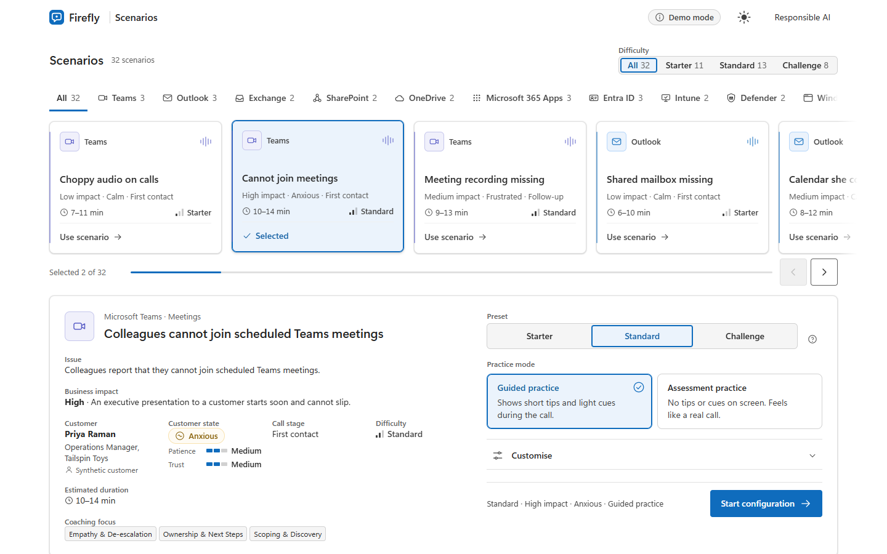
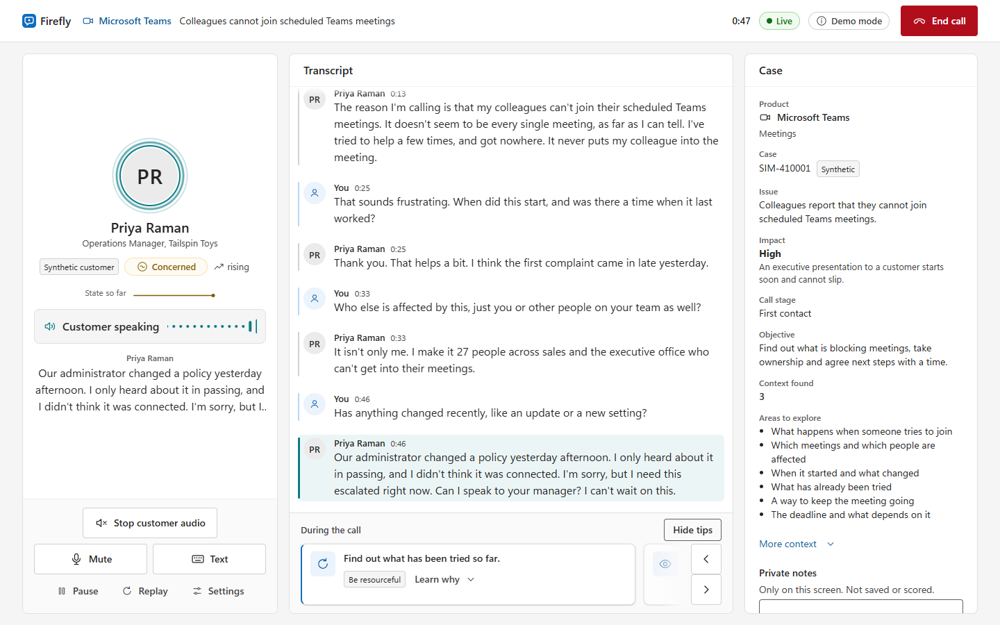
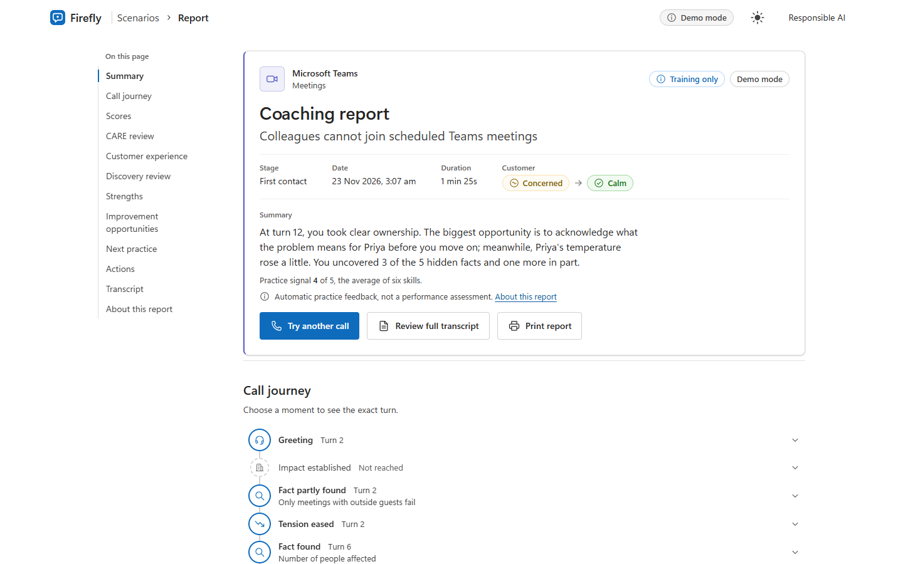
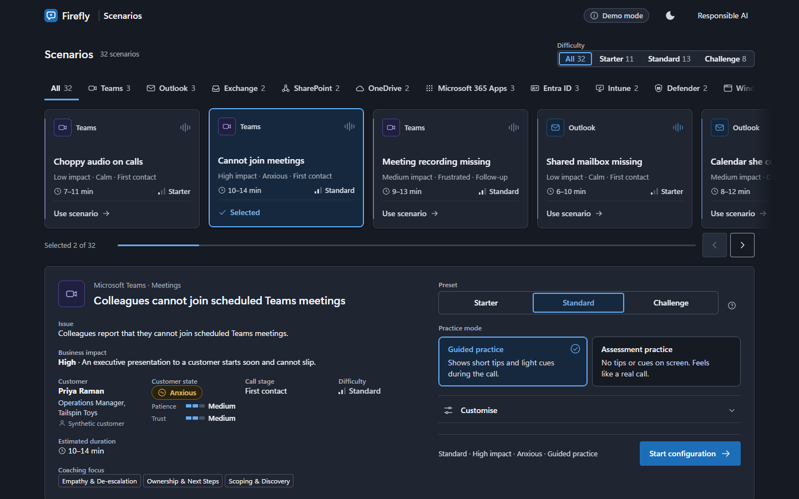
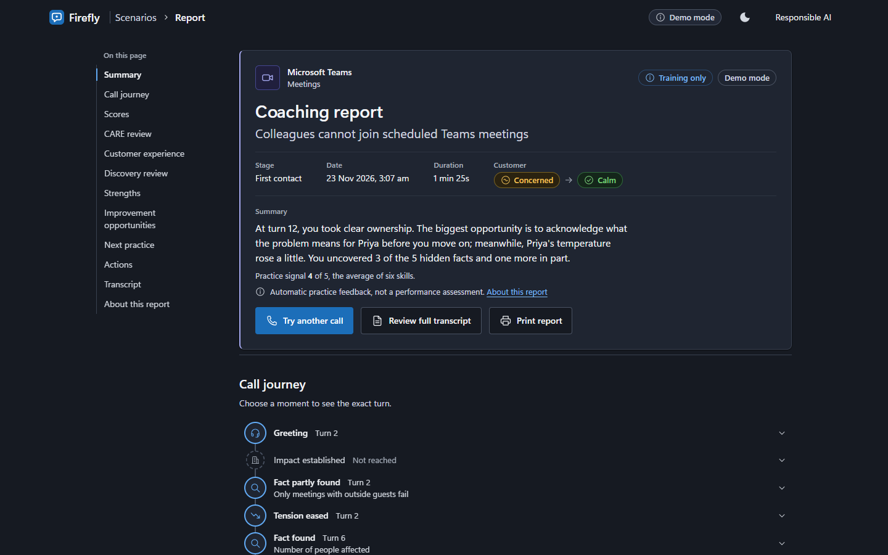

# Firefly

Practise difficult customer conversations before they become real ones.

Firefly is a voice-first simulator for new Microsoft support engineers. You take a call from a fictional customer, then read coaching that quotes what you actually said.


## Why Firefly

A live customer is a poor place to practise the basics: introducing yourself, finding out what the problem costs the customer, saying what happens next and owning it. Firefly gives you a call you can repeat.

The customer and the case are invented. The customer gives up some facts only when you ask a question that fits. After the call, the report points to the turns behind each score, so you can check it against what you said.

The scores are practice signals from a simulated call. They are not an assessment of a person.

## What it does

1. **Choose a scenario.** Pick one of thirty-two fictional Microsoft support cases from the carousel, narrowing it with the product rail or the difficulty filter. Set how hard the call should be and whether it is Guided practice or Assessment practice, then choose **Start configuration**.
2. **Review the brief.** The case brief shows what you may read before the call, such as the issue, the impact and your objective. It never shows the facts the customer holds back. Choose a customer voice and try it.
3. **Start a call.** Start a voice call or a text call. A voice call opens your microphone only after you press a button and your browser allows it.
4. **Talk to the customer.** The customer greets you first and gives the reason for the call once you have greeted them. In a voice call you simply speak: the microphone stays open between turns, as it does on a phone call, a pause to think does not end your turn, and the customer replies once you have been quiet for a moment. **Done speaking** sends sooner, **Mute** or **Pause** closes the microphone, and a spoken call pauses itself after about ten minutes without sound. Switch **Hands-free** off in Voice settings to press **Talk** for each answer instead. You can type if you prefer, and typing always works. In Guided practice, short tips sit under the transcript.
5. **End the call.** Choose **End call**, then **End and review**. In Guided practice the question is "Ready to close?" and four neutral checks come first (plan, owner, update time, the customer's agreement), under a line that says they are not a score. They never stop you ending.
6. **Read the coaching report.** It opens with a summary and a call journey, scores six skills with the quotes behind each, shows the CARE review, follows the customer's mood through the call, reviews the facts you found and missed, and suggests better wording and what to practise next.

|                                                                                 |                                                                 |
| ------------------------------------------------------------------------------- | --------------------------------------------------------------- |
|  |           |
|                          |  |

The same two screens in the dark theme, which the footer and the header toggle switch to:

|                                                                             |                                                                                        |
| --------------------------------------------------------------------------- | -------------------------------------------------------------------------------------- |
|  |  |

These pictures come from the running app in demo mode with demo speech (`node scripts/readme-screenshots.mjs`). In the call picture, the engineer's lines are the demo speech provider's scripted sentences, not a real voice, and the customer is played by the rules engine. The call preview on the landing page is a scripted loop with no sound, captioned as an example, not a call. It plays three times, with a Pause button that reads Replay once it has finished.

## Features

- Thirty-two fictional Microsoft support scenarios across Microsoft 365, Windows, Azure and Dynamics 365.
- A scenario workspace: a product rail, a difficulty filter, a carousel of scenario cards (arrow keys, Home and End, a mouse drag or touch scrolling; it never moves by itself) and the chosen scenario's details and set-up below it. The address keeps your filters, your choice and your settings, so a link reopens the same view.
- Settings for impact, the customer's starting state, proficiency, style, call stage, difficulty and curveballs (called complications in the set-up and unexpected turns in the report), and a practice mode. **Guided practice** (the default at Starter) adds a "During the call" strip of short tips, "Areas to explore" and a "Context found" count in the case panel, and a "Ready to close?" check when you end the call. **Assessment practice** (the default at Standard and Challenge) shows none of them. The tips are general advice chosen only from the call stage and how many messages you have sent, never from the scenario's hidden facts.
- A customer who greets first and gives the reason once you have greeted them, remembers what was said and promised, can say "I don't know", and reveals a hidden fact only to a question that fits. The customer also says a clear owner and time back to you or takes it in with a few words, asks when a promise has no time, and answers "Is there anything else?" and a goodbye in a few words.
- A spoken call that works like a call. Hands-free listening is the default: the microphone stays open on your turn until you mute, pause or end the call, and quiet never switches it off. Firefly decides when your turn is over (after a short quiet, or when you press **Done speaking**) so a pause inside a sentence does not split it, and the browser's recogniser restarts itself without you noticing. The screen shows a presence ring around the customer (connecting, listening, hearing you, working out a reply, speaking, held), live captions while either of you speaks, and a "Call ended" moment before your report. There is no Talk button to press in a hands-free call. Push to talk, typing and a text fallback remain, and a voice step that fails never ends the call.
- Motion that explains a change of state: a page arriving, a dialog opening and closing, a choice sliding into place, the report settling in (its score counts up once, its chart is drawn once). It is built from a small set of duration and distance tokens, moves only transform and opacity, is switched off under the operating system's reduced-motion setting, and leaves nothing hidden on paper.
- Four neutral synthetic voices, Voice A to Voice D, where the speech provider offers them, with a **Test voice** button.
- A coaching report that opens with a summary and a call journey (each moment opens the exact turn), then six skills scored 1 to 5 in a score matrix with the quotes behind each (a score that no quote backs is shown as a "first look", with dashed segments and no rubric word), a CARE review in four tabs, the customer's mood through the call as a chart with a table, and a discovery review of the facts you found and missed. Its better wording shows your own words ("You said") and wording to try ("Try") one under the other, with the removed and added words marked. Every quote is checked against the transcript. The report prints on A4, black on white even when the app is dark, and has a layout for phones.
- Light and dark themes, from the header toggle or the footer's Light, Dark and System choice. The choice is kept in this browser only (local storage, key `firefly.theme`) and is never sent anywhere. The footer says "Saved on this device" only when the browser kept it, and says so when storage is blocked. System follows the device.
- Demo mode that needs no credentials. A rules engine plays the customer and writes the coaching.
- Delete a call, its transcript and its report from the report page.

## Scenarios

All people, companies and cases are invented, and the product in each case is real. A scenario says what a customer reports, not how the product behaves. Each one carries an internal record of how far its product wording was checked against public Microsoft documentation (Microsoft Learn and Microsoft Support pages). By those records, 21 of the 32 were checked against current pages and 11 only in part, and all 32 are marked as reviewed by an AI assistant; none is marked as reviewed by a mentor. The internal Microsoft support wiki was not available to this project, so nothing came from it. The records are never shown in the app.

| Family        | Product                 | What the customer reports                                          | Stage         | Difficulty |
| ------------- | ----------------------- | ------------------------------------------------------------------ | ------------- | ---------- |
| Microsoft 365 | Outlook                 | Shared team mailbox missing from Outlook                           | First contact | Starter    |
| Microsoft 365 | OneDrive for Business   | Closing a case on files that stopped syncing                       | Closure       | Starter    |
| Microsoft 365 | Power Platform          | An approval process that used to run by itself has stopped         | Follow-up     | Starter    |
| Microsoft 365 | Microsoft Teams         | Choppy audio on Teams calls                                        | First contact | Starter    |
| Microsoft 365 | SharePoint Online       | Shared link will not open for the person it was sent to            | First contact | Starter    |
| Microsoft 365 | OneDrive for Business   | Files show a small cloud icon beside their names                   | First contact | Starter    |
| Microsoft 365 | Microsoft Entra ID      | Password reset is unavailable to a warehouse supervisor            | First contact | Starter    |
| Microsoft 365 | Microsoft Intune        | Company Portal enrolment fails when setting up a device for work   | First contact | Starter    |
| Microsoft 365 | Microsoft Teams         | Colleagues cannot join scheduled Teams meetings                    | First contact | Standard   |
| Microsoft 365 | Exchange Online         | Email to and from some recipients arrives late                     | Follow-up     | Standard   |
| Microsoft 365 | Microsoft 365 Apps      | Excel keeps closing since an update                                | First contact | Standard   |
| Microsoft 365 | Microsoft Intune        | Closing a case on laptops that showed as not compliant             | Closure       | Standard   |
| Microsoft 365 | Defender for Office 365 | Supplier invoices held in quarantine before a payment run          | First contact | Standard   |
| Microsoft 365 | Microsoft Teams         | Teams meeting recording is missing                                 | Follow-up     | Standard   |
| Microsoft 365 | Outlook                 | Outlook keeps asking for a password                                | First contact | Standard   |
| Microsoft 365 | Outlook                 | Closing a case on a calendar she could not edit                    | Closure       | Standard   |
| Microsoft 365 | Microsoft 365 Apps      | Word and Excel say a licence cannot be found                       | First contact | Standard   |
| Microsoft 365 | Power Platform          | A shared app the team relies on shows a connection error           | Follow-up     | Standard   |
| Microsoft 365 | SharePoint Online       | Programme team still blocked from their SharePoint site            | Escalated     | Challenge  |
| Microsoft 365 | Microsoft Entra ID      | New starters blocked from signing in on day one                    | First contact | Challenge  |
| Microsoft 365 | Exchange Online         | Email to a business partner keeps bouncing back                    | Follow-up     | Challenge  |
| Microsoft 365 | Microsoft Entra ID      | Sales director cannot complete the extra sign-in check             | First contact | Challenge  |
| Microsoft 365 | Defender for Office 365 | Supplier contract attachment held back                             | Escalated     | Challenge  |
| Microsoft 365 | Microsoft 365 Apps      | Shared Word document creates copies and edits go missing           | Escalated     | Challenge  |
| Windows       | Windows 11              | Laptop has felt slow since an update                               | First contact | Starter    |
| Windows       | Windows 11              | Windows 11 laptop keeps dropping its Wi-Fi connection              | First contact | Starter    |
| Windows       | Windows 11              | Work laptop asks for a recovery key after an update                | First contact | Standard   |
| Azure         | Azure                   | Azure bill far above budget after a team deployed a new project    | Escalated     | Standard   |
| Azure         | Azure                   | Production virtual machine unreachable, airport check-in affected  | First contact | Challenge  |
| Azure         | Azure                   | Scripted deployment now fails for a service account                | Follow-up     | Challenge  |
| Dynamics 365  | Dynamics 365            | Sales dashboard in Dynamics 365 is slow to load                    | First contact | Starter    |
| Dynamics 365  | Dynamics 365            | Some sales staff can't see customer records after a reorganisation | First contact | Standard   |

[docs/scenario-authoring.md](docs/scenario-authoring.md) explains how scenarios are written and checked, and what each value in the provenance record means. `npm run validate:scenarios` prints the records.

## How coaching works

- **Six skills**, each scored 1 to 5: Opening and Rapport, Scoping and Discovery, Empathy and De-escalation, Clarity, Ownership and Next Steps, and Closing. The overall score is their mean, shown as one modest "Practice signal" line. A call that is too short to judge gets none.
- **CARE** is read separately, behaviour by behaviour, from what you said: Communicate effectively, Be accountable, Be resourceful and Be empathetic. A behaviour that is shown or partly shown carries a quote of the moment (one judged by what was left out of the call has nothing to quote). The report shows the four as tabs, each with what the level rests on (how many of its behaviours were shown), what was observed, one quote, from a shown behaviour where there is one (never the same words under two principles), and a next action taken from the weakest skill that feeds it.
- **Evidence is checked.** Every quote in the report must be a word-for-word part of the turn it cites (case, punctuation and spacing aside). A quote that is not is dropped. A score of 4 needs one verified quote and a 5 needs two, or the score is lowered. The report page checks each quote again against the saved transcript, and shows "Insufficient evidence" in place of any quote the turn does not say. A score that no verified quote backs is drawn as a first look.
- **Rules or a model.** In demo mode, rules score all six skills from the transcript. With a live model, the model proposes the six scores and the wording, and the server checks them. CARE behaviours, milestones, discovery and the overall score always come from the server's rules, never from a model.
- **Never scored:** accent, fluency, harmless grammar and speaking style. Tone of voice is never heard.
- **CBCF mapping is not applied.** No CBCF material was found in this repository or supplied for it. The report says "CBCF mapping is not applied: awaiting authoritative source confirmation." Firefly makes no claim of alignment or compliance with CBCF.

Details and limits are in [docs/care-cbcf-rubric.md](docs/care-cbcf-rubric.md).

## Voice and privacy

- Your microphone opens only after you press a button and your browser allows it. A text call never opens it. In a hands-free spoken call it then stays open whenever it is your turn, whether or not you are speaking, and closes while the customer speaks, when you press **Mute** or **Pause**, when the call ends, and after about ten minutes without sound. A spoken call also pauses by itself when its browser tab is hidden, and stays paused until you press **Resume**.
- Where speech goes depends on the speech provider:
  - **Azure AI Speech** (when configured): your recording is sent to the service to be turned into text, and each customer line is sent to it to be spoken.
  - **The browser's own speech** (Edge or Chrome, when no server provider is set): the browser handles the audio. In Chromium that is usually the browser maker's online service, which hears the microphone for as long as Firefly is listening, quiet included.
  - **Demo speech:** the recording goes to the Firefly server, which does not understand it, and no further.
- With a live model provider, the redacted conversation text and the facts the customer may share are sent to that provider. In demo mode nothing is sent to a model.
- Firefly does not write audio to disk or to its database. A recording is held in memory only while it is being turned into text. If that fails in a way you can retry, the browser keeps it until you retry, type instead or end the call.
- Firefly stores the transcript, the report and a snapshot of the scenario settings in a local SQLite database. You can delete a call from its report page.
- Obvious personal data such as email addresses and phone numbers is replaced with a marker before a message is saved or sent to a model. This is pattern matching and will not catch everything. Use fictional content only.
- Logs carry identifiers, sizes and timings, not audio or transcript text.

Details: [docs/privacy-audio.md](docs/privacy-audio.md) and [docs/responsible-ai.md](docs/responsible-ai.md).

## Demo mode and live providers

Firefly runs fully in demo mode with no credentials. The model and the speech service are chosen separately, by environment variables (see `.env.example`).

| Kind   | Setting                                  | What it does                                                                                                                   | Tested with                                                          | Live check                       |
| ------ | ---------------------------------------- | ------------------------------------------------------------------------------------------------------------------------------ | -------------------------------------------------------------------- | -------------------------------- |
| Model  | `FIREFLY_PROVIDER=mock` (default)        | Demo mode. A rules engine plays the customer and writes the coaching. The app labels it "Demo mode".                           | Unit, API and browser tests                                          | Not run (no external service)    |
| Model  | `FIREFLY_PROVIDER=gemini`                | Google's Gemini API, through its OpenAI-compatible endpoint. Needs `GEMINI_API_KEY`.                                           | A local fake model server: request shape, JSON repair and guards     | Limited smoke check, 21 Nov 2026 |
| Model  | `FIREFLY_PROVIDER=azure-openai`          | An Azure OpenAI chat-completions deployment. Needs an endpoint, a key, a deployment name and an API version.                   | The same local fake model server                                     | Not run                          |
| Model  | `FIREFLY_PROVIDER=openai-compatible`     | Any OpenAI-compatible chat-completions endpoint. Needs a base URL, a key and a model name.                                     | The same local fake model server                                     | Not run                          |
| Speech | `FIREFLY_SPEECH_PROVIDER=none` (default) | Firefly's own speech is off. Calls are typed, or use the browser's own speech recognition and voices in Edge or Chrome.        | Unit and browser tests with fake microphones and fake browser speech | Not run (no external service)    |
| Speech | `FIREFLY_SPEECH_PROVIDER=mock`           | A scripted demo. It does not understand audio: it answers with the next of a few fixed lines, and the "voice" is a soft sound. | Unit and browser tests                                               | Not run (no external service)    |
| Speech | `FIREFLY_SPEECH_PROVIDER=azure-speech`   | Azure AI Speech. Needs a key and a region or an address.                                                                       | A local fake Azure speech server                                     | Not run                          |

**What the status column means.** The live adapters are written against each vendor's documentation and tested against local fakes that stand in for the services. CI uses the fake servers and the mock. "Not run" means Firefly has not been run against that service.

Gemini (model `gemini-3.5-flash-lite`, free tier, key supplied locally by the user) got a limited live smoke check on 21 Nov 2026 through the real HTTP API: two scripted calls (Outlook shared mailbox, 7 engineer turns; Teams external meetings, 10 engineer turns) with live customer replies and a model-written v2 report for each; no errors, no retries, no coaching or list-style replies detected by simple automatic checks. That is a smoke check, not a quality evaluation: it says nothing about voice, about other scenarios, or about paid-tier behaviour. It was not repeated for the newest customer prompt (`customer-4`) or its guards, which have only met the local fake model.

Azure OpenAI, the OpenAI-compatible endpoint and Azure AI Speech have not been run live.

If you choose a live model but leave out a required setting, Firefly starts in demo mode and prints a notice that names the missing variable. An incomplete Azure speech setting turns speech off in the same way. Neither notice shows a value.

With a live model, the customer's replies come from a model held to the same plan, fact rules and length limits as demo mode. Demo mode is simpler: its customer follows rules and a phrase bank, so it varies less than a live model. See [docs/customer-realism.md](docs/customer-realism.md), [docs/ai-providers.md](docs/ai-providers.md) and [docs/speech-providers.md](docs/speech-providers.md).

## Run it locally

You need Node.js 24 or later (the `engines` field in `package.json`) and npm.

```
npm ci
npm run dev
```

Open <http://localhost:5173>. `npm run dev` starts the API on port 8787 and the Vite dev server on port 5173, and Vite forwards `/api` to the API. Change the ports with `FIREFLY_PORT` and `FIREFLY_WEB_PORT`.

With no configuration, Firefly starts in demo mode with speech off and keeps its database in `data/firefly.db`. To change that, copy `.env.example` to `.env`. Firefly loads `.env` when it starts, and variables already in the environment win. Never commit real values.

Typed calls work with no setup. For a spoken call without Azure, either use Edge or Chrome and leave `FIREFLY_SPEECH_PROVIDER` unset, or set `FIREFLY_SPEECH_PROVIDER=mock` for the scripted demo. [docs/demo-guide.md](docs/demo-guide.md) has a short script for a live demo.

## Test it

| Command                      | What it does                                                                                                                                                             |
| ---------------------------- | ------------------------------------------------------------------------------------------------------------------------------------------------------------------------ |
| `npm run check`              | Everything CI's first job runs: format check, lint, type check, scenario validation, unit and API tests, production build, size budgets, secret scan and lockfile check. |
| `npm test`                   | Unit and API tests with Vitest.                                                                                                                                          |
| `npm run test:e2e`           | Builds, then runs the Playwright browser tests against the production build in demo mode, in desktop and mobile Chromium.                                                |
| `npm run validate:scenarios` | Checks every scenario against the schema and the authoring rules, and prints each scenario's internal provenance record.                                                 |
| `npm run check:budgets`      | After a build, checks the gzip size budgets in `scripts/budgets.json`.                                                                                                   |

The browser tests need a browser. Run `npx playwright install chromium` once, or set `PW_CHANNEL=msedge` (or `chrome`) to use an installed one.

No test calls a live service. They use local fakes. There is no `npm run calibrate`, and no tool in this repository that compares Firefly's scores with a mentor's.

## Production build

```
npm run build   # writes the web app to dist/web
npm start       # serves the API and dist/web from one process
```

`npm start` listens on <http://127.0.0.1:8787> unless you change `FIREFLY_PORT` or `FIREFLY_HOST`. Firefly has no sign-in. Keep it on loopback, or put authentication and TLS in front of it.

## Known limitations

- **Live providers.** Gemini had one limited smoke check on 21 Nov 2026, and it was not repeated for the newest customer prompt (`customer-4`) or its guards, which have only met the local fake model. Azure OpenAI, the OpenAI-compatible endpoint and Azure AI Speech have not been run live. Everything else about them is tested against local fakes. See [Demo mode and live providers](#demo-mode-and-live-providers).
- **No barge-in.** The microphone stays closed while the customer speaks, so you cannot talk over them: wait, or press **Stop customer audio**, then talk. [docs/voice-architecture.md](docs/voice-architecture.md) explains why.
- **Speech is unverified with real speech.** Recognition, voices and hands-free listening were tested with fakes: a scripted recogniser and fake timers in unit tests, and the same scripted recogniser in a real Edge page. How a real Chrome or Edge recogniser behaves in continuous mode (how long its sessions live, what its results look like, how fast **Done speaking** gets the last words back) has not been checked, and no real speech was heard. Whether the customer's voice sounds like their mood has not been judged.
- **Browsers and devices.** The interface was checked in Microsoft Edge, and the browser tests run in Chromium: Playwright's own Chromium in CI, or an installed Edge or Chrome chosen with `PW_CHANNEL`. Firefox, Safari and real touch hardware have not been tried. The phone tests use Playwright's Pixel 7 emulation.
- **Accessibility.** Automated axe checks run in the browser tests, and a unit test checks the colour tokens' contrast in both themes. No screen reader or other assistive technology has been used to test Firefly.
- **Scenarios are synthetic and only partly checked.** Product wording was checked against public Microsoft documentation, 21 scenarios against current pages and 11 in part. The records mark all 32 as reviewed by an AI assistant and none as reviewed by a mentor. No internal Microsoft material was used. See [Scenarios](#scenarios).
- **Demo mode is simpler.** The rules-based customer varies less than a live model.
- **Scores are rules-based.** They read words, not tone, and they have not been compared with mentors' scores.
- **English only.** Speech languages are en-GB, en-US, en-IE, en-AU and en-IN.
- **No sign-in.** Firefly identifies a browser with a cookie and has no accounts.

## Deployment status

Firefly is not deployed. This repository holds no deployment configuration: no container file, infrastructure code or hosting settings. `npm run build` and `npm start` run it on one machine.

## Documentation

| Document                                                 | What it covers                                                      |
| -------------------------------------------------------- | ------------------------------------------------------------------- |
| [docs/demo-guide.md](docs/demo-guide.md)                 | A short script for a live demo, and how to recover from a failure   |
| [docs/architecture.md](docs/architecture.md)             | How the web app, server, database and providers fit together        |
| [docs/customer-realism.md](docs/customer-realism.md)     | How the customer behaves, and what was tested                       |
| [docs/care-cbcf-rubric.md](docs/care-cbcf-rubric.md)     | The six skills, the CARE behaviours, levels, and the CBCF status    |
| [docs/scenario-authoring.md](docs/scenario-authoring.md) | Writing and testing scenarios                                       |
| [docs/voice-architecture.md](docs/voice-architecture.md) | Ports, call states, turn-taking, prosody and failure handling       |
| [docs/speech-providers.md](docs/speech-providers.md)     | Speech provider setup, limits and status                            |
| [docs/ai-providers.md](docs/ai-providers.md)             | Model provider setup, what is sent and status                       |
| [docs/privacy-audio.md](docs/privacy-audio.md)           | What the microphone does, what leaves the device and what is stored |
| [docs/responsible-ai.md](docs/responsible-ai.md)         | Limits and responsible use                                          |
| [docs/accessibility.md](docs/accessibility.md)           | What was built and tested, and what was not                         |
| [docs/performance.md](docs/performance.md)               | Size budgets and how to measure                                     |
| [docs/design-system.md](docs/design-system.md)           | The visual system and components                                    |
| [docs/troubleshooting.md](docs/troubleshooting.md)       | Common problems                                                     |
| [docs/ecc-workflows.md](docs/ecc-workflows.md)           | Which agent skills the rebuild used and how they were installed     |
| [CONTRIBUTING.md](CONTRIBUTING.md)                       | Conventions for changing Firefly                                    |
