# Firefly

**Practice difficult customer conversations before they become real ones.**

[](https://github.com/snowjug/Firefly/actions/workflows/ci.yml?query=branch%3Amain)
[](package.json)

<p align="center">
  <picture>
    <source media="(prefers-color-scheme: light)" srcset="docs/images/home-light.jpg">
    
  </picture>
</p>

Firefly is a customer-call training simulator for new technical support engineers and apprentices. You choose a fictional customer, hold an unscripted conversation with a simulated one, and get coaching tied to your own words. Technical knowledge alone does not make a good support experience, and learning conversation skills on live cases puts real customers at risk. Firefly lets trainees rehearse first.

The interface is built around one idea: **light is earned**. A customer is a light you are talking to; a skill is a constellation that lights up with completed calls; a milestone appears only when your own words in a call support it. Nothing glows without a reason that is also written in words, and there are no points, streaks or rankings.

| Status              | Detail                                                                                                                                                   |
| ------------------- | -------------------------------------------------------------------------------------------------------------------------------------------------------- |
| Application         | Working, and merged into `main`.                                                                                                                         |
| Demo mode           | Available locally. No credentials needed: a built-in rules engine plays the customer and writes the coaching.                                            |
| Live model provider | Optional. Gemini has been run end to end against the real API; Azure OpenAI and OpenAI-compatible endpoints are tested only against a local fake server. |
| Deployment          | Not deployed. Firefly runs on your own machine.                                                                                                          |

```bash
git clone https://github.com/snowjug/Firefly.git
cd Firefly
npm ci
npm run build
npm start
```

Then open <http://127.0.0.1:8787>. You need Node.js 24 or newer. [Getting started](#getting-started) covers development mode, live providers and tests.

**On this page:** [The experience](#the-experience) · [Why Firefly](#why-firefly) · [What it does](#what-firefly-does) · [Light is earned](#light-is-earned) · [Key features](#key-features) · [Scenario model](#scenario-model) · [Coaching dimensions](#coaching-dimensions) · [Architecture](#architecture) · [Tech stack](#tech-stack) · [Project structure](#project-structure) · [Getting started](#getting-started) · [Accessibility and performance](#accessibility-and-performance) · [Responsible AI](#responsible-ai-and-data-safety) · [Evaluation and calibration](#evaluation-and-calibration) · [Quality and testing](#quality-and-testing) · [Limitations](#current-limitations) · [Roadmap](#roadmap) · [Documentation](#documentation) · [Contributing](#contributing)

## The experience

A walk through one practice call. Open the sections to see each screen. Every picture is a real screenshot of the running app with fictional data, and [the steps to regenerate them](#regenerate-the-screenshots) are below.

<details open>
<summary><strong>1 · Choose a mission</strong></summary>

&nbsp;

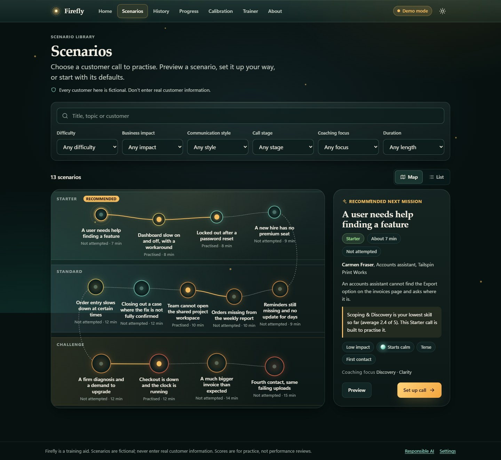

- The library is a **map**: 13 scenarios in three bands (Starter, Standard, Challenge). A mission shows whether it is new, in progress or practised (with your best score), and one is marked **Recommended** with the evidence behind it.
- It works from the keyboard: arrow keys move to the nearest mission, Home and End jump to the ends, search and filters dim what does not match.
- The familiar list is one switch away, the choice is remembered on this device, and phones get the list only.

</details>

<details>
<summary><strong>2 · Set up the customer and launch the call</strong></summary>

&nbsp;

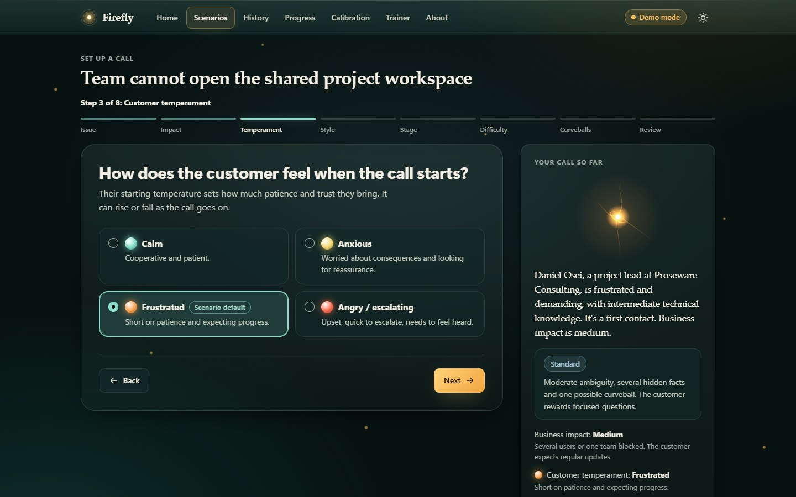

An eight-step setup shapes the issue, business impact, the customer's mood, technical level, communication style, call stage, difficulty and optional curveballs. The preview shows the customer you are building, and the light at its centre takes on their starting mood.

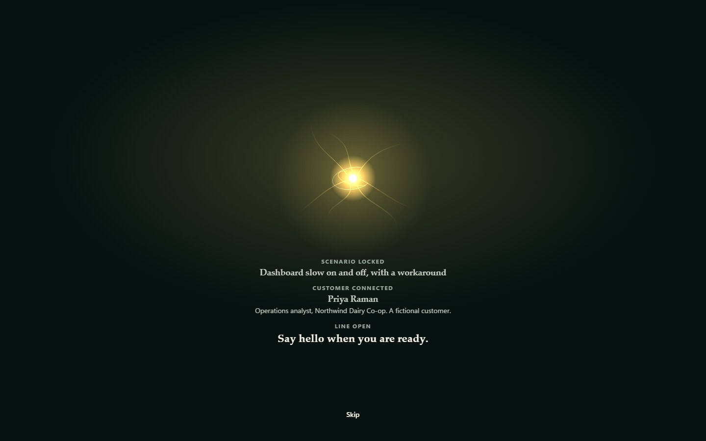

**Begin call** opens a short launch moment. It is honest: "Line open" appears only once the call really exists, a failure closes it and keeps every choice, and **Skip**, Escape, Enter and Space all end it. With reduced motion it is not shown at all.

</details>

<details>
<summary><strong>3 · Hold the conversation</strong></summary>

&nbsp;


- The customer is a light whose colour, tempo and restlessness follow how they feel. Nothing is scripted: they react to what you actually say, hold facts back until you ask a fitting question, and may raise a curveball.
- **Guided practice** shows the mood in words, how many signals you have found (never how many exist), a "Signal found" chip and a line when the mood shifts. **Immersive practice** shows none of it, because real calls do not.
- Sound is optional and off by default. A short tone when a signal is found, only if you turn it on.

</details>

<details>
<summary><strong>4 · Read the debrief</strong></summary>

&nbsp;


The report keeps every guarantee of the coaching model and adds structure. The six scores form one constellation; what the call earned appears next; every score is backed by quotes that open the transcript at that turn.

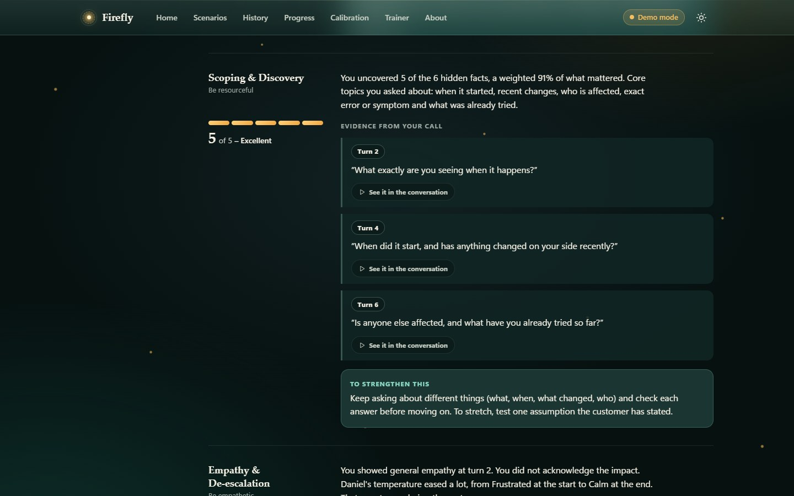

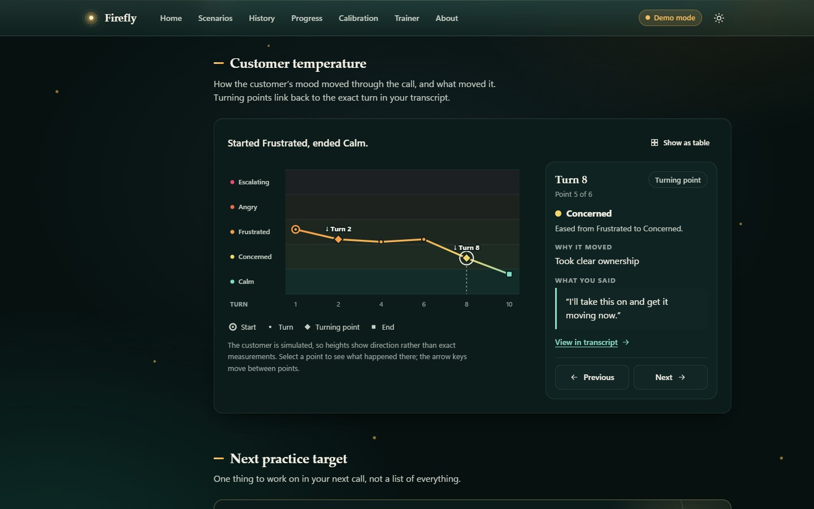

The mood timeline shows when and why the customer moved, with the words that moved them.

</details>

<details>
<summary><strong>5 · Watch your skills light up</strong></summary>

&nbsp;

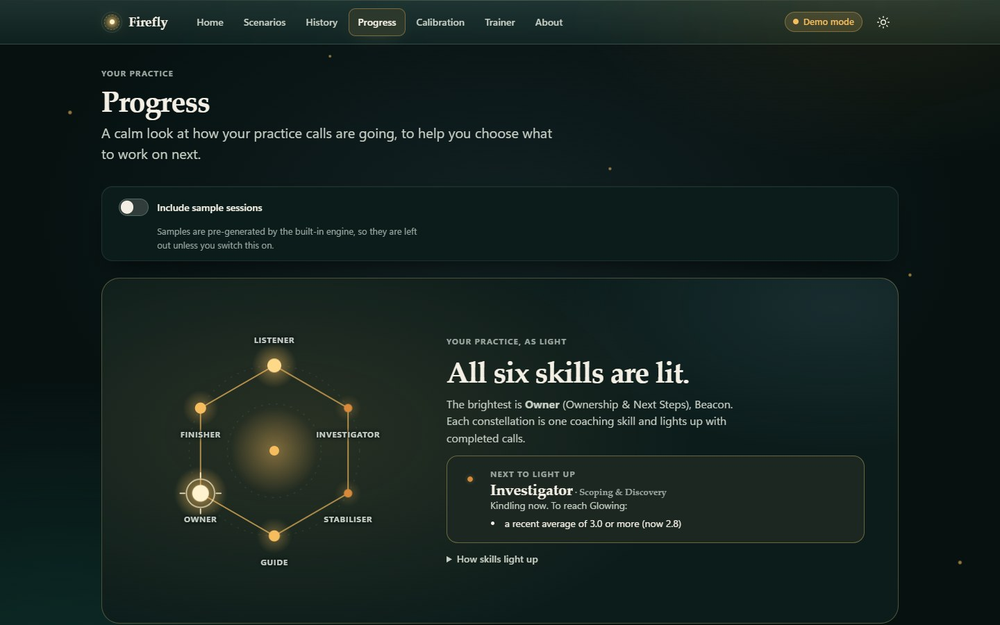

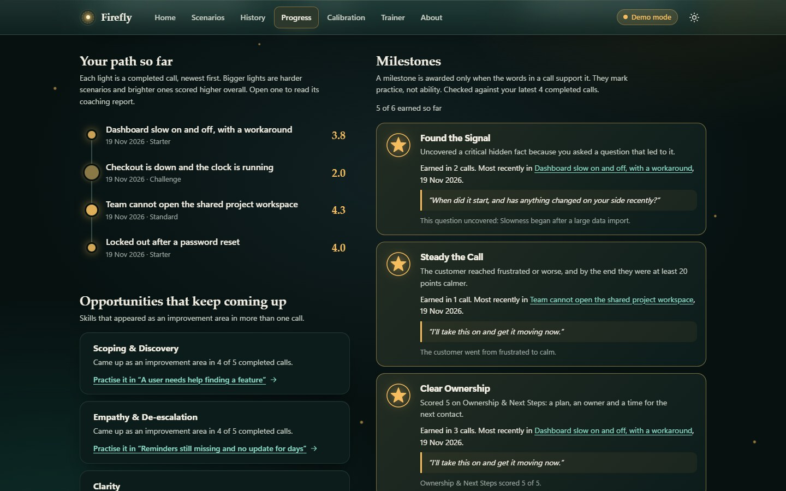

Progress is a mastery journey, not a dashboard. See [Light is earned](#light-is-earned) for the rules.

</details>

<details>
<summary><strong>6 · On every screen</strong></summary>

&nbsp;


Phone to ultra-wide, dark and light themes, reduced motion from the device or the app, keyboard-only use, an optional five-step tour, and a calm notice when the browser goes offline. See [Accessibility and performance](#accessibility-and-performance).

</details>

## Why Firefly?

Technical knowledge alone does not guarantee a strong support experience. Trainees also have to learn to:

- open calls professionally and establish business impact
- scope unclear issues with focused discovery questions
- communicate without unnecessary jargon
- handle frustrated or escalating customers and de-escalate
- take ownership, set expectations and agree on next steps
- close calls professionally

Practising these skills only on live cases creates risk for customers and delays useful feedback. Firefly gives trainees a place to rehearse as often as they like, and shows them where a call went well or badly, in their own words.

It is an FY27 apprentice team project. It focuses on customer-handling and support-conversation skills and is product-agnostic: it does not teach the details of any one product. All scenarios are fictional and every customer detail is synthetic. Firefly is a coaching tool, not an employee-performance assessment system.

## What Firefly does


| Stage         | What happens                                                                                                                                                                                                |
| ------------- | ----------------------------------------------------------------------------------------------------------------------------------------------------------------------------------------------------------- |
| **Configure** | Choose one of 13 fictional scenarios on the mission map and set its business impact, customer temperature, technical proficiency, communication style, call stage and difficulty, with optional curveballs. |
| **Simulate**  | Read a pre-call brief, launch the call and hold an unscripted text conversation with a simulated customer. The brief never shows hidden facts.                                                              |
| **Adapt**     | The customer's mood, trust and patience move with what the trainee says. Hidden facts appear only for relevant questions, and a curveball may land mid-call.                                                |
| **Evaluate**  | Ending the call produces a coaching report: six scored skills with verified quotes, what the call earned, strengths, improvements with alternative phrasing, a discovery review and a mood timeline.        |
| **Improve**   | Reopen any report from History, follow quotes into the transcript, and use Progress to see which skills are lit, what each needs next, your milestones and a recommended next mission.                      |

## Light is earned

Firefly rewards practice, reflection and mastery, and nothing else. Every rule below is a pure function with tests (`shared/domain/mastery.ts`, `achievements.ts` and `recommend.ts`), so each number can be explained.

**Skill tiers.** One constellation per coaching skill. Only completed calls count, judged on the latest five that scored the skill, and each skill always says exactly what the next tier needs.

| Tier     | What it takes                                                                                              |
| -------- | ---------------------------------------------------------------------------------------------------------- |
| Dormant  | No completed call has scored this skill yet                                                                |
| Kindling | One completed call, whatever the score                                                                     |
| Glowing  | Two calls and a recent average of 3.0 or more                                                              |
| Radiant  | Three calls in two scenarios, a recent average of 3.8 or more, and a Standard or Challenge call scoring 4+ |
| Beacon   | Four calls in three scenarios, a recent average of 4.4 or more, and a Challenge call scoring 4+            |

**Milestones.** Six, each awarded from the saved coaching report and nothing else. A call that ended early, or whose evidence was too thin to score, earns none.

| Milestone         | Earned when                                                                       |
| ----------------- | --------------------------------------------------------------------------------- |
| Found the Signal  | A critical hidden fact came out because of a question you asked                   |
| Steady the Call   | The customer reached frustrated or worse and ended at least 20 points calmer      |
| Clear Ownership   | Ownership & Next Steps scored 5: a plan, an owner and a time for the next contact |
| Plain Language    | Clarity scored 4 or more with a customer who is new to the technology             |
| Complete the Loop | Closing scored 4 or more: agreement confirmed and the call closed properly        |
| Handled the Turn  | A curveball changed the conversation and was resolved                             |

**Next mission.** Always derived from your saved practice, always with the reason: a gentle first call, a scenario built for your lowest skill, a step up after strong calls, a step back after hard ones, something new, or a second attempt. Calls in progress and sample calls never steer it.

**Deliberately missing.** No points or XP, no streaks or daily goals, no leaderboards, no comparison with colleagues, and no reward for message volume or call length. The full reasoning is in [docs/experience-design.md](docs/experience-design.md#gamification).

## Key features

| Area                                                                          | Status                                                                                                                                             |
| ----------------------------------------------------------------------------- | -------------------------------------------------------------------------------------------------------------------------------------------------- |
| Scenario library (map and list), setup, brief, launch, live call              | Implemented and verified by browser tests                                                                                                          |
| Customer simulation, hidden facts, curveballs                                 | Implemented and verified (rules engine in demo mode)                                                                                               |
| Coaching reports with verified quotes and earned milestones                   | Implemented and verified (rules evaluator in demo mode)                                                                                            |
| History, Progress (skill tiers, path of calls, milestones), transcript review | Implemented and verified                                                                                                                           |
| Mentor review and calibration tooling                                         | Implemented and verified. No real mentor data exists yet.                                                                                          |
| Trainer tools                                                                 | Implemented and verified                                                                                                                           |
| Optional sound, first-run tour, offline notice                                | Implemented and verified                                                                                                                           |
| Live Gemini provider                                                          | Implemented. Needs an API key. Run end to end against the real Gemini API in a few scripted calls; free-tier rate limits and data-use terms apply. |
| Live Azure OpenAI or OpenAI-compatible provider                               | Implemented. Requires credentials. Tested only against a local fake server; not verified against a real service.                                   |
| Accessibility                                                                 | Automated checks and keyboard tests pass. No screen-reader validation.                                                                             |
| Hosted deployment, voice simulation, trainer-authored scenarios               | Not implemented (future work)                                                                                                                      |

<details>
<summary><strong>Adaptive customer, hidden facts, curveballs, coaching and tools in detail</strong></summary>

### Configurable scenarios

There are 13 fictional scenarios (4 Starter, 5 Standard, 4 Challenge) across 7 issue types. Each can be reconfigured before a call through an eight-step setup, and the settings used are stored with the session so a call can be replayed and evaluated as it was configured. See [Scenario model](#scenario-model). Every scenario is checked by `npm run validate:scenarios` and the library tests, which fail if a hidden fact cannot be found or leaks into the customer's opening.

### Adaptive customer simulation

In demo mode the customer is produced by a deterministic rules engine. It classifies what the trainee did (empathy, ownership, next steps, jargon, blame, focused questions and more), updates the customer's state, and composes a reply grounded in the scenario's persona, communication style, proficiency and the facts the customer is allowed to share.

- **Customer state.** Seven bounded values (0-100), among them temperature, trust, patience, confidence and urgency, changed only by explicit rules. Trainees see the mood in words (Calm, Concerned, Frustrated, Angry, Escalating) and its trend, never the numbers.
- **Behaviour that matters.** Specific empathy, acknowledging impact, clear ownership and focused questions help. Blame, dismissal, unexplained jargon, repeated questions and premature fixes hurt.
- **Practice modes.** Guided practice shows light cues (mood, facts found, areas worth exploring). Immersive practice shows none.

### Hidden-fact discovery

Each scenario holds facts the customer reveals only when asked an appropriate question. Some also need enough trust or an acknowledgement of the impact first. After the call, the report lists which facts were found, partly found or missed, the question that revealed each, and a better question for any that were missed.

### Controlled curveballs

Curveballs are optional. There are eight types: asks for a manager, threatens to cancel, imposes a deadline, changes the issue, goes quiet, mentions a bad experience, demands a guarantee and challenges credibility. Each fires deterministically when its conditions are met (a window of turns plus a state condition, such as ownership still being unclear), and the report says how the trainee handled it.

### Evidence-based coaching

Each report scores six dimensions from 1 to 5 and includes a rationale for every score with verified quotes from the trainee's own turns, strengths and improvement opportunities with alternative phrasing, discovery results (including what the customer held back), a customer temperature timeline with turning points linked to the transcript, an assessment of any curveball and one suggested next practice target. Short calls say that the report rests on limited evidence. See [Coaching dimensions](#coaching-dimensions).

### History and Progress

**History** stores individual practice sessions. Filter them, reopen a report or transcript, compare two sessions or delete one. **Progress** shows the skill constellations, tiers, path of calls, milestones and opportunities that keep repeating, with a link to a scenario that practises each. It is for personal coaching: practice signals from a handful of calls, never an assessment, and never compared with other people.

### Calibration and trainer tools

A mentor can score a completed session from its transcript alone and then see how the AI's scores compared; `npm run calibrate` compares scores kept in files. See [Evaluation and calibration](#evaluation-and-calibration). The Trainer page offers a spotlight scenario, a quick start, a demo checklist, the provider status, labelled sample sessions (load and remove) and confirmed resets of practice data.

### Demo and live provider modes

|                     | Demo mode (default)                                                | Live mode (optional)                                                                         |
| ------------------- | ------------------------------------------------------------------ | -------------------------------------------------------------------------------------------- |
| Set with            | `FIREFLY_PROVIDER=mock`, or leave it unset                         | `FIREFLY_PROVIDER=gemini`, `azure-openai` or `openai-compatible`                             |
| Credentials         | None                                                               | Required (see [Configure a live provider](#configure-a-live-provider))                       |
| Customer replies    | Rules engine, from phrase banks, scenario facts and customer state | A model, from what the engine has allowed the customer to say in that reply                  |
| Turn classification | Rules                                                              | A model                                                                                      |
| Coaching            | Rules evaluator                                                    | A model drafts it; the server verifies every quote and caps scores by the evidence           |
| Labelled in the app | "Demo mode (built-in rules engine)"                                | The configured provider                                                                      |
| Status              | Verified                                                           | Gemini: run end to end against the real API. Others: tested only against a local fake server |

If a live provider is requested but its variables are incomplete, Firefly starts in demo mode and prints a notice that names the missing variables (verified). Customer state, discovery, curveballs and the checks on the report stay in code in both modes. Details are in [docs/ai-providers.md](docs/ai-providers.md).

</details>

## How a simulation works

1. **Select a mission** on the map (or in the list), using search and filters.
2. **Configure the customer and difficulty** in the eight-step setup, or keep the defaults.
3. **Review the pre-call brief**: the situation, your goal, the ground rules and the settings. Hidden facts are never shown.
4. **Launch the call and start the conversation.** Type in your own words; nothing is scripted.
5. **Ask discovery questions**: what is happening, when it started, what changed, who is affected, what the screen says, what was tried and what it means for the business.
6. **Respond to changing behaviour and curveballs.** Acknowledge impact, take ownership and notice what moves the customer's mood.
7. **End the call.** Firefly asks for confirmation, locks the transcript and shows the stage of evaluation it has actually reached.
8. **Read the coaching report** and follow quotes into the transcript.
9. **Reopen the session through History** whenever you need it.
10. **Watch your skills light up in Progress** and take the recommended next mission.

## Scenario model

| Parameter             | Purpose                                      | Options                                                                                                            |
| --------------------- | -------------------------------------------- | ------------------------------------------------------------------------------------------------------------------ |
| Issue type            | Defines the fictional support problem        | Sign-in or access, service outage, slow performance, data missing, billing or licence, how-to, feature not working |
| Business impact       | Controls customer urgency                    | Low, medium, high                                                                                                  |
| Customer temperature  | Establishes starting behaviour               | Calm, anxious, frustrated, angry / escalating                                                                      |
| Technical proficiency | Controls vocabulary and technical depth      | Novice, intermediate, expert                                                                                       |
| Communication style   | Changes how the customer communicates        | Talkative, terse, demanding, vague, non-native English speaker                                                     |
| Call stage            | Establishes expectations and prior history   | First contact, follow-up, escalated, closure                                                                       |
| Hidden facts          | Tests discovery and scoping                  | Defined per scenario. Starter has fewer in play and clearer clues; Challenge puts every fact in play.              |
| Curveballs            | Introduces controlled complications          | Eight types. Up to one at Starter (off by default) and Standard, up to two at Challenge.                           |
| Difficulty            | Bundles scenario complexity                  | Starter, Standard, Challenge                                                                                       |
| Practice mode         | Sets how many cues are shown during the call | Guided (the Starter default) or immersive (the Standard and Challenge default)                                     |

Difficulty also sets the customer's starting trust and patience, how strongly good and bad behaviour moves them and how readily they volunteer context. Scenarios are written as TypeScript files; see [docs/scenario-authoring.md](docs/scenario-authoring.md).

## Coaching dimensions

Scores are whole numbers from 1 (not demonstrated) to 5 (excellent). The overall score is the mean of the six, rounded to one decimal place, and is left out when the call was too short to judge. Each dimension has a constellation name used for orientation on the Progress page.

| #   | Dimension               | Constellation | What it looks at                                                         | CARE behaviour (working mapping) |
| --- | ----------------------- | ------------- | ------------------------------------------------------------------------ | -------------------------------- |
| 1   | Opening & Rapport       | Listener      | Greeting, introduction, an open question, early connection               | Communicate, Be empathetic       |
| 2   | Scoping & Discovery     | Investigator  | Focused questions, hidden facts found, core topics covered               | Be resourceful                   |
| 3   | Empathy & De-escalation | Stabiliser    | Specific empathy, acknowledging impact, how the customer's mood moved    | Be empathetic                    |
| 4   | Clarity                 | Guide         | Plain language, jargon explained, recap and check-ins                    | Communicate                      |
| 5   | Ownership & Next Steps  | Owner         | Clear ownership, specific next steps with a time, realistic promises     | Be accountable                   |
| 6   | Closing                 | Finisher      | Recap of what was agreed, next contact confirmed, anything else, goodbye | Be accountable, Communicate      |

- **Evidence rules.** A 4 needs one verified quote and a 5 needs two. Quotes are checked against the trainee turn they cite before a report is saved.
- **Never penalised.** Short messages, grammar, spelling, an accent or non-native phrasing never lower a score.
- **Limited evidence.** Short calls are labelled as resting on limited evidence.
- **CARE mapping.** The rubric maps the dimensions loosely to the four CARE behaviours (communicate effectively, be accountable, be resourceful, be empathetic). It is a working aid for coaching conversations, not an official standard.

The full rules are in [docs/evaluation-rubric.md](docs/evaluation-rubric.md).

## Architecture

Firefly is a single Node.js process. It serves a JSON API and the built web app, and keeps everything in a local SQLite file.

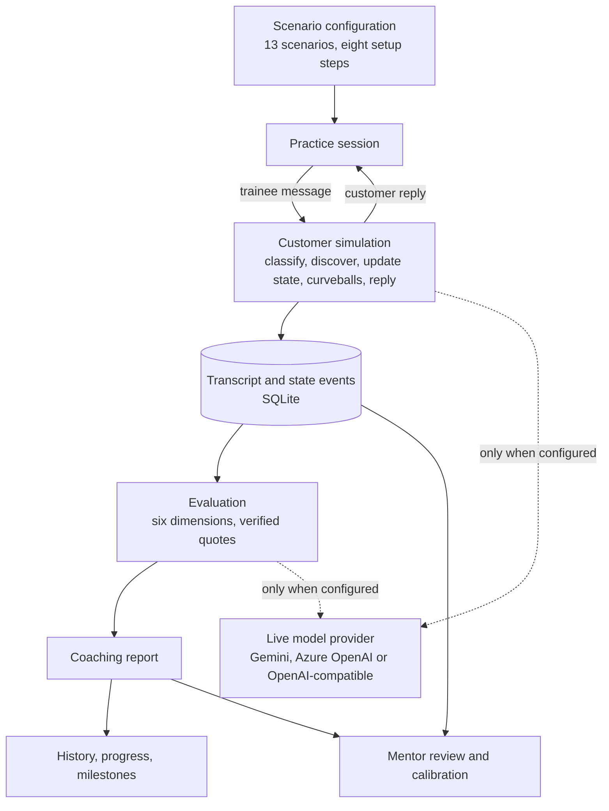

### The web app

The experience layer sits entirely in the browser and reads the same JSON API as before. Mastery tiers, milestones and recommendations are derived from data the app already loads, by pure functions in `shared/domain`.

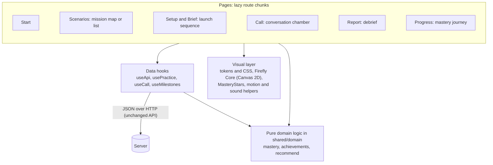

### One message, end to end

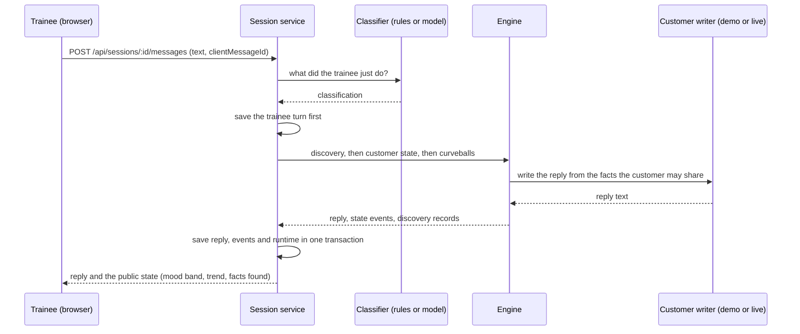

### Ending a call

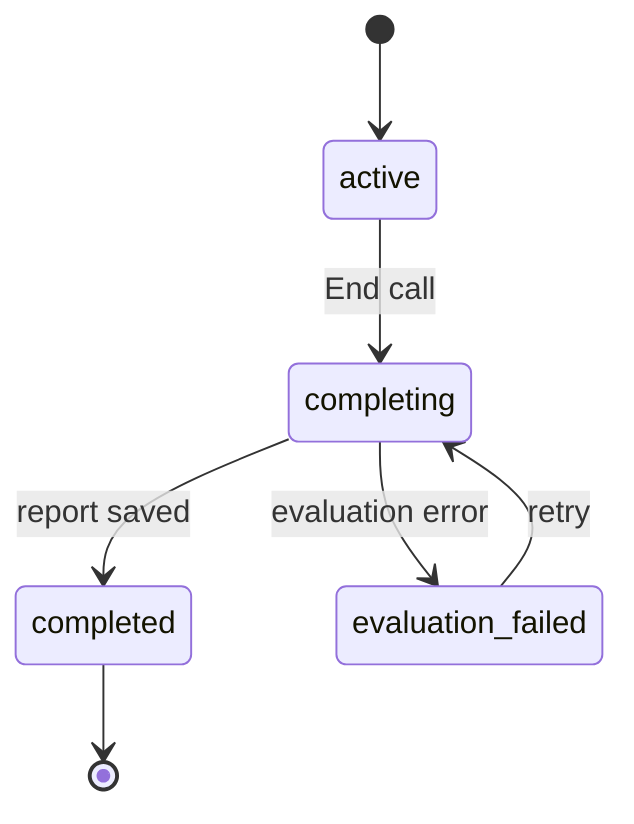

- **Frontend.** A React single-page app with one lazy route per screen (Start, Scenarios, Setup, Brief, Call, Report, Transcript, History, Progress, Calibration, Trainer, About and Settings). The Firefly Core, the tour and the report are separate chunks, so none is part of the first download.
- **Server and API.** A hand-written router on `node:http`, with a strict Content-Security-Policy, same-origin checks on writes and rate limits. There is no sign-in; each browser gets an anonymous cookie that scopes its own history.
- **Simulation.** A deterministic rules engine runs every turn: classify, apply discovery rules, update the bounded customer state, check curveball triggers, then compose the reply. The trainee's message is saved before the reply, so a failed reply loses nothing and a retry creates no duplicate.
- **Evaluator.** Scores the transcript and the engine's records, verifies every quote and builds the report. Ending a call is a real state change with phases, and exactly one report is saved.
- **Live model provider.** Optional and off by default. A model can classify turns, write replies and draft the coaching, but the state, discovery, curveballs and checks stay in code.
- **Persistence.** SQLite through `node:sqlite`, with versioned migrations. Transcripts, state events, reports and mentor reviews are stored locally.
- **Visuals.** The Firefly Core is a hand-written Canvas 2D engine with no dependency. It pauses off screen, lowers its own quality on slow hardware, draws one still frame under reduced motion and leaves a CSS glow if a canvas is unavailable. There is no WebGL.
- **Browser tests.** Playwright runs against the production build with an in-memory database.

See [docs/architecture.md](docs/architecture.md) for the full picture and [docs/experience-design.md](docs/experience-design.md) for the design.

## Tech stack

| Layer          | Technology                                                                                                         |
| -------------- | ------------------------------------------------------------------------------------------------------------------ |
| Frontend       | React 19, React Router 7, Vite 8, TypeScript 5.9 (strict)                                                          |
| Visuals        | Hand-written Canvas 2D engine, CSS custom properties, system fonts. No animation, 3D or icon library               |
| Audio          | Optional tones synthesised with the Web Audio API. No audio files                                                  |
| Server and API | Node.js 24 or newer running TypeScript directly, `node:http` (no web framework), zod 4 for validation              |
| Simulation     | Deterministic TypeScript rules engine in `server/engine` (classifier, discovery, state, curveballs)                |
| AI provider    | Built-in demo provider by default. Optional Gemini, Azure OpenAI or OpenAI-compatible chat completions via `fetch` |
| Styling        | Plain CSS on design tokens, light and dark themes, no UI framework                                                 |
| Testing        | Vitest 5 with Testing Library and jsdom; Playwright 1.65 with axe-core                                             |
| Code quality   | ESLint 9 (typescript-eslint, jsx-a11y, react-hooks) and Prettier 3                                                 |
| CI             | GitHub Actions                                                                                                     |
| Storage        | SQLite file through `node:sqlite`                                                                                  |

The runtime dependencies are React, React Router and zod. The redesign added none.

## Project structure

```text
Firefly/
├── server/                 Node.js server, written in TypeScript
│   ├── engine/             Simulation engine and the demo-mode customer
│   ├── scenarios/          Scenario registry and the 13 built-in scenarios
│   ├── evaluator/          Coaching evaluator and verification of model drafts
│   ├── providers/          Demo and live model providers
│   ├── prompts/            Versioned prompts used in live mode
│   ├── services/           Sessions, progress, calibration, sample data
│   ├── db/                 SQLite schema, migrations and queries
│   └── http/               Router, API routes, security, static files
├── shared/domain/          Types, schemas and pure logic shared by server and web,
│                           including mastery, achievements and recommendations
├── web/src/
│   ├── pages/              One lazy-loaded route per screen
│   ├── components/         core (Firefly Core), call, report, mission (map), progress,
│   │                       scenario (setup, launch), mastery, tour and more
│   ├── lib/                API client, hooks, theme, sound, tour, milestones
│   └── styles/             Design tokens and plain CSS, one file per area
├── e2e/                    Playwright browser tests
├── calibration/samples/    Invented example records for the calibration tool
├── scripts/                Dev runner, scenario validation, calibration CLI, screenshot tools,
│                           secret and lockfile checks
├── docs/                   Architecture, experience design, rubric, providers, calibration,
│   │                       design system, demo guide
│   └── images/             Screenshots used in this README
├── .github/workflows/      Continuous integration
├── .env.example            Configuration template with placeholders only
└── package.json            Scripts and dependencies. The tool configs (vite, vitest, playwright, eslint, tsconfig) sit beside it.
```

## Getting started

### Prerequisites

- **Node.js 24 or newer.** This is the `engines` requirement in `package.json`, because the server runs TypeScript directly and uses the built-in `node:sqlite`. Older versions are not supported.
- **npm**, which comes with Node.js.
- **No credentials** for demo mode.
- **A Chromium-based browser** only if you run the browser tests (see [Test](#test)).

### Install and run in demo mode

```bash
git clone https://github.com/snowjug/Firefly.git
cd Firefly
npm ci
npm run build
npm start
```

No credentials are needed. Open <http://127.0.0.1:8787>. The badge at the top right of the app says "Demo mode". Data is kept in `data/firefly.db`, which is git-ignored.

| Goal                    | Command                           | Opens at                                                                                  |
| ----------------------- | --------------------------------- | ----------------------------------------------------------------------------------------- |
| Use the built app       | `npm run build`, then `npm start` | <http://127.0.0.1:8787>                                                                   |
| Develop with hot reload | `npm run dev`                     | <http://localhost:5173> (the API runs on port 8787 and restarts when server files change) |

If port 8787 is busy, set `FIREFLY_PORT`. Firefly has no sign-in, so keep `FIREFLY_HOST` on its loopback default.

### Configure a live provider

Copy `.env.example` to `.env` (also git-ignored) and fill in **one** provider. Use your own values; never commit real keys.

For Google's Gemini API (a key from [Google AI Studio](https://aistudio.google.com/apikey); only the key is required):

```bash
FIREFLY_PROVIDER=gemini
GEMINI_API_KEY=<your-api-key>
```

Gemini defaults to `gemini-3.5-flash-lite`; set `GEMINI_MODEL` to use another model. A free-tier project is rate limited (15 requests per minute for that model when this was tested, and each message sent uses two), and Google's terms say it uses content sent through unpaid services to improve its products and that human reviewers may read it, so use fictional scenarios only. Details are in [docs/ai-providers.md](docs/ai-providers.md#gemini-google-ai-studio).

For Azure OpenAI:

```bash
FIREFLY_PROVIDER=azure-openai
AZURE_OPENAI_ENDPOINT=<https://your-resource.openai.azure.com>
AZURE_OPENAI_API_KEY=<your-api-key>
AZURE_OPENAI_DEPLOYMENT=<your-deployment-name>
AZURE_OPENAI_API_VERSION=<api-version>
```

For any OpenAI-compatible chat-completions endpoint:

```bash
FIREFLY_PROVIDER=openai-compatible
FIREFLY_LLM_BASE_URL=<https://your-endpoint/v1>
FIREFLY_LLM_API_KEY=<your-api-key>
FIREFLY_LLM_MODEL=<model-name>
```

The console prints which provider is running when the server starts, and the app labels it everywhere. Only Gemini has been run against a real service (see [Verified against the Gemini API](docs/ai-providers.md#verified-against-the-gemini-api)); run the smoke test in [docs/ai-providers.md](docs/ai-providers.md) with your own credentials before relying on Azure OpenAI or an OpenAI-compatible endpoint. To go back to demo mode, set `FIREFLY_PROVIDER=mock` and restart.

### Build

```bash
npm run build
```

This writes the production web app to `dist/web`.

### Test

| Purpose                                | Command                                                     |
| -------------------------------------- | ----------------------------------------------------------- |
| Everything below plus the build        | `npm run check`                                             |
| Unit, component and API tests          | `npm test`                                                  |
| Browser tests, including accessibility | `npm run test:e2e`                                          |
| Scenario validation                    | `npm run validate:scenarios`                                |
| Calibration on the bundled sample data | `npm run calibrate`                                         |
| Secret scan                            | `npm run check:secrets`                                     |
| Lockfile and registry check            | `npm run check:lockfile`                                    |
| Format, lint and type checks           | `npm run format:check`, `npm run lint`, `npm run typecheck` |

`npm run check` runs formatting, lint, types, scenario validation, tests, the build, the secret scan and the lockfile check in that order. Browser tests need a browser: install Playwright's with `npx playwright install chromium`, or reuse an installed Edge or Chrome by setting `PW_CHANNEL=msedge` (in PowerShell: `$env:PW_CHANNEL = 'msedge'`). See [docs/troubleshooting.md](docs/troubleshooting.md) if anything does not start.

### Regenerate the screenshots

The pictures in this README come from a script, so they can be refreshed after a design change. Start Firefly in demo mode with an empty in-memory database, then run the script (its options are documented at the top of the file):

```bash
FIREFLY_DB_PATH=:memory: FIREFLY_PROVIDER=mock FIREFLY_MOCK_DELAY_MS=120 FIREFLY_PORT=4444 npm start
node scripts/readme-screenshots.mjs --base http://127.0.0.1:4444
```

<details>
<summary><strong>Environment variables</strong></summary>

Firefly loads `.env` at startup, and variables already in the environment win. Nothing is required for demo mode.

| Variable                                                                                               | Required                         | Purpose                                                                                                                         |
| ------------------------------------------------------------------------------------------------------ | -------------------------------- | ------------------------------------------------------------------------------------------------------------------------------- |
| `FIREFLY_PROVIDER`                                                                                     | No (default `mock`)              | `mock` (demo mode), `gemini`, `azure-openai` or `openai-compatible`                                                             |
| `GEMINI_API_KEY`                                                                                       | Only with `gemini`               | Google Gemini API key. Keep it in the git-ignored `.env`.                                                                       |
| `GEMINI_MODEL`, `GEMINI_BASE_URL`                                                                      | No (with `gemini`)               | Model (default `gemini-3.5-flash-lite`) and OpenAI-compatible endpoint (default Google's)                                       |
| `AZURE_OPENAI_ENDPOINT`, `AZURE_OPENAI_API_KEY`, `AZURE_OPENAI_DEPLOYMENT`, `AZURE_OPENAI_API_VERSION` | Only with `azure-openai`         | Azure OpenAI chat-completions deployment                                                                                        |
| `FIREFLY_LLM_BASE_URL`, `FIREFLY_LLM_API_KEY`, `FIREFLY_LLM_MODEL`                                     | Only with `openai-compatible`    | Any OpenAI-compatible chat-completions endpoint                                                                                 |
| `FIREFLY_LLM_TIMEOUT_MS`                                                                               | No (default `30000`)             | Timeout for each model call                                                                                                     |
| `FIREFLY_LLM_MAX_RETRIES`                                                                              | No (default `1`, at most `3`)    | Retries for a failed model call                                                                                                 |
| `FIREFLY_PORT`                                                                                         | No (default `8787`)              | Port the server listens on                                                                                                      |
| `FIREFLY_HOST`                                                                                         | No (default `127.0.0.1`)         | Address the server listens on. Keep it on loopback: there is no sign-in.                                                        |
| `FIREFLY_DB_PATH`                                                                                      | No (default `./data/firefly.db`) | SQLite file. `:memory:` keeps data in memory.                                                                                   |
| `FIREFLY_LOG_LEVEL`                                                                                    | No (default `info`)              | `info`, `warn`, `error` or `silent`. Logs never contain transcripts.                                                            |
| `FIREFLY_MOCK_DELAY_MS`                                                                                | No (default `700`)               | Pause before demo-mode replies so the typing state is visible                                                                   |
| `FIREFLY_TEST_HOOKS`, `FIREFLY_DEV_DIAGNOSTICS`                                                        | No (off)                         | Failure injection and internal diagnostics for tests. Never enable on a shared host.                                            |
| `PW_CHANNEL`, `E2E_PORT`, `E2E_BASE_URL`                                                               | No (tests only)                  | Playwright: browser channel such as `msedge`, test server port (default `4321`), or the URL of a server that is already running |

</details>

## Accessibility and performance

**Accessibility.** WCAG 2.2 AA is a release requirement. The experience is built so that nothing depends on colour, motion or a pointer:

- Constellations are images with a full text description, and every tier, score, mood and difficulty is also written out.
- Everything works from the keyboard: the mission map (arrow keys, Home and End), setup, the call composer, the launch (Skip, Escape), the tour and every dialog.
- Reduced motion is honoured from the device and from Settings: the Firefly Core draws one still frame, the launch is not shown, and animation and transitions collapse to near zero.
- axe-core runs on 19 page states in both themes in the browser tests, and no page scrolls sideways at 320 px or 1440 px.
- Nobody has tested Firefly with a screen reader yet (see [Current limitations](#current-limitations)).

**Performance.** The redesign adds no runtime dependency, no web font and no image. Every page is its own chunk, the page for the opening address is fetched before the first render, and the optional pieces (the Core's drawing code, the tour, the next-mission card and the Progress views) load after the first paint, so the first screen never waits for them.

Measured against the release before the redesign (`e805b21`) on one Windows machine: headless Edge, no throttling, cache off, the two builds alternating on every run, median of 9 runs. Read each cell as previous → this release.

| Page                      | First contentful paint | JavaScript (gzip) | CSS (gzip)     | JS and CSS requests |
| ------------------------- | ---------------------- | ----------------- | -------------- | ------------------- |
| Start                     | 376 → 332 ms           | 95.7 → 111.7 kB   | 6.9 → 9.9 kB   | 10 → 25             |
| Scenarios (map)           | 648 → 408 ms           | 100.6 → 107.3 kB  | 7.7 → 10.9 kB  | 13 → 20             |
| A call                    | 288 → 316 ms           | 101.3 → 110.2 kB  | 8.1 → 10.8 kB  | 11 → 17             |
| A long call (40 messages) | 536 → 308 ms           | 101.3 → 110.2 kB  | 8.1 → 10.8 kB  | 11 → 17             |
| A report                  | 848 → 484 ms           | 107.8 → 118.4 kB  | 11.4 → 15.5 kB | 13 → 21             |
| Progress                  | 500 → 492 ms           | 96.5 → 112.4 kB   | 12.4 → 16.0 kB | 10 → 26             |

First screens are no slower: first contentful paint is lower on five of six pages and 28 ms higher on the call page, which is inside the noise. The Core holds 60 frames a second in both releases. The price is 7 to 16 kB more JavaScript and 3 to 4 kB more CSS per page, more (smaller) requests and more scripting. Layout shift is 0 everywhere except Progress (0.06 against 0.04).

These are lab numbers from one machine on localhost. The same build moved by 100 ms or more between repeated sessions, so read smaller differences as noise. Slower devices, real networks and other browsers were not measured.

Details, including the measurement method and its limits, are in [docs/experience-design.md](docs/experience-design.md#performance-strategy).

## Example training session

<details>
<summary><strong>An illustration written for this document</strong></summary>

&nbsp;

It is not taken from a built-in scenario, so it gives nothing away about the scenarios in the library.

| Setting               | Value                                                              |
| --------------------- | ------------------------------------------------------------------ |
| Issue                 | Production service unavailable (a customer-facing booking service) |
| Business impact       | High                                                               |
| Starting temperature  | Frustrated                                                         |
| Technical proficiency | Intermediate                                                       |
| Communication style   | Demanding                                                          |
| Difficulty            | Challenge                                                          |

- **What the trainee is told.** The pre-call brief says a fictional operations lead is calling because clients cannot make bookings. It gives the trainee a goal: find out what is happening and who is affected, take ownership, and agree what happens next and when. It never lists hidden facts.
- **A hidden fact.** Suppose the customer's team raised the same errors in a case yesterday and it was closed without a fix. The customer will not mention it unprompted. It comes out only if the trainee asks something like "Has anyone contacted support about this already?"
- **A possible curveball.** A few turns in, if no one has taken ownership, the customer may ask for a manager. The report later says whether the trainee acknowledged the request, explained what they would do and offered a route.
- **How feedback is produced.** When the trainee ends the call, Firefly locks the transcript, reviews which hidden facts were found, scores the six dimensions and builds a report. Each score is explained and, where there is something to quote, cites quotes from the trainee's own turns. The report names any fact that was missed together with a better question to ask, shows how the customer's temperature moved, lists any milestone the call earned and suggests one thing to practise next.

</details>

## Responsible AI and data safety

Firefly is a training aid.

- **Fictional data only.** Use fictional and synthetic customer information. Do not enter real customer names, case details, logs, screenshots or identifiers.
- **Best-effort redaction.** Emails, phone numbers, long numbers and identifiers are removed from messages before they are saved or sent to a model, and the call screen warns before you send something that looks like one. This is pattern matching, so it will not catch everything.
- **Coaching can be wrong.** AI-generated coaching can be incomplete or wrong. Review it with a mentor.
- **Practice, not assessment.** Scores, skill tiers and milestones are for practice and must not be treated as employee-performance assessments. Firefly never ranks or compares colleagues.
- **Honest labelling.** Demo mode is always labelled and never presented as a model. Quotes are verified against the transcript, and short calls say their reports rest on limited evidence.
- **Controlled model use.** A live model is given only what the engine has decided the customer may say in that reply. Model output is validated and shown as plain text, and API keys stay on the server.
- **No telemetry.** There are no accounts, analytics or tracking. Logs contain short ids and timings, never transcripts. With a live provider, redacted transcripts go to the endpoint you configure. With a free-tier Gemini key, Google's terms say it uses content sent through unpaid services to improve its products and that human reviewers may read it, so keep everything fictional.
- **Secrets stay out of Git.** Never commit secrets. `.env` is git-ignored, `.env.example` holds placeholders only and `npm run check:secrets` scans for common patterns, including Google API key shapes.

Firefly makes no compliance or certification claims. Data lives in a local SQLite file that Firefly does not encrypt. The full picture is in [docs/responsible-ai.md](docs/responsible-ai.md).

## Evaluation and calibration

<details>
<summary><strong>How scores are produced, and what is and is not validated</strong></summary>

&nbsp;

**How scores are produced.** In demo mode a rules evaluator reads the classified transcript and the engine's records and scores each dimension. With a live provider a model drafts the scores and wording, and the server then verifies every quote against the turn it cites, caps scores by the evidence, and builds discovery, the mood timeline, the curveball assessment and the overall score itself.

**How transcript evidence is used.** Every quoted moment is a real excerpt from a trainee turn and links to that turn in the transcript. A quote that cannot be found is dropped, and a score cannot rise above what its verified quotes support. Milestones are derived from that same evidence, so a milestone can never appear without a quote (or, for Handled the Turn, a resolved curveball) behind it.

**How mentors score sessions.** On the Calibration page a mentor picks a completed session that has no review yet and scores the six dimensions from 1 to 5 using only the transcript and the rubric scale. The review screen never loads the AI's scores or the report, and the review queue does not carry them either. After saving, the page shows the AI's scores beside the mentor's. This blindness is a process aid, not an access control: anyone using the app can open a report from History, so mentors should score before they read it.

**How the calibration command works.** `npm run calibrate` reads records from `calibration/samples/` by default, or from the files you give it (`npm run calibrate -- path/to/records.json`). It prints the mean absolute difference, the share of scores within one point and any consistent over- or under-scoring, overall and per dimension. The file format is described in [docs/calibration.md](docs/calibration.md).

**What calibration currently proves.** Nothing yet about real-world agreement. The only records in the repository are six invented examples, all marked as samples, and the tool says so and warns when there are fewer than 20 reviews. The tool, the file format and the in-app flow work; there is no real mentor data.

**What remains unvalidated.** Agreement between the evaluator and real mentors, the quality of coaching from a live model (Gemini has been run end to end, but its coaching has not been compared with mentors' scoring), and whether skill tiers and milestones, which are built on those scores, match how mentors would judge the same trainee. Treat every score as a starting point for a conversation.

</details>

## Quality and testing

Last verified on commit [`ee78397`](https://github.com/snowjug/Firefly/commit/ee783970b35f07fc0a0fc33bd59c6b89a04050c7) on 2026-11-19. Commits after it change only documentation, images and the screenshot script.

| Check                                                             | Result                                                                                                         |
| ----------------------------------------------------------------- | -------------------------------------------------------------------------------------------------------------- |
| Formatting, lint, types and scenario validation (`npm run check`) | Pass                                                                                                           |
| Unit, component and API tests (`npm test`)                        | 1,068 passed in 55 files                                                                                       |
| Browser tests (`npm run test:e2e`)                                | 32 passed: 29 on a desktop viewport, 3 on a phone                                                              |
| Accessibility                                                     | axe-core on 19 page states in both themes (WCAG 2.0 to 2.2, A and AA rules): no serious or critical violations |
| Layout                                                            | No sideways scrolling at 320 px or 1440 px on the same page states                                             |
| Secret scan and lockfile check                                    | No findings                                                                                                    |
| Calibration command on the bundled sample (`npm run calibrate`)   | Runs. Its six records are invented samples and prove nothing about agreement with mentors.                     |
| Continuous integration (GitHub Actions, Ubuntu, Node 24)          | Green: [run 44530451509](https://github.com/snowjug/Firefly/actions/runs/44530451509)                          |

The unit tests cover the domain rules (customer state, discovery, curveballs, scoring, mastery, milestones, recommendations), the evaluator and its quote checks, the HTTP API and database, the providers (against a local fake model server), and every page and component. The browser tests run real journeys against the production build with an in-memory database. See [CONTRIBUTING.md](CONTRIBUTING.md) for how to run them and [docs/troubleshooting.md](docs/troubleshooting.md) if a browser will not start.

## Current limitations

- The Gemini provider has been run end to end against the real API only in a few scripted calls, and free-tier rate limits apply (about 15 requests a minute for the default model when tested). Azure OpenAI and other OpenAI-compatible services were tested only against a local fake server.
- No real mentor calibration dataset exists, so nothing is known about how closely the scores agree with people.
- Accessibility is checked by automated tools, keyboard tests and review. Nobody has tested with a screen reader or voice control.
- Browser tests run in Chromium (Edge and Chromium). Other browser engines are not tested.
- Demo mode is pattern-based. It can miss unusual phrasing, and it cannot answer small-talk questions about itself, such as the customer's name or phone number, so the customer carries on with the call instead. It is less flexible than a person or a model.
- There is no dedicated mid-call cue when a curveball lands, because the call state the browser receives does not include one. Mood shifts and silence are shown, and the report explains the curveball afterwards.
- Firefly is not deployed. There is no hosting configuration.
- It has no sign-in, so keep it on a trusted network. Text and English only; there is no voice.

## Roadmap

✅ **Available**

- 13 configurable scenarios on a mission map or list, with setup, brief, launch and live call
- Adaptive demo-mode customer with hidden facts and curveballs
- Evidence-based coaching reports with a mood timeline and earned milestones
- History, a Progress journey (skill tiers, path of calls, milestones, recommendations) and transcript review
- Blind mentor review and calibration tooling
- Trainer tools and labelled sample sessions
- Optional sound, a first-run tour and an offline notice
- Live-provider integration for Gemini, Azure OpenAI and OpenAI-compatible endpoints (Gemini run against the real API; the others tested against a fake server only)

🚧 **In progress**

- None right now.

🔭 **Future possibilities**

- Validating Azure OpenAI or another OpenAI-compatible service against a real endpoint, and measuring coaching quality from a live model
- Collecting real mentor reviews to calibrate the scores, and checking skill tiers against them
- A hosted deployment for panel demonstrations
- Voice simulation
- Richer trainer scenario authoring
- Deeper accessibility validation with assistive technology

The future items are possibilities, not commitments.

## Documentation

| Document                                                 | Contents                                                                          |
| -------------------------------------------------------- | --------------------------------------------------------------------------------- |
| [docs/architecture.md](docs/architecture.md)             | Components, data flow, persistence, API, security, the web app                    |
| [docs/experience-design.md](docs/experience-design.md)   | Creative concept, gamification, motion, accessibility, performance, visual review |
| [docs/design-system.md](docs/design-system.md)           | Tokens, materials, components, accessibility checklist                            |
| [docs/evaluation-rubric.md](docs/evaluation-rubric.md)   | How each dimension is scored and what is never penalised                          |
| [docs/ai-providers.md](docs/ai-providers.md)             | Configuring a live model, what is sent to it, failure behaviour                   |
| [docs/calibration.md](docs/calibration.md)               | Comparing AI and mentor scores                                                    |
| [docs/scenario-authoring.md](docs/scenario-authoring.md) | Writing and testing scenarios                                                     |
| [docs/responsible-ai.md](docs/responsible-ai.md)         | Safeguards and limits                                                             |
| [docs/demo-guide.md](docs/demo-guide.md)                 | A 20-minute demo runbook                                                          |
| [docs/troubleshooting.md](docs/troubleshooting.md)       | Common problems                                                                   |

## Contributing

1. **Branch from `main`.** Name the branch for the change, for example `feature/short-description` or `fix/short-description`.
2. **Make focused changes.** One idea per pull request.
3. **Run the checks.** `npm run check`, plus `npm run test:e2e` for anything visible, and try the change in the browser in both themes, at phone width and with the keyboard only. For a design change, regenerate and review the screenshots (see [Regenerate the screenshots](#regenerate-the-screenshots)).
4. **Open a pull request** that says what changed, why and how you tested it.
5. **Update the docs** whenever behaviour changes.

[CONTRIBUTING.md](CONTRIBUTING.md) has the conventions. Use fictional data only and never commit secrets.

## Team

Firefly is a collaborative FY27 apprentice project. See the [GitHub contributors page](https://github.com/snowjug/Firefly/graphs/contributors) for the people who have contributed.

## License

This repository does not currently specify a license: there is no `LICENSE` file, so no license is granted to others by the repository itself. Ask the repository owner before reusing the code.
