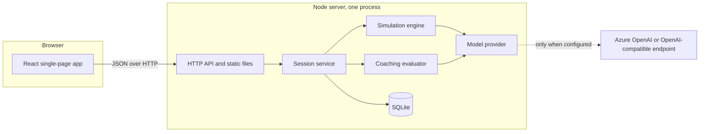

# Firefly: an advanced customer call simulator

**Practice difficult customer conversations before they become real ones.**

Firefly is a practice environment for apprentice technical support engineers. A trainee picks a fictional customer, shapes how difficult the call will be, and has an unscripted text conversation with a simulated customer who reacts to what they actually say. When the call ends, Firefly writes coaching that points to the trainee's own words, shows how the customer's mood moved, and says which hidden facts they found or missed.

It trains conversation skills, not knowledge of any one product. All customers, organisations and products in it are invented.

```
git clone https://github.com/snowjug/Firefly.git
cd Firefly
npm ci
npm run build
npm start
```

Then open <http://127.0.0.1:8787>. You need Node.js 24 or newer. No credentials are needed: Firefly starts in **demo mode**, where a built-in rules engine plays the customer and writes the coaching. Demo mode is labelled everywhere in the app. [Getting started](#getting-started) covers development mode, configuration and tests.

## Why Firefly?

Technical knowledge alone does not guarantee a good support experience. New engineers also have to learn to:

- scope unclear problems and understand the business impact
- communicate clearly and set expectations
- handle frustrated customers and de-escalate conversations
- take ownership and give clear next steps

Learning this only on real cases is hard, because mistakes land on real customers. Firefly gives new engineers a safe place to rehearse these conversations as often as they like, and to see exactly where a call went well or badly.

## What Firefly does

**Configure → Practise → Adapt → Evaluate → Improve**

1. **Configure.** Choose one of 13 fictional scenarios and set its business impact, customer temperature, technical proficiency, communication style, call stage and difficulty. Optionally enable curveballs. A live preview shows what you have set.
2. **Practise.** Talk to the customer in a chat-style call. Nothing is scripted: replies are built from what you say and what the customer is allowed to share.
3. **Adapt.** The customer's mood, trust and patience move with your behaviour. Empathy, ownership and focused questions help. Blame, jargon, repeated questions and premature fixes hurt. A curveball can land mid-call.
4. **Evaluate.** End the call and get a coaching report on six dimensions, with quotes from your transcript, a customer-mood timeline, and a review of the hidden facts you found, partly found or missed.
5. **Improve.** Reopen reports from History, follow quotes to the exact turn in the transcript, see practice trends in Progress, and take the suggested next scenario.

## Key features

**Configurable scenarios.** Thirteen scenarios across seven issue types and three difficulty presets (Starter, Standard, Challenge). Every scenario is validated for hidden-fact leaks and discoverability, and every one can be reconfigured. See [Scenario model](#scenario-model).

**An adaptive customer.** In demo mode the customer is produced by a deterministic rules engine. It classifies what the trainee did, updates bounded customer state (temperature, trust, patience, confidence, urgency), and composes a reply that follows the scenario's communication style and technical proficiency. With a configured language model, the model classifies turns, writes the customer's replies and drafts the coaching report. The customer's state, what gets revealed, when curveballs fire, the discovery review and the checks on the report (every quote verified, scores capped by the evidence) stay in code.

**Hidden facts.** Each scenario holds facts the customer reveals only when asked an appropriate question, and only when they trust the engineer enough, or have had the impact acknowledged, where the scenario requires it. Hidden facts are never in the customer's prompt until earned.

**Curveballs.** Eight kinds: asks for a manager, threatens to cancel, imposes a deadline, changes the issue, goes quiet, mentions a bad experience, demands a guarantee, challenges credibility. They fire deterministically when their conditions are met, at most once each, and the report judges how you handled them.

**Evidence-based coaching.** Each report scores six dimensions from 1 to 5 with a rationale, quotes and the turn they come from, a note on how firm the evidence is, strengths, opportunities with better phrasing, discovery results with the question that would have found what was missed, a customer-mood timeline and one next practice target. Every quote is checked against the turn it cites before a report is saved. See [the scoring rubric](docs/evaluation-rubric.md).

**Practice history and progress.** Sessions, transcripts, state history, reports and mentor reviews are stored locally in SQLite. History can be filtered and reopened; Progress shows trends per dimension with a small-sample caveat and no ranking.

**Calibration.** Mentors can score completed sessions blind in the app or compare scores kept in files with `npm run calibrate`. Firefly shows only what the stored records support. See [Evaluation and calibration](#evaluation-and-calibration).

**Trainer tools.** A spotlight scenario, quick start, a demo checklist, labelled sample sessions as a backup, and safe resets. The demo stays unscripted.

**Accessible and responsive.** Keyboard operable, visible focus, labelled controls, text alternatives for charts, reduced-motion support, light and dark themes, and layouts from phone to desktop.

## How a simulation works

1. **Choose and configure.** Pick a scenario in the library and walk through the eight-step setup, or start with its defaults.
2. **Read the brief.** It shows what you are allowed to know: the situation, your goal, the ground rules and the settings. It never shows hidden facts.
3. **Begin the call.** The customer opens, and you reply in your own words.
4. **Discover.** Ask about what happened, when it started, what changed, who is affected, what the screen says, what was tried and what it means for the business. Focused questions earn facts the customer would not volunteer.
5. **Respond to the customer.** Acknowledge impact, take ownership, avoid jargon, and notice any curveball.
6. **End the call.** Firefly locks the transcript and works through discovery review, scoring and report building. The wrap-up screen shows the stage it has really reached.
7. **Review.** Read the report, follow evidence links into the transcript, and read what you could have asked.
8. **Practise again.** History and Progress show where to focus next.

## Scenario model

| Parameter             | Purpose                                                    | Values                                                                                                             |
| --------------------- | ---------------------------------------------------------- | ------------------------------------------------------------------------------------------------------------------ |
| Issue type            | The customer's underlying problem                          | Sign-in or access, service outage, slow performance, data missing, billing or licence, how-to, feature not working |
| Business impact       | Controls urgency and stakes                                | Low, medium, high                                                                                                  |
| Customer temperature  | Starting behaviour                                         | Calm, anxious, frustrated, angry / escalating                                                                      |
| Technical proficiency | Vocabulary and technical depth                             | Novice, intermediate, expert                                                                                       |
| Communication style   | How information is shared                                  | Talkative, terse, demanding, vague, non-native English speaker                                                     |
| Call stage            | The customer's expectations                                | First contact, follow-up, escalated, closure                                                                       |
| Hidden facts          | Rewards discovery; revealed only for appropriate questions | Per scenario; more of them at higher difficulty                                                                    |
| Curveballs            | Unexpected events                                          | Up to one at Starter and Standard, two at Challenge                                                                |
| Difficulty            | A preset bundling how forgiving the call is                | Starter, Standard, Challenge                                                                                       |
| Practice mode         | How many cues you see during the call                      | Immersive, guided                                                                                                  |

Every setting can be changed for a call. The settings used are stored with the session, so a call can always be replayed and evaluated as it was configured. Writing scenarios is covered in [docs/scenario-authoring.md](docs/scenario-authoring.md).

## Coaching dimensions

Scores run from 1 (not demonstrated) to 5 (excellent). The mapping to CARE behaviours is a working aid for coaching conversations, not an official standard.

| #   | Dimension               | What it looks at                                                                | CARE behaviours             |
| --- | ----------------------- | ------------------------------------------------------------------------------- | --------------------------- |
| 1   | Opening & Rapport       | Greeting, introduction, an open question, early connection                      | Communicate, Be empathetic  |
| 2   | Scoping & Discovery     | Focused questions, the share of hidden facts found, core topics covered         | Be resourceful              |
| 3   | Empathy & De-escalation | Specific empathy, acknowledging impact, how the customer's mood moved           | Be empathetic               |
| 4   | Clarity                 | Plain language, jargon explained, recap and check-ins                           | Communicate                 |
| 5   | Ownership & Next Steps  | Clear ownership, specific next steps with a time, realistic promises            | Be accountable              |
| 6   | Closing                 | Recap of what was agreed, next contact confirmed, anything else, a polite close | Be accountable, Communicate |

A 4 needs a verified quote and a 5 needs two. Scores never go down because of short messages, grammar, an accent or non-native phrasing. A short call is labelled as resting on limited evidence. Full rules are in [docs/evaluation-rubric.md](docs/evaluation-rubric.md).

## Architecture



One Node process serves a JSON API and the built web app and stores everything in a local SQLite file. There is no account system: each browser gets an anonymous cookie that scopes its history. The trainee's message is saved before the customer replies, so a failed reply loses nothing and can be retried without a duplicate. Ending a call is a real state change with phases and exactly one saved report. See [docs/architecture.md](docs/architecture.md).

## Tech stack

| Layer       | Technology                                                                                                    |
| ----------- | ------------------------------------------------------------------------------------------------------------- |
| Web app     | React 19, React Router 7, Vite 8, TypeScript 5.9 (strict)                                                     |
| Styling     | Plain CSS on design tokens, light and dark themes, no UI framework                                            |
| Server      | Node.js 24+ (`node:http`, TypeScript run natively, no web framework)                                          |
| Persistence | SQLite through `node:sqlite`                                                                                  |
| Validation  | zod 4, shared between server and web                                                                          |
| AI          | Built-in rules engine by default; optional Azure OpenAI or OpenAI-compatible chat completions through `fetch` |
| Testing     | Vitest 5 with Testing Library, Playwright with axe-core                                                       |
| Quality     | ESLint 9 (typescript-eslint, jsx-a11y, react-hooks), Prettier 3, GitHub Actions                               |
| Hosting     | None. Firefly runs where you start it; no deployment configuration is included                                |

## Project structure

```
Firefly/
├── server/
│   ├── engine/         Simulation engine: classifier, discovery, customer state, curveballs, demo-mode customer
│   ├── scenarios/      Scenario registry and the 13 built-in scenarios
│   ├── evaluator/      Coaching evaluator and verification of model-written drafts
│   ├── providers/      Demo and live model providers
│   ├── prompts/        Prompts used in live mode
│   ├── services/       Sessions, progress, calibration, sample data
│   ├── db/             SQLite schema and queries
│   └── http/           API routes, security, static files
├── shared/domain/      Types, schemas and pure logic shared by server and web
├── web/                React app: pages, components, styles
├── e2e/                Playwright browser tests
├── calibration/        Example calibration records (invented)
├── scripts/            Dev runner, scenario validation, calibration, secret scan
├── docs/               Architecture, rubric, providers, calibration, responsible AI, design system
└── .github/workflows/  Continuous integration
```

## Getting started

### Prerequisites

- Node.js 24 or newer (the server runs TypeScript directly and uses the built-in SQLite)
- npm (it comes with Node.js)

### Install

```
git clone https://github.com/snowjug/Firefly.git
cd Firefly
npm ci
```

### Run

| Goal                    | Commands                          | Opens at                                                                                  |
| ----------------------- | --------------------------------- | ----------------------------------------------------------------------------------------- |
| Use it                  | `npm run build`, then `npm start` | <http://127.0.0.1:8787>                                                                   |
| Develop with hot reload | `npm run dev`                     | <http://localhost:5173> (the API runs on port 8787 and restarts when server files change) |

### Configure

Copy `.env.example` to `.env` to change settings. Firefly loads `.env` at startup, and variables already in the environment win. `.env` is git-ignored. Demo mode needs none of this.

| Variable                                                                                               | Purpose                                                                              | Default             |
| ------------------------------------------------------------------------------------------------------ | ------------------------------------------------------------------------------------ | ------------------- |
| `FIREFLY_PORT`, `FIREFLY_HOST`                                                                         | Where the server listens. Keep the host on loopback: Firefly has no sign-in.         | `8787`, `127.0.0.1` |
| `FIREFLY_DB_PATH`                                                                                      | The SQLite file. `:memory:` keeps data in memory.                                    | `./data/firefly.db` |
| `FIREFLY_LOG_LEVEL`                                                                                    | `info`, `warn`, `error` or `silent`.                                                 | `info`              |
| `FIREFLY_PROVIDER`                                                                                     | `mock` (demo mode), `azure-openai` or `openai-compatible`                            | `mock`              |
| `AZURE_OPENAI_ENDPOINT`, `AZURE_OPENAI_API_KEY`, `AZURE_OPENAI_DEPLOYMENT`, `AZURE_OPENAI_API_VERSION` | Azure OpenAI settings                                                                | none                |
| `FIREFLY_LLM_BASE_URL`, `FIREFLY_LLM_API_KEY`, `FIREFLY_LLM_MODEL`                                     | OpenAI-compatible endpoint settings                                                  | none                |
| `FIREFLY_LLM_TIMEOUT_MS`, `FIREFLY_LLM_MAX_RETRIES`                                                    | Model call limits                                                                    | `30000`, `1`        |
| `FIREFLY_MOCK_DELAY_MS`                                                                                | A short pause before demo-mode replies so the typing state shows                     | `700`               |
| `FIREFLY_TEST_HOOKS`, `FIREFLY_DEV_DIAGNOSTICS`                                                        | Failure injection and internal diagnostics for tests. Never enable on a shared host. | off                 |

Use placeholders in `.env.example`, such as `AZURE_OPENAI_ENDPOINT=<https://your-resource.openai.azure.com>`, and never commit real keys. If a live provider is requested but a variable is missing, Firefly starts in demo mode and prints a notice naming what is missing. Details are in [docs/ai-providers.md](docs/ai-providers.md).

### Build and test

```
npm run build          # production build into dist/web
npm test               # unit, component and API tests (Vitest)
npm run test:e2e       # browser tests (Playwright; builds first)
npm run lint           # ESLint
npm run typecheck      # TypeScript
npm run format:check   # Prettier
npm run validate:scenarios
npm run check          # format, lint, types, scenarios, tests, build, secret scan, lockfile
```

Browser tests need a browser. Install one with `npx playwright install chromium`, or reuse an installed one with `PW_CHANNEL=msedge` (or `chrome`). See [docs/troubleshooting.md](docs/troubleshooting.md) if anything does not start.

## Example training session

A fictional scenario with the **Standard** difficulty, run in demo mode. The customer is Daniel Osei, a project lead whose team cannot open their shared workspace: frustrated, demanding and intermediate, first contact, medium impact.

> **Daniel:** Hi. I need some help with something that should be working. I need to report a problem. Nobody on my team can open our shared project workspace, and we can't get to any of our files. Six of us are stuck, and a client deliverable is due by the end of today. I need someone to take this on.
>
> **Trainee:** Hello, thanks for calling. What exactly happens when you try to open the workspace?
>
> **Daniel:** It says something about permission, and then it will not open. There are six of us on the team, and we all use that workspace every day. Everything else works. (…) It is only this workspace. (…)
>
> **Trainee:** Has anything changed recently?
>
> **Daniel:** Last night at about eight, Helen, who owns the workspace, posted in our team chat that she was reorganising the access groups before her leave started. She did not say what she was changing, and nobody thought it would affect us. I need a time frame. When will I hear from you?
>
> **Trainee:** What does the error message say exactly?
>
> **Daniel:** It says, "You do not have permission to open this workspace. Contact the workspace owner to request access." I'd like to speak to your manager, or to whoever can actually take charge of this. I need one person who owns it.
>
> **Trainee:** Can anyone at all still open it?
>
> **Daniel:** I've already told you that.

The access reorganisation is a hidden fact. It came out only because the trainee asked what had changed. The manager request is a curveball, which fired because nobody had yet taken ownership. The trainee then repeated a question Daniel had already answered, and followed with "What have you tried so far?", so Daniel's mood slid from Frustrated to Angry. It recovered when the trainee finished with: _"I'm sorry this is holding up your deliverable. I'll take this on and call you back at 2pm with an update."_

The report then says, in part:

- **Summary.** _At turn 14, you acknowledged what this meant for Daniel ("I'm sorry this is holding up your deliverable."), and Daniel's temperature eased a little. The biggest opportunity is to check what Daniel has already told you before you ask again (turn 10, "Can anyone at all still open it?"), after which Daniel's temperature rose a little. You uncovered 4 of the 6 hidden facts._
- **Scores for this run.** Opening & Rapport 3, Scoping & Discovery 4, Empathy & De-escalation 3, Clarity 3, Ownership & Next Steps 4, Closing 2, each with its rationale and the quotes behind it.
- **Curveball, unresolved.** _After turn 8, Daniel asked for a manager, and it was not resolved. Your reply at turn 12 ("What have you tried so far?") did not address it._
- **A stronger way to say it.** _Thanks Daniel, I have that already. Next, what have you already tried, and who have you spoken to so far?_
- **A question worth asking.** One of the two missed facts was when the problem started. The report suggests: _When did you last open it successfully, and when did you first notice it was blocked?_

This is real output from the demo-mode engine for one run, with the trainee's lines written by hand. A different run, a different scenario or a live model will differ.

## Responsible AI and data safety

Firefly is a **training aid**. It is not for assessing, ranking or comparing colleagues, and scores must not be used for performance reviews.

- **Fictional by design.** Every scenario is synthetic. The library tests fail if a scenario contains an email address, phone number or link. The interface labels the customer as simulated and warns against entering real customer information.
- **Less personal data.** Emails, phone numbers, long numbers and identifiers are removed from messages before they are saved or sent to a model, and the call screen warns before you send something that looks like one. This is pattern matching, so it will not catch everything (a name, for example). There are no accounts, analytics or telemetry. Logs hold short ids and timings, never transcripts.
- **Control of the model.** When a model plays the customer, it is given only what the engine has decided the customer may say in that reply, and it never sets the customer's state, discovery or curveballs. If a model drafts the coaching report, the server still verifies every quote and caps scores by the evidence. Model output is validated and shown as plain text. API keys stay on the server.
- **Honest feedback.** Quotes are verified against the turns they cite. Short calls say their reports rest on limited evidence. Demo mode is always labelled and never presented as a model.
- **Human review.** Calibration against mentor scoring is part of the product.

AI-generated coaching can be incomplete or wrong, and a mentor's review adds what automatic feedback cannot. Firefly makes no compliance or certification claims. Data lives in a local SQLite file that Firefly does not encrypt; with a live model, transcripts go to the provider you configure. The full picture is in [docs/responsible-ai.md](docs/responsible-ai.md).

## Evaluation and calibration

AI scores are only useful if they roughly agree with an experienced mentor, so Firefly includes a way to measure that. In the Calibration page a mentor scores a completed practice call on the six dimensions from the transcript alone: the review screen never loads the AI's scores or the report, and the review queue does not carry them either. Firefly then compares the two sets: mean absolute difference, the share of scores within one point, and any consistent over- or under-scoring, overall and per dimension, with evaluator and rubric versions tracked. The blindness is a process aid, not an access control, because anyone using the app can still open a report from History, so mentors should score before they read it. Scores kept in files can be compared with:

```
npm run calibrate                           # the bundled example records
npm run calibrate -- path/to/records.json   # your own
```

**No calibration results exist yet.** The repository contains the tooling, the file format and a few invented example records (clearly labelled as samples), but no real mentor reviews, so there is nothing to report about how well the evaluator agrees with people. Until mentors have reviewed enough varied calls, treat every score as a starting point for a conversation. See [docs/calibration.md](docs/calibration.md).

## Status and limits

- **Demo mode is the default and the best-tested path.** The customer and the coaching are pattern-based, so they are less flexible than a person or a model and can miss a good way of saying something.
- **The live model path is unverified.** It has been tested only against a local fake OpenAI-compatible server, never a real Azure OpenAI or other service. Run the smoke test in [docs/ai-providers.md](docs/ai-providers.md) with your own key before relying on it.
- **No sign-in.** An anonymous cookie separates browsers on a shared server. Keep Firefly on a trusted network.
- **Text and English only.** There is no voice, and tone of voice cannot be assessed.
- **Accessibility is checked by machine, not by people.** The browser tests run axe-core over every page in both themes and exercise setup from the keyboard, but nobody has yet tested with a screen reader or assistive technology. Treat the accessibility claims accordingly.
- **Node.js 24 is required.** Continuous integration runs on Node 24 (lint, types, tests, build and browser tests); day-to-day development here used a newer Node release.

## Roadmap

| Status          | Items                                                                                                                                                                                                                                                                                                                     |
| --------------- | ------------------------------------------------------------------------------------------------------------------------------------------------------------------------------------------------------------------------------------------------------------------------------------------------------------------------- |
| ✅ Available    | Thirteen configurable scenarios; adaptive demo-mode customer with hidden facts and curveballs; evidence-checked coaching reports with a mood timeline; history and progress; calibration tooling and blind mentor review; trainer and sample-session tools; live-provider integration (tested against a fake server only) |
| 🚧 Next         | Run the live provider against a real model and record the results; collect mentor reviews and calibrate; widen scenario coverage                                                                                                                                                                                          |
| 🔭 Future ideas | Voice simulation; richer progress analytics; trainer-managed scenario libraries; more languages                                                                                                                                                                                                                           |

The future ideas are possibilities, not commitments.

## Documentation

| Document                                                 | Contents                                                        |
| -------------------------------------------------------- | --------------------------------------------------------------- |
| [docs/architecture.md](docs/architecture.md)             | Components, data flow, persistence, API, security               |
| [docs/evaluation-rubric.md](docs/evaluation-rubric.md)   | How each dimension is scored and what is never penalised        |
| [docs/ai-providers.md](docs/ai-providers.md)             | Configuring a live model, what is sent to it, failure behaviour |
| [docs/calibration.md](docs/calibration.md)               | Comparing AI and mentor scores                                  |
| [docs/scenario-authoring.md](docs/scenario-authoring.md) | Writing and testing scenarios                                   |
| [docs/responsible-ai.md](docs/responsible-ai.md)         | Safeguards and limits                                           |
| [docs/design-system.md](docs/design-system.md)           | Tokens, components, accessibility checklist                     |
| [docs/demo-guide.md](docs/demo-guide.md)                 | A 20-minute demo runbook                                        |
| [docs/troubleshooting.md](docs/troubleshooting.md)       | Common problems                                                 |

## Team

Firefly is being built as a collaborative FY27 apprentice project. See the [GitHub contributors page](https://github.com/snowjug/Firefly/graphs/contributors) for who has contributed.

## Contributing

1. Create a branch from `main`.
2. Make a focused change.
3. Run `npm run check` (and `npm run test:e2e` for interface changes) and try the change in the browser.
4. Open a pull request that explains what changed and why.

[CONTRIBUTING.md](CONTRIBUTING.md) has the conventions. Use fictional data only, never commit secrets, and keep the documentation in step with behaviour.

## License

This repository does not currently specify a license (there is no `LICENSE` file). Please ask the maintainers before reusing the code.
