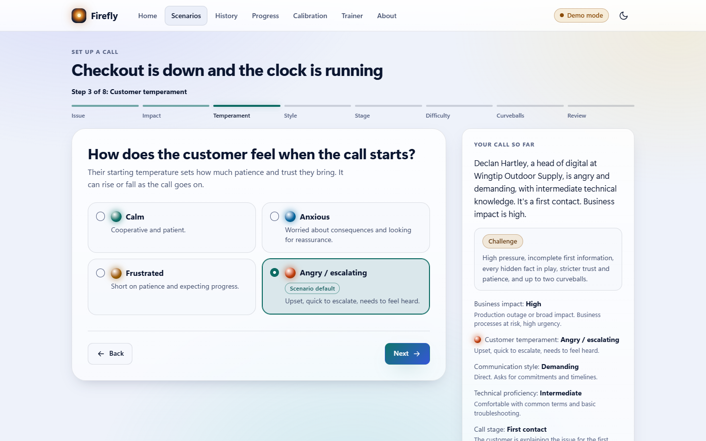
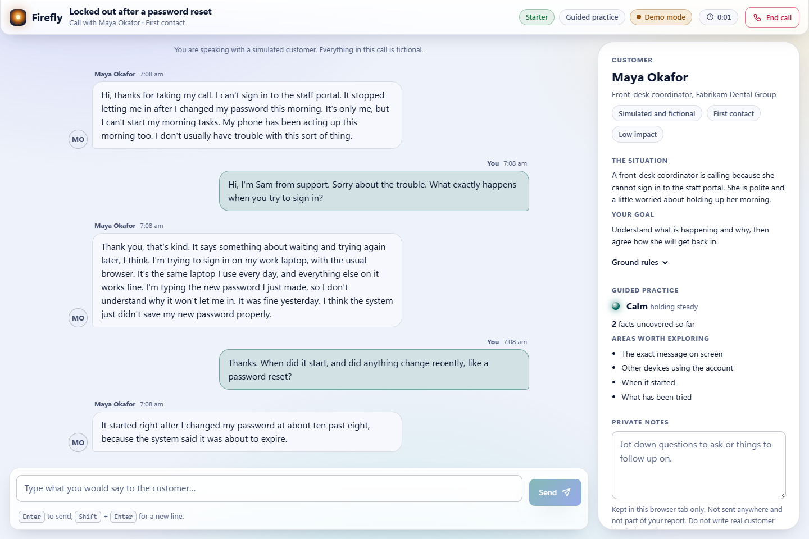
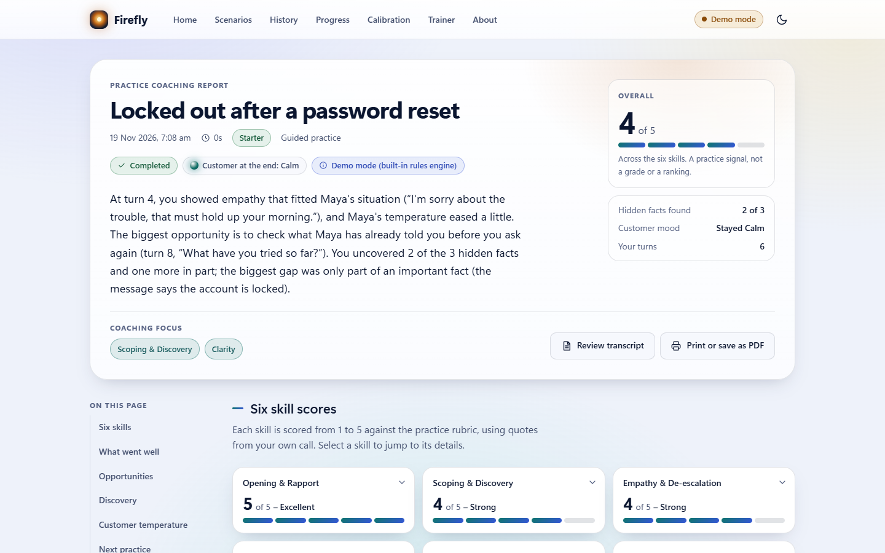
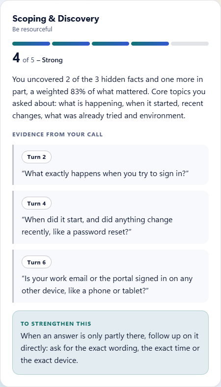
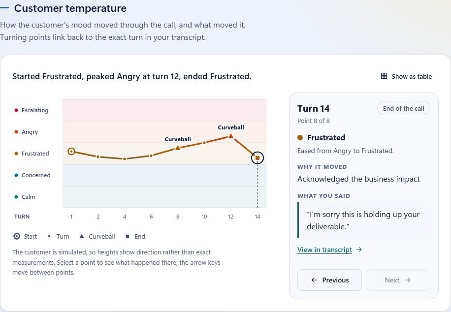
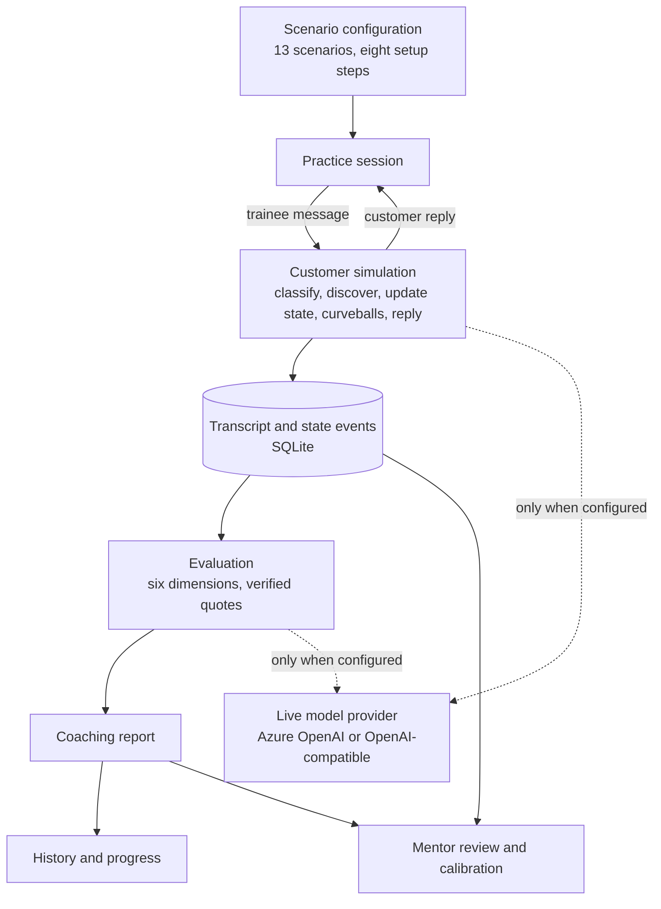

# Firefly

**Practice difficult customer conversations before they become real ones.**

[](https://github.com/snowjug/Firefly/actions/workflows/ci.yml?query=branch%3Afeature%2Ffirefly-end-to-end-product)
[](package.json)

Firefly is a customer-call training simulator for new technical support engineers and apprentices. It provides a safe environment where trainees can configure fictional support scenarios, practise conversations with an adaptive simulated customer and receive evidence-based coaching.

Technical knowledge alone does not make a good support experience, and learning conversation skills on live cases puts real customers at risk. Firefly lets trainees rehearse first.

| Status              | Detail                                                                                                              |
| ------------------- | ------------------------------------------------------------------------------------------------------------------- |
| Application         | Working. Implemented on the `feature/firefly-end-to-end-product` branch, which has not yet been merged into `main`. |
| Demo mode           | Available locally. No credentials needed: a built-in rules engine plays the customer and writes the coaching.       |
| Live model provider | Optional (Azure OpenAI or an OpenAI-compatible endpoint). Implemented, but tested only against a local fake server. |
| Deployment          | Not deployed. Firefly runs on your own machine.                                                                     |

```bash
git clone https://github.com/snowjug/Firefly.git
cd Firefly
git checkout feature/firefly-end-to-end-product
npm ci
npm run build
npm start
```

Then open <http://127.0.0.1:8787>. You need Node.js 24 or newer. [Getting started](#getting-started) covers development mode, live providers and tests.

## About Firefly

Firefly is an FY27 apprentice team project. It focuses on customer-handling and support-conversation skills, and it is product-agnostic: it does not teach the details of any one product. It helps trainees practise safely before they handle real customers.

All scenarios are fictional and every customer detail is synthetic. Firefly is a coaching tool, not an employee-performance assessment system. Its scores are practice signals that help a trainee choose what to work on next.

## Why Firefly?

Technical knowledge alone does not guarantee a strong support experience. Trainees also have to learn to:

- open calls professionally
- establish business impact
- scope unclear issues
- ask focused discovery questions
- communicate without unnecessary jargon
- handle frustrated or escalating customers
- take ownership
- set expectations
- agree on next steps
- close calls professionally

Practising these skills only on live cases creates risk for customers and delays useful feedback. Firefly gives trainees a place to rehearse as often as they like, and shows them where a call went well or badly, in their own words.

## What Firefly Does

**Configure → Simulate → Adapt → Evaluate → Improve**

| Stage         | What happens                                                                                                                                                                                                              |
| ------------- | ------------------------------------------------------------------------------------------------------------------------------------------------------------------------------------------------------------------------- |
| **Configure** | Choose one of 13 fictional scenarios and set its business impact, customer temperature, technical proficiency, communication style, call stage and difficulty, with optional curveballs. A live summary shows the result. |
| **Simulate**  | Read a pre-call brief, then hold an unscripted text conversation with a simulated customer. The brief never shows hidden facts.                                                                                           |
| **Adapt**     | The customer's mood, trust and patience move with what the trainee says. Hidden facts appear only for relevant questions, and a curveball may land mid-call.                                                              |
| **Evaluate**  | Ending the call produces a coaching report: six scored skills with verified quotes, strengths, improvements with alternative phrasing, a discovery review and a mood timeline.                                            |
| **Improve**   | Reopen any report from History, follow quotes into the transcript, check Progress for trends and a suggested focus, and take the suggested next scenario.                                                                 |

## Key Features

| Area                                                            | Status                                                                                                           |
| --------------------------------------------------------------- | ---------------------------------------------------------------------------------------------------------------- |
| Scenario library, setup, brief and live call                    | Implemented and verified by browser tests                                                                        |
| Customer simulation, hidden facts, curveballs                   | Implemented and verified (rules engine in demo mode)                                                             |
| Coaching reports with verified quotes                           | Implemented and verified (rules evaluator in demo mode)                                                          |
| History, Progress and transcript review                         | Implemented and verified                                                                                         |
| Mentor review and calibration tooling                           | Implemented and verified. No real mentor data exists yet.                                                        |
| Trainer tools                                                   | Implemented and verified                                                                                         |
| Live Azure OpenAI or OpenAI-compatible provider                 | Implemented. Requires credentials. Tested only against a local fake server; not verified against a real service. |
| Accessibility                                                   | Automated checks and keyboard tests pass. No screen-reader validation.                                           |
| Hosted deployment, voice simulation, trainer-authored scenarios | Not implemented (future work)                                                                                    |

### Configurable Scenarios

There are 13 fictional scenarios (4 Starter, 5 Standard, 4 Challenge) across 7 issue types. Each can be reconfigured before a call through an eight-step setup, and the settings used are stored with the session so a call can be replayed and evaluated as it was configured. See [Scenario Model](#scenario-model). Every scenario is checked by `npm run validate:scenarios` and the library tests, which fail if a hidden fact cannot be found or leaks into the customer's opening.

### Adaptive Customer Simulation

In demo mode the customer is produced by a deterministic rules engine. It classifies what the trainee did (empathy, ownership, next steps, jargon, blame, focused questions and more), updates the customer's state, and composes a reply grounded in the scenario's persona, communication style, proficiency and the facts the customer is allowed to share.

- **Customer state.** Seven bounded values (0-100), among them temperature, trust, patience, confidence and urgency, changed only by explicit rules. Trainees see the mood in words (Calm, Concerned, Frustrated, Angry, Escalating) and its trend, never the numbers.
- **Behaviour that matters.** Specific empathy, acknowledging impact, clear ownership and focused questions help. Blame, dismissal, unexplained jargon, repeated questions and premature fixes hurt.
- **Practice modes.** Guided practice shows light cues (mood, facts found, areas worth exploring). Immersive practice shows none.

### Hidden-Fact Discovery

Each scenario holds facts the customer reveals only when asked an appropriate question. Some also need enough trust or an acknowledgement of the impact first. After the call, the report lists which facts were found, partly found or missed, the question that revealed each, and a better question for any that were missed.

### Controlled Curveballs

Curveballs are optional. There are eight types: asks for a manager, threatens to cancel, imposes a deadline, changes the issue, goes quiet, mentions a bad experience, demands a guarantee and challenges credibility. Each fires deterministically when its conditions are met (a window of turns plus a state condition, such as ownership still being unclear), and the report says how the trainee handled it.

### Evidence-Based Coaching

Each report scores six dimensions from 1 to 5 and includes:

- a rationale for every score, with verified quotes from the trainee's own turns wherever there is something to quote
- strengths and improvement opportunities, with alternative phrasing and why it works
- discovery results, including what the customer held back
- a customer temperature timeline with turning points linked to the transcript
- an assessment of any curveball and one suggested next practice target

Short calls say that the report rests on limited evidence. See [Coaching Dimensions](#coaching-dimensions).

### History and Progress

- **History** stores individual practice sessions. Filter them, reopen a report or transcript, compare two sessions or delete one.
- **Progress** shows coaching trends across completed sessions: score trends for each skill, recent change, strongest skill, a suggested focus with the reason, and opportunities that keep repeating.

Progress is for personal coaching. It shows practice signals from a handful of calls, not an assessment of the trainee, and nothing is ever compared with other people. Firefly has no leaderboard or ranking.

### Calibration

A mentor can score a completed session from its transcript alone and then see how the AI's scores compared. The Calibration page shows how closely the two sets of scores agree, with warnings when there are too few reviews. `npm run calibrate` compares scores kept in files. See [Evaluation and Calibration](#evaluation-and-calibration). No real mentor review data exists yet.

### Trainer Tools

The Trainer page offers a spotlight scenario, a quick start, a demo checklist, the provider status, labelled sample sessions (load and remove) and confirmed resets of practice data.

### Demo and Live Provider Modes

|                     | Demo mode (default)                                                | Live mode (optional)                                                               |
| ------------------- | ------------------------------------------------------------------ | ---------------------------------------------------------------------------------- |
| Set with            | `FIREFLY_PROVIDER=mock`, or leave it unset                         | `FIREFLY_PROVIDER=azure-openai` or `openai-compatible`                             |
| Credentials         | None                                                               | Required (see [Environment Variables](#environment-variables))                     |
| Customer replies    | Rules engine, from phrase banks, scenario facts and customer state | A model, from what the engine has allowed the customer to say in that reply        |
| Turn classification | Rules                                                              | A model                                                                            |
| Coaching            | Rules evaluator                                                    | A model drafts it; the server verifies every quote and caps scores by the evidence |
| Labelled in the app | "Demo mode (built-in rules engine)"                                | The configured provider                                                            |
| Status              | Verified                                                           | Implemented; tested only against a local fake server                               |

If a live provider is requested but its variables are incomplete, Firefly starts in demo mode and prints a notice that names the missing variables (verified). Customer state, discovery, curveballs and the checks on the report stay in code in both modes. Details are in [docs/ai-providers.md](docs/ai-providers.md).

## How a Simulation Works

1. **Select a scenario** in the library, using search and filters.
2. **Configure the customer and difficulty** in the eight-step setup, or keep the defaults.
3. **Review the pre-call brief**: the situation, your goal, the ground rules and the settings. Hidden facts are never shown.
4. **Start the conversation.** Type in your own words; nothing is scripted.
5. **Ask discovery questions**: what is happening, when it started, what changed, who is affected, what the screen says, what was tried and what it means for the business.
6. **Respond to changing behaviour and curveballs.** Acknowledge impact, take ownership and notice what moves the customer's mood.
7. **End the call.** Firefly asks for confirmation, locks the transcript and shows the stage of evaluation it has actually reached.
8. **Review the coaching report** and follow quotes into the transcript.
9. **Reopen the session through History** whenever you need it.
10. **Track development through Progress.**

## Scenario Model

| Parameter             | Purpose                                      | Options                                                                                                            |
| --------------------- | -------------------------------------------- | ------------------------------------------------------------------------------------------------------------------ |
| Issue type            | Defines the fictional support problem        | Sign-in or access, service outage, slow performance, data missing, billing or licence, how-to, feature not working |
| Business impact       | Controls customer urgency                    | Low, medium, high                                                                                                  |
| Customer temperature  | Establishes starting behaviour               | Calm, anxious, frustrated, angry / escalating                                                                      |
| Technical proficiency | Controls vocabulary and technical depth      | Novice, intermediate, expert                                                                                       |
| Communication style   | Changes how the customer communicates        | Talkative, terse, demanding, vague, non-native English speaker                                                     |
| Call stage            | Establishes expectations and prior history   | First contact, follow-up, escalated, closure                                                                       |
| Hidden facts          | Tests discovery and scoping                  | Defined per scenario. Starter has fewer in play and clearer clues; Challenge puts every fact in play.              |
| Curveballs            | Introduces controlled complications          | Eight types. Up to one at Starter (off by default) and Standard, up to two at Challenge.                           |
| Difficulty            | Bundles scenario complexity                  | Starter, Standard, Challenge                                                                                       |
| Practice mode         | Sets how many cues are shown during the call | Guided (the Starter default) or immersive (the Standard and Challenge default)                                     |

Difficulty also sets the customer's starting trust and patience, how strongly good and bad behaviour moves them and how readily they volunteer context. Scenarios are written as TypeScript files; see [docs/scenario-authoring.md](docs/scenario-authoring.md).

## Coaching Dimensions

Scores are whole numbers from 1 (not demonstrated) to 5 (excellent). The overall score is the mean of the six, rounded to one decimal place, and is left out when the call was too short to judge.

| #   | Dimension               | What it looks at                                                         | CARE behaviour (working mapping) |
| --- | ----------------------- | ------------------------------------------------------------------------ | -------------------------------- |
| 1   | Opening & Rapport       | Greeting, introduction, an open question, early connection               | Communicate, Be empathetic       |
| 2   | Scoping & Discovery     | Focused questions, hidden facts found, core topics covered               | Be resourceful                   |
| 3   | Empathy & De-escalation | Specific empathy, acknowledging impact, how the customer's mood moved    | Be empathetic                    |
| 4   | Clarity                 | Plain language, jargon explained, recap and check-ins                    | Communicate                      |
| 5   | Ownership & Next Steps  | Clear ownership, specific next steps with a time, realistic promises     | Be accountable                   |
| 6   | Closing                 | Recap of what was agreed, next contact confirmed, anything else, goodbye | Be accountable, Communicate      |

- **Evidence rules.** A 4 needs one verified quote and a 5 needs two. Quotes are checked against the trainee turn they cite before a report is saved.
- **Never penalised.** Short messages, grammar, spelling, an accent or non-native phrasing never lower a score.
- **Limited evidence.** Short calls are labelled as resting on limited evidence.
- **CARE mapping.** The rubric maps the dimensions loosely to the four CARE behaviours (communicate effectively, be accountable, be resourceful, be empathetic). It is a working aid for coaching conversations, not an official standard.

The full rules are in [docs/evaluation-rubric.md](docs/evaluation-rubric.md).

## Screenshots

Captured from a local demo-mode run with fictional data, in the light theme. Firefly also has a dark theme.

**Setting up a call.** The eight-step setup, with a live summary of the customer being built.



**A call in progress.** Guided practice shows the briefing, a mood cue and the areas still worth exploring.



**The coaching report.** A summary, the overall practice signal, the discovery count and the six skill scores.



**Evidence behind a score.** Each score has a rationale and, where there is something to quote, quotes from the trainee's own turns.



**How the customer's mood moved.** Turning points and curveballs are linked to the turn that caused them.



## Architecture



Firefly is a single Node.js process. It serves a JSON API and the built web app, and keeps everything in a local SQLite file.

- **Frontend.** A React single-page app with one route per screen (Home, Scenarios, Setup, Brief, Call, Report, Transcript, History, Progress, Calibration, Trainer, About and Settings).
- **Server and API.** A hand-written router on `node:http`, with a strict Content-Security-Policy, same-origin checks on writes and rate limits. There is no sign-in; each browser gets an anonymous cookie that scopes its own history.
- **Simulation.** A deterministic rules engine runs every turn: classify, apply discovery rules, update the bounded customer state, check curveball triggers, then compose the reply. The trainee's message is saved before the reply, so a failed reply loses nothing and a retry creates no duplicate.
- **Evaluator.** Scores the transcript and the engine's records, verifies every quote and builds the report. Ending a call is a real state change with phases, and exactly one report is saved.
- **Live model provider.** Optional and off by default. A model can classify turns, write replies and draft the coaching, but the state, discovery, curveballs and checks stay in code.
- **Persistence.** SQLite through `node:sqlite`, with versioned migrations. Transcripts, state events, reports and mentor reviews are stored locally.
- **Browser tests.** Playwright runs against the production build with an in-memory database.

See [docs/architecture.md](docs/architecture.md) for the full picture.

## Tech Stack

| Layer          | Technology                                                                                                 |
| -------------- | ---------------------------------------------------------------------------------------------------------- |
| Frontend       | React 19, React Router 7, Vite 8, TypeScript 5.9 (strict)                                                  |
| Server and API | Node.js 24 or newer running TypeScript directly, `node:http` (no web framework), zod 4 for validation      |
| Simulation     | Deterministic TypeScript rules engine in `server/engine` (classifier, discovery, state, curveballs)        |
| AI provider    | Built-in demo provider by default. Optional Azure OpenAI or OpenAI-compatible chat completions via `fetch` |
| Styling        | Plain CSS on design tokens, light and dark themes, no UI framework                                         |
| Testing        | Vitest 5 with Testing Library and jsdom; Playwright 1.65 with axe-core                                     |
| Code quality   | ESLint 9 (typescript-eslint, jsx-a11y, react-hooks) and Prettier 3                                         |
| CI             | GitHub Actions                                                                                             |
| Storage        | SQLite file through `node:sqlite`                                                                          |

## Project Structure

```text
Firefly/
├── server/                 Node.js server, written in TypeScript
│   ├── engine/             Simulation engine and the demo-mode customer
│   ├── scenarios/          Scenario registry and the 13 built-in scenarios
│   ├── evaluator/          Coaching evaluator and verification of model drafts
│   ├── providers/          Demo and live model providers
│   ├── prompts/            Versioned prompts used in live mode
│   ├── services/           Sessions, progress, calibration, sample data
│   ├── db/                 SQLite schema, migrations and queries
│   └── http/               Router, API routes, security, static files
├── shared/domain/          Types, schemas and pure logic shared by server and web
├── web/                    React single-page app (pages, components, styles)
├── e2e/                    Playwright browser tests
├── calibration/samples/    Invented example records for the calibration tool
├── scripts/                Dev runner, scenario validation, calibration CLI, secret and lockfile checks
├── docs/                   Architecture, rubric, providers, calibration, design system, demo guide
│   └── images/             Screenshots used in this README
├── .github/workflows/      Continuous integration
├── .env.example            Configuration template with placeholders only
└── package.json            Scripts and dependencies. The tool configs (vite, vitest, playwright, eslint, tsconfig) sit beside it.
```

## Getting Started

### Prerequisites

- **Node.js 24 or newer.** This is the `engines` requirement in `package.json`, because the server runs TypeScript directly and uses the built-in `node:sqlite`. Checked on Node.js 24.22.2 (CI) and 26.13.1 (local development). Older versions are not supported.
- **npm**, which comes with Node.js.
- **No credentials** for demo mode.
- **A Chromium-based browser** only if you run the browser tests (see [Test](#test)).

### Clone the Repository

```bash
git clone https://github.com/snowjug/Firefly.git
cd Firefly
git checkout feature/firefly-end-to-end-product
```

The `git checkout` line is needed only while this work is not merged into `main`. Drop it once it is.

### Install Dependencies

```bash
npm ci
```

### Run in Demo Mode

```bash
npm run build
npm start
```

No credentials are needed. Open <http://127.0.0.1:8787>. The badge at the top right of the app says "Demo mode". Data is kept in `data/firefly.db`, which is git-ignored.

### Configure a Live Provider

Copy `.env.example` to `.env` (also git-ignored) and fill in **one** provider. Use your own values; never commit real keys.

For Azure OpenAI:

```bash
FIREFLY_PROVIDER=azure-openai
AZURE_OPENAI_ENDPOINT=<https://your-resource.openai.azure.com>
AZURE_OPENAI_API_KEY=<your-api-key>
AZURE_OPENAI_DEPLOYMENT=<your-deployment-name>
AZURE_OPENAI_API_VERSION=<api-version>
```

For any OpenAI-compatible chat-completions endpoint:

```bash
FIREFLY_PROVIDER=openai-compatible
FIREFLY_LLM_BASE_URL=<https://your-endpoint/v1>
FIREFLY_LLM_API_KEY=<your-api-key>
FIREFLY_LLM_MODEL=<model-name>
```

The live path has not been validated against a real service. Run the smoke test in [docs/ai-providers.md](docs/ai-providers.md) with your own credentials before relying on it.

### Start the Application

| Goal                    | Command                           | Opens at                                                                                  |
| ----------------------- | --------------------------------- | ----------------------------------------------------------------------------------------- |
| Use the built app       | `npm run build`, then `npm start` | <http://127.0.0.1:8787>                                                                   |
| Develop with hot reload | `npm run dev`                     | <http://localhost:5173> (the API runs on port 8787 and restarts when server files change) |

If port 8787 is busy, set `FIREFLY_PORT`. Firefly has no sign-in, so keep `FIREFLY_HOST` on its loopback default.

### Build

```bash
npm run build
```

This writes the production web app to `dist/web`.

### Test

| Purpose                                | Command                                                     |
| -------------------------------------- | ----------------------------------------------------------- |
| Everything below plus the build        | `npm run check`                                             |
| Unit, component and API tests          | `npm test`                                                  |
| Browser tests, including accessibility | `npm run test:e2e`                                          |
| Scenario validation                    | `npm run validate:scenarios`                                |
| Calibration on the bundled sample data | `npm run calibrate`                                         |
| Secret scan                            | `npm run check:secrets`                                     |
| Lockfile and registry check            | `npm run check:lockfile`                                    |
| Format, lint and type checks           | `npm run format:check`, `npm run lint`, `npm run typecheck` |

`npm run check` runs formatting, lint, types, scenario validation, tests, the build, the secret scan and the lockfile check in that order. Browser tests need a browser: install Playwright's with `npx playwright install chromium`, or reuse an installed Edge or Chrome by setting `PW_CHANNEL=msedge` (in PowerShell: `$env:PW_CHANNEL = 'msedge'`). See [docs/troubleshooting.md](docs/troubleshooting.md) if anything does not start.

## Environment Variables

Firefly loads `.env` at startup, and variables already in the environment win. Nothing is required for demo mode.

| Variable                                                                                               | Required                         | Purpose                                                                                                                         |
| ------------------------------------------------------------------------------------------------------ | -------------------------------- | ------------------------------------------------------------------------------------------------------------------------------- |
| `FIREFLY_PROVIDER`                                                                                     | No (default `mock`)              | `mock` (demo mode), `azure-openai` or `openai-compatible`                                                                       |
| `AZURE_OPENAI_ENDPOINT`, `AZURE_OPENAI_API_KEY`, `AZURE_OPENAI_DEPLOYMENT`, `AZURE_OPENAI_API_VERSION` | Only with `azure-openai`         | Azure OpenAI chat-completions deployment                                                                                        |
| `FIREFLY_LLM_BASE_URL`, `FIREFLY_LLM_API_KEY`, `FIREFLY_LLM_MODEL`                                     | Only with `openai-compatible`    | Any OpenAI-compatible chat-completions endpoint                                                                                 |
| `FIREFLY_LLM_TIMEOUT_MS`                                                                               | No (default `30000`)             | Timeout for each model call                                                                                                     |
| `FIREFLY_LLM_MAX_RETRIES`                                                                              | No (default `1`, at most `3`)    | Retries for a failed model call                                                                                                 |
| `FIREFLY_PORT`                                                                                         | No (default `8787`)              | Port the server listens on                                                                                                      |
| `FIREFLY_HOST`                                                                                         | No (default `127.0.0.1`)         | Address the server listens on. Keep it on loopback: there is no sign-in.                                                        |
| `FIREFLY_DB_PATH`                                                                                      | No (default `./data/firefly.db`) | SQLite file. `:memory:` keeps data in memory.                                                                                   |
| `FIREFLY_LOG_LEVEL`                                                                                    | No (default `info`)              | `info`, `warn`, `error` or `silent`. Logs never contain transcripts.                                                            |
| `FIREFLY_MOCK_DELAY_MS`                                                                                | No (default `700`)               | Pause before demo-mode replies so the typing state is visible                                                                   |
| `FIREFLY_TEST_HOOKS`, `FIREFLY_DEV_DIAGNOSTICS`                                                        | No (off)                         | Failure injection and internal diagnostics for tests. Never enable on a shared host.                                            |
| `PW_CHANNEL`, `E2E_PORT`, `E2E_BASE_URL`                                                               | No (tests only)                  | Playwright: browser channel such as `msedge`, test server port (default `4321`), or the URL of a server that is already running |

## Example Training Session

This illustration was written for this document. It is not taken from a built-in scenario, so it gives nothing away about the scenarios in the library.

| Setting               | Value                                                              |
| --------------------- | ------------------------------------------------------------------ |
| Issue                 | Production service unavailable (a customer-facing booking service) |
| Business impact       | High                                                               |
| Starting temperature  | Frustrated                                                         |
| Technical proficiency | Intermediate                                                       |
| Communication style   | Demanding                                                          |
| Difficulty            | Challenge                                                          |

- **What the trainee is told.** The pre-call brief says a fictional operations lead is calling because clients cannot make bookings. It gives the trainee a goal: find out what is happening and who is affected, take ownership, and agree what happens next and when. It never lists hidden facts.
- **A hidden fact.** Suppose the customer's team raised the same errors in a case yesterday and it was closed without a fix. The customer will not mention it unprompted. It comes out only if the trainee asks something like "Has anyone contacted support about this already?"
- **A possible curveball.** A few turns in, if no one has taken ownership, the customer may ask for a manager. The report later says whether the trainee acknowledged the request, explained what they would do and offered a route.
- **How feedback is produced.** When the trainee ends the call, Firefly locks the transcript, reviews which hidden facts were found, scores the six dimensions and builds a report. Each score is explained and, where there is something to quote, cites quotes from the trainee's own turns. The report names any fact that was missed together with a better question to ask, shows how the customer's temperature moved and suggests one thing to practise next.

## Responsible AI and Data Safety

Firefly is a training aid.

- **Fictional data only.** Use fictional and synthetic customer information. Do not enter real customer names, case details, logs, screenshots or identifiers.
- **Best-effort redaction.** Emails, phone numbers, long numbers and identifiers are removed from messages before they are saved or sent to a model, and the call screen warns before you send something that looks like one. This is pattern matching, so it will not catch everything.
- **Coaching can be wrong.** AI-generated coaching can be incomplete or wrong. Review it with a mentor.
- **Practice, not assessment.** Scores are for practice and must not be treated as employee-performance assessments. Firefly never ranks or compares colleagues.
- **Honest labelling.** Demo mode is always labelled and never presented as a model. Quotes are verified against the transcript, and short calls say their reports rest on limited evidence.
- **Controlled model use.** A live model is given only what the engine has decided the customer may say in that reply. Model output is validated and shown as plain text, and API keys stay on the server.
- **No telemetry.** There are no accounts, analytics or tracking. Logs contain short ids and timings, never transcripts. With a live provider, redacted transcripts go to the endpoint you configure.
- **Secrets stay out of Git.** Never commit secrets. `.env` is git-ignored, `.env.example` holds placeholders only and `npm run check:secrets` scans for common patterns.

Firefly makes no compliance or certification claims. Data lives in a local SQLite file that Firefly does not encrypt. The full picture is in [docs/responsible-ai.md](docs/responsible-ai.md).

## Evaluation and Calibration

**How scores are produced.** In demo mode a rules evaluator reads the classified transcript and the engine's records and scores each dimension. With a live provider a model drafts the scores and wording, and the server then verifies every quote against the turn it cites, caps scores by the evidence, and builds discovery, the mood timeline, the curveball assessment and the overall score itself.

**How transcript evidence is used.** Every quoted moment is a real excerpt from a trainee turn and links to that turn in the transcript. A quote that cannot be found is dropped, and a score cannot rise above what its verified quotes support.

**How mentors score sessions.** On the Calibration page a mentor picks a completed session that has no review yet and scores the six dimensions from 1 to 5 using only the transcript and the rubric scale. The review screen never loads the AI's scores or the report, and the review queue does not carry them either. After saving, the page shows the AI's scores beside the mentor's. This blindness is a process aid, not an access control: anyone using the app can open a report from History, so mentors should score before they read it.

**How the calibration command works.** `npm run calibrate` reads records from `calibration/samples/` by default, or from the files you give it (`npm run calibrate -- path/to/records.json`). It prints the mean absolute difference, the share of scores within one point and any consistent over- or under-scoring, overall and per dimension. The file format is described in [docs/calibration.md](docs/calibration.md).

**What calibration currently proves.** Nothing yet about real-world agreement. The only records in the repository are six invented examples, all marked as samples, and the tool says so and warns when there are fewer than 20 reviews. The tool, the file format and the in-app flow work; there is no real mentor data.

**What remains unvalidated.** Agreement between the evaluator and real mentors, and the quality of coaching from a real live model. Treat every score as a starting point for a conversation.

## Quality and Testing

Verified on 19 November 2026 against the code at commit `55e73d5`, with Node.js 26.13.1 locally. The same checks run in GitHub Actions on Node.js 24.22.2; [run 44402961242](https://github.com/snowjug/Firefly/actions/runs/44402961242) passed for that commit.

| Check                         | Command                      | Result                                                                                                                   |
| ----------------------------- | ---------------------------- | ------------------------------------------------------------------------------------------------------------------------ |
| Formatting, lint and types    | `npm run check`              | Pass                                                                                                                     |
| Scenario validation           | `npm run validate:scenarios` | 13 scenarios loaded, all valid                                                                                           |
| Unit, component and API tests | `npm test`                   | 888 tests in 39 files pass (742 in the server and shared project, 146 in the web project)                                |
| Production build              | `npm run build`              | Pass                                                                                                                     |
| Browser tests                 | `npm run test:e2e`           | 24 pass (22 desktop, 2 phone viewport)                                                                                   |
| Accessibility                 | Part of the browser tests    | axe-core (WCAG 2.0, 2.1 and 2.2 A and AA rules) found no serious or critical violations on 19 page states in both themes |
| Layout and motion             | Part of the browser tests    | No sideways scroll at 320 px or 1440 px; reduced motion honoured from the device and the app                             |
| Secret scan and lockfile      | `npm run check`              | No findings; all resolved URLs use the public registry                                                                   |
| Dependency audit              | GitHub Actions (advisory)    | 0 vulnerabilities in production dependencies                                                                             |

The full dependency tree reports 7 moderate findings, all one `minimatch` advisory reached through `typescript-eslint`. That package is development tooling for linting and is not part of the running application. No stable patched release exists yet, so it has been left as it is.

## Current Limitations

- The live provider has not been validated against a real Azure OpenAI or other service. It was tested only against a local fake server.
- No real mentor calibration dataset exists, so nothing is known about how closely the scores agree with people.
- Accessibility is checked by automated tools and keyboard tests only. Nobody has tested with a screen reader.
- Demo mode is pattern-based. It can miss unusual phrasing, so it is less flexible than a person or a model.
- Firefly is not deployed. There is no hosting configuration.
- It has no sign-in, so keep it on a trusted network. Text and English only; there is no voice.
- The repository has no LICENSE file.

## Roadmap

✅ **Available**

- 13 configurable scenarios with setup, brief and live call
- Adaptive demo-mode customer with hidden facts and curveballs
- Evidence-based coaching reports with a mood timeline
- History, Progress and transcript review
- Blind mentor review and calibration tooling
- Trainer tools and labelled sample sessions
- Live-provider integration (tested against a fake server only)

🚧 **In progress**

- Getting this branch reviewed and merged into `main`

🔭 **Future possibilities**

- Validating a live provider against a real service
- Collecting real mentor reviews to calibrate the scores
- A hosted deployment for panel demonstrations
- Voice simulation
- Richer trainer scenario authoring
- Deeper accessibility validation with assistive technology

The future items are possibilities, not commitments.

## Documentation

| Document                                                 | Contents                                                        |
| -------------------------------------------------------- | --------------------------------------------------------------- |
| [docs/architecture.md](docs/architecture.md)             | Components, data flow, persistence, API, security               |
| [docs/evaluation-rubric.md](docs/evaluation-rubric.md)   | How each dimension is scored and what is never penalised        |
| [docs/ai-providers.md](docs/ai-providers.md)             | Configuring a live model, what is sent to it, failure behaviour |
| [docs/calibration.md](docs/calibration.md)               | Comparing AI and mentor scores                                  |
| [docs/scenario-authoring.md](docs/scenario-authoring.md) | Writing and testing scenarios                                   |
| [docs/responsible-ai.md](docs/responsible-ai.md)         | Safeguards and limits                                           |
| [docs/design-system.md](docs/design-system.md)           | Tokens, components, accessibility checklist                     |
| [docs/demo-guide.md](docs/demo-guide.md)                 | A 20-minute demo runbook                                        |
| [docs/troubleshooting.md](docs/troubleshooting.md)       | Common problems                                                 |

## Contributing

1. **Branch from the correct base.** Until the end-to-end work is merged, branch from `feature/firefly-end-to-end-product`. After that, branch from `main`.
2. **Make focused changes.** One idea per pull request.
3. **Run the checks.** `npm run check`, plus `npm run test:e2e` for anything visible, and try the change in the browser.
4. **Open a pull request** that says what changed, why and how you tested it.
5. **Update the docs** whenever behaviour changes.

[CONTRIBUTING.md](CONTRIBUTING.md) has the conventions. Use fictional data only and never commit secrets.

## Team

Firefly is a collaborative FY27 apprentice project. See the [GitHub contributors page](https://github.com/snowjug/Firefly/graphs/contributors) for the people who have contributed.

## License

This repository does not currently specify a software license.
