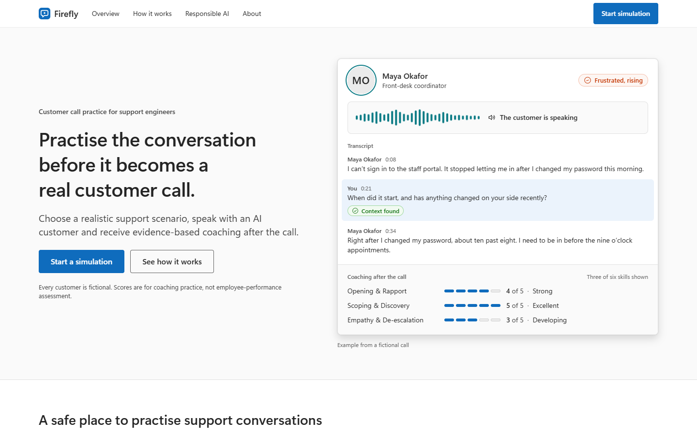
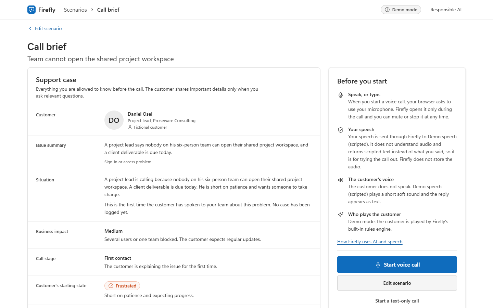
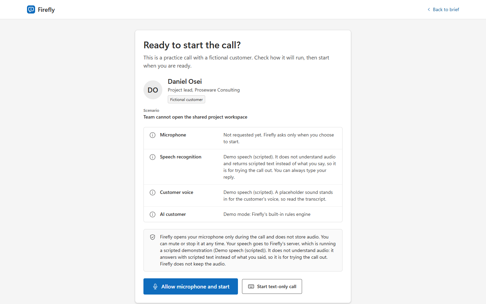
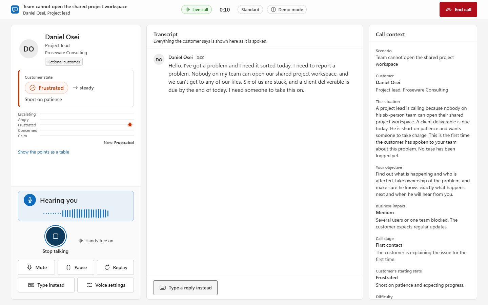
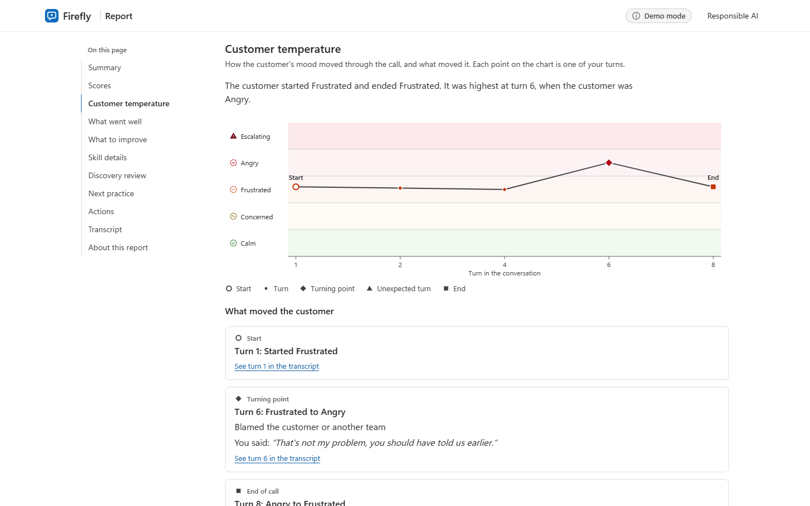
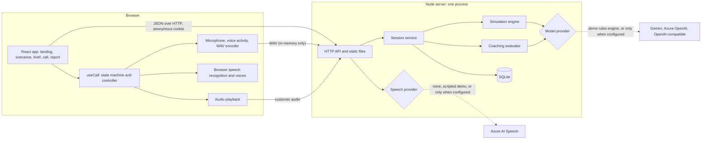

# Firefly

**Practise difficult customer conversations before they become real ones.**

Firefly is a call simulator for new technical support engineers and apprentices. Choose a fictional scenario, speak (or type) with a simulated customer, end the call, and read coaching that quotes what you actually said. It trains the conversation, not a product: opening a call, scoping an unclear problem, handling a frustrated customer, taking ownership and agreeing next steps.



> **Status.** A working prototype for practice and demonstration. Every customer, organisation and scenario is fictional. Scores are coaching feedback, not an assessment of a person. Firefly is **not deployed** anywhere and has no sign-in. Live speech through Azure AI Speech is built but has **not been verified against the real service**: see [What is verified](#what-is-verified-and-what-is-not).

## Contents

[Why Firefly](#why-firefly) · [The journey](#the-journey) · [What you can do today](#what-you-can-do-today) · [Voice and demo modes](#voice-and-demo-modes) · [Run it](#run-it) · [Configuration](#configuration) · [Architecture](#architecture) · [Privacy and Responsible AI](#privacy-and-responsible-ai) · [Testing](#testing-and-quality) · [What is verified](#what-is-verified-and-what-is-not) · [Documentation](#documentation) · [Contributing](#contributing)

## Why Firefly

Technical knowledge alone does not make a good support experience. New engineers also have to scope unclear problems, understand business impact, explain clearly, calm a frustrated customer, take ownership and set expectations. Learning that only on real cases is hard, because every mistake lands on a real customer.

Firefly gives them somewhere safe to repeat it: the same situation at a different difficulty, a customer who only shares important details when asked the right question, and feedback tied to the exact words that were said.

## The journey

Landing, scenario, brief, call, report. Nothing else.

| Step | What happens                                                                                                                                                                                            |
| ---- | ------------------------------------------------------------------------------------------------------------------------------------------------------------------------------------------------------- |
| 1    | **Choose a scenario.** Thirteen fictional scenarios, grouped by kind of issue, with search and filters. Change difficulty, impact, the customer's mood and style, the call stage, curveballs and hints. |
| 2    | **Read the call brief.** Everything you are allowed to know before the call, and what the chosen speech set-up will really do. Hidden facts are never shown.                                            |
| 3    | **Hold the call.** Speak or type. The customer's mood moves with what you say, and they share important details only when you ask relevant questions.                                                   |
| 4    | **End the call** when you are ready. The microphone and any customer audio stop, the transcript is saved and the report is built.                                                                       |
| 5    | **Read the coaching report.** Six skills scored with quoted evidence, what went well, what to try instead, which hidden facts you found or missed, how the mood moved, and one next target.             |

|                                                         |                                                        |
| ------------------------------------------------------- | ------------------------------------------------------ |
|         |                    |
| _Choose and configure a scenario_                       | _Read the call brief_                                  |
|      |      |
| _Check what speech will really do before the call_      | _A spoken call, in demo mode_                          |
|  |  |
| _A demo call continued by typing, with the mood chart_  | _The report that follows every call_                   |

The pictures were taken from a running copy in demo mode with `scripts/readme-screenshots.mjs`. The "customer" in them is Firefly's built-in rules engine and the "voice" is the scripted demo speech provider; see [Voice and demo modes](#voice-and-demo-modes). The picture at the top is the landing page, whose example call is an illustration written for that page, not a recording.

## What you can do today

Everything here exists in the repository and is covered by automated tests, unless it says otherwise.

### Scenarios

Thirteen synthetic scenarios across seven kinds of issue, each with a persona, a business impact, a starting mood, a communication style and four to six hidden facts (fewer are in play at Starter).

| Scenario                                                | Issue type          | Difficulty | Customer starts | Style                      | Minutes |
| ------------------------------------------------------- | ------------------- | ---------- | --------------- | -------------------------- | ------- |
| Locked out after a password reset                       | Sign-in or access   | Starter    | Calm            | Talkative                  | 8       |
| A user needs help finding a feature                     | How-to              | Starter    | Calm            | Terse                      | 7       |
| Dashboard slow on and off, with a workaround            | Slow performance    | Starter    | Anxious         | Vague                      | 8       |
| A new hire has no premium seat                          | Billing or licence  | Starter    | Calm            | Non-native English speaker | 9       |
| Closing out a case where the fix is not fully confirmed | Feature not working | Standard   | Calm            | Talkative                  | 12      |
| Team cannot open the shared project workspace           | Sign-in or access   | Standard   | Frustrated      | Demanding                  | 10      |
| Orders missing from the weekly report                   | Data missing        | Standard   | Frustrated      | Vague                      | 10      |
| Order entry slows down at certain times                 | Slow performance    | Standard   | Anxious         | Talkative                  | 12      |
| Reminders still missing and no update for days          | Feature not working | Standard   | Frustrated      | Terse                      | 9       |
| Checkout is down and the clock is running               | Service outage      | Challenge  | Angry           | Demanding                  | 12      |
| Fourth contact, same failing uploads                    | Feature not working | Challenge  | Angry           | Non-native English speaker | 15      |
| A much bigger invoice than expected                     | Billing or licence  | Challenge  | Frustrated      | Vague                      | 14      |
| A firm diagnosis and a demand to upgrade                | Slow performance    | Challenge  | Frustrated      | Terse                      | 12      |

Each scenario can be reconfigured before the call (the call brief and the report show what was chosen):

| Setting                  | Options                                                                                                                                                                                                 |
| ------------------------ | ------------------------------------------------------------------------------------------------------------------------------------------------------------------------------------------------------- |
| Difficulty               | **Starter**, **Standard**, **Challenge** (see below)                                                                                                                                                    |
| Business impact          | Low, medium, high                                                                                                                                                                                       |
| Customer's starting mood | Calm, anxious, frustrated, angry                                                                                                                                                                        |
| Technical proficiency    | Novice, intermediate, expert                                                                                                                                                                            |
| Communication style      | Talkative, terse, demanding, vague, non-native English speaker                                                                                                                                          |
| Call stage               | First contact, follow-up, escalated, closure                                                                                                                                                            |
| Curveballs               | None, or any the scenario offers of: asks for a manager, threatens to cancel, imposes a deadline, changes the issue, goes quiet, mentions a bad experience, demands a guarantee, challenges credibility |
| Live hints               | On (guided practice) or off (immersive). On by default for Starter only.                                                                                                                                |

| Difficulty    | What changes                                                                                                                   |
| ------------- | ------------------------------------------------------------------------------------------------------------------------------ |
| **Starter**   | Clearer clues, fewer hidden facts, a more cooperative customer, at most one optional curveball; guided practice by default.    |
| **Standard**  | Moderate ambiguity, several hidden facts and one possible curveball. The customer rewards focused questions.                   |
| **Challenge** | High pressure, incomplete first information, every hidden fact in play, stricter trust and patience, and up to two curveballs. |

The scenarios are written in TypeScript and checked by `npm run validate:scenarios` and the library tests. To add one, see [docs/scenario-authoring.md](docs/scenario-authoring.md).

### The customer

- **Mood.** The customer's mood is one of five bands (calm, concerned, frustrated, angry, escalating) with a direction (rising, steady, easing). It moves according to explicit, tested rules: acknowledging the impact and owning the problem calm a customer; blaming, dismissing or telling them to calm down raise tension. A model never decides a number.
- **Hidden facts.** Each scenario holds facts the customer shares only in answer to an appropriate question: what the screen says, when it started, what changed, who is affected. The report later shows which you found, which you only partly found and which you missed, with a better question for each. In guided practice the call shows how many facts have been found, never the facts.
- **Curveballs.** The unexpected turns above can fire during a call, and the report says whether you handled them.
- **Honest limits.** In demo mode the customer is a rules engine, so replies repeat in long calls and are less flexible than a person or a language model.

### The coaching report

Six skills, each scored 1 to 5 against a published rubric, using quotes from your own call: **Opening & Rapport**, **Scoping & Discovery**, **Empathy & De-escalation**, **Clarity**, **Ownership & Next Steps** and **Closing**, loosely mapped to the CARE behaviours (communicate effectively, be accountable, be resourceful, be empathetic).

- **Evidence is checked.** Every quote must be a real part of the turn it cites, or it is dropped. A 4 needs one verified quote and a 5 needs two. A short call says its report rests on limited evidence, and a call of two trainee turns or fewer gets no overall score.
- **Nothing invented.** The report only describes the customer's reaction when the engine recorded it, and never prints internal numbers.
- **What is never penalised:** short messages, a terse style, grammar or spelling, accent or non-native phrasing.
- **Who wrote it is shown.** Demo mode: Firefly's built-in rules evaluator. Live mode: a model drafts the coaching and the server verifies it. Either way it is practice feedback, can be incomplete or wrong, and is meant to be discussed with a mentor.
- **After the call:** a customer-temperature chart (with a table alternative), turning points that link to the transcript, a discovery review, one next practice target with a suggested scenario, a searchable transcript, print styles, and a way to delete the call.



_The customer-temperature section of a report from a demo call. Each point is one of your turns; turning points link to the transcript._

The full rules are in [docs/scoring-rubric.md](docs/scoring-rubric.md).

## Voice and demo modes

A call can be spoken or typed, in every mode. A voice problem never blocks the call: the customer's words are always in the transcript, and typing always works. What a spoken call uses depends on how the server is set up and on the browser, and the pre-flight page says exactly which before anything is requested.

| Set-up                                               | Your speech becomes text by…                                                            | The customer's voice is…                                | Status                                                                                                                                                     |
| ---------------------------------------------------- | --------------------------------------------------------------------------------------- | ------------------------------------------------------- | ---------------------------------------------------------------------------------------------------------------------------------------------------------- |
| `FIREFLY_SPEECH_PROVIDER=azure-speech` (needs a key) | Firefly's server, through Azure AI Speech (the audio is held in memory for one request) | Azure's synthetic voices, chosen by speaker and mood    | Built, and tested against a fake Azure server. **Not verified against live Azure.**                                                                        |
| `FIREFLY_SPEECH_PROVIDER=mock`                       | A scripted demo: it **does not understand audio** and returns the next fixed sentence   | A short placeholder sound, not speech                   | Demo only, for tests and demonstrations.                                                                                                                   |
| Not configured (the default), in Edge or Chrome      | The browser's own speech recognition (Firefly never sees the audio)                     | The browser's own voices                                | Tested with fakes. In automated Edge 158 and Chrome 157 the browser returned no words for a clean test utterance, so real recognition is **not verified**. |
| Not configured, other browsers                       | Typing                                                                                  | The browser's voices if it has them, otherwise captions | Tested.                                                                                                                                                    |

- The microphone is requested only after you press **Allow microphone and start**, can be muted or paused, and is released when you pause, end the call or leave the call screen. Audio is never written to disk, logged or stored. See [docs/privacy-and-audio.md](docs/privacy-and-audio.md).
- Speaking over the customer is **not** implemented: use **Interrupt** or **Talk** to take the turn.
- The customer's voice is synthetic. Pace and pitch (and, for a few Azure voices that support it, a style) are adjusted to suggest their mood. Nobody has measured how that sounds, and Firefly never claims it shows real emotion, clones a voice or analyses yours.
- How it all works, with the state machine, timers and failure handling: [docs/voice-architecture.md](docs/voice-architecture.md).

**Language model.** Separately from speech, the customer and the coaching come from either Firefly's built-in rules engine (**demo mode**, the default, no credentials, labelled "Demo mode" everywhere) or a live model: Google's Gemini API, Azure OpenAI, or any OpenAI-compatible endpoint. Gemini has been run end to end against the real API in a handful of scripted calls; Azure OpenAI and generic endpoints are verified only against a local fake server. See [docs/ai-providers.md](docs/ai-providers.md).

## Run it

You need **Node.js 24 or newer**. Demo mode needs no credentials.

```
git clone https://github.com/snowjug/Firefly.git
cd Firefly
npm ci
npm run dev
```

Open <http://localhost:5173>. `npm run dev` starts the API server (port 8787) and the Vite dev server together, and Vite proxies `/api` to the server.

For a production-style run:

```
npm run build
npm start
```

Then open <http://127.0.0.1:8787>. The server serves the built app and the API from one process and stores calls in a local SQLite file (`data/firefly.db`, git-ignored).

To try a **spoken call without Azure**, run with `FIREFLY_SPEECH_PROVIDER=mock` (in PowerShell: `$env:FIREFLY_SPEECH_PROVIDER='mock'; npm run dev`) and use any microphone: the recognised text will be the scripted demo sentences, not your words. To try the **browser's own speech**, leave the variable unset, use Edge or Chrome, and check what the pre-flight page reports.

| Command                       | What it does                                                                                                         |
| ----------------------------- | -------------------------------------------------------------------------------------------------------------------- |
| `npm run dev`                 | API with file watching plus the Vite dev server                                                                      |
| `npm run build` / `npm start` | Build the web app into `dist/web`; serve it with the API                                                             |
| `npm test`                    | Unit, component and API tests (Vitest)                                                                               |
| `npm run test:e2e`            | Build, then run the browser tests (Playwright)                                                                       |
| `npm run check`               | Everything CI runs: formatting, lint, types, scenario validation, tests, build, budgets, secret scan, lockfile check |
| `npm run validate:scenarios`  | Validate the scenario library and print its coverage                                                                 |

## Configuration

Settings come from environment variables. Firefly loads `.env` on start-up (copy `.env.example`; `.env` is git-ignored), and variables already set in the environment win. Never commit real values. A wrong or incomplete setting never stops the server: the affected feature turns off, and the notice names the variable, never its value.

| Variable                                                                | Default             | Purpose                                                                                  |
| ----------------------------------------------------------------------- | ------------------- | ---------------------------------------------------------------------------------------- |
| `FIREFLY_PORT`, `FIREFLY_HOST`                                          | `8787`, `127.0.0.1` | Where the server listens. Keep the host on loopback: Firefly has no sign-in.             |
| `FIREFLY_DB_PATH`                                                       | `./data/firefly.db` | The SQLite file (`:memory:` for tests).                                                  |
| `FIREFLY_LOG_LEVEL`                                                     | `info`              | `info`, `warn`, `error` or `silent`. Logs never contain transcripts or secrets.          |
| `FIREFLY_PROVIDER`                                                      | `mock`              | `mock` (demo mode), `gemini`, `azure-openai` or `openai-compatible`.                     |
| `GEMINI_API_KEY` (and optional `GEMINI_MODEL`)                          | none                | Gemini provider. The default model is `gemini-3.5-flash-lite`.                           |
| `AZURE_OPENAI_ENDPOINT`, `_API_KEY`, `_DEPLOYMENT`, `_API_VERSION`      | none                | Azure OpenAI provider.                                                                   |
| `FIREFLY_LLM_BASE_URL`, `FIREFLY_LLM_API_KEY`, `FIREFLY_LLM_MODEL`      | none                | Any OpenAI-compatible endpoint.                                                          |
| `FIREFLY_LLM_TIMEOUT_MS`, `FIREFLY_LLM_MAX_RETRIES`                     | `30000`, `1`        | Model call limits.                                                                       |
| `FIREFLY_SPEECH_PROVIDER`                                               | `none`              | `none`, `mock` (scripted demo) or `azure-speech`.                                        |
| `AZURE_SPEECH_KEY` and `AZURE_SPEECH_REGION` or `AZURE_SPEECH_ENDPOINT` | none                | Azure AI Speech. The key stays on the server and is never sent to the browser or logged. |
| `AZURE_SPEECH_VOICE_FEMALE`, `AZURE_SPEECH_VOICE_MALE`                  | built-in voices     | Optional prebuilt Azure voice names.                                                     |
| `FIREFLY_SPEECH_TIMEOUT_MS`                                             | `15000`             | Limit for each call to the speech service (1,000 to 60,000).                             |
| `FIREFLY_MOCK_DELAY_MS`                                                 | `700`               | Delay for demo-mode replies, so the "thinking" state is visible.                         |
| `FIREFLY_TEST_HOOKS`, `FIREFLY_DEV_DIAGNOSTICS`                         | `0`                 | Test failure injection and developer diagnostics. Never enable on a shared host.         |

`.env.example` lists every variable with placeholders only. Details: [docs/ai-providers.md](docs/ai-providers.md) and [docs/speech-providers.md](docs/speech-providers.md).

## Architecture

One Node.js process and one React single-page app, written in TypeScript. There is no external service in the default setup.



| Area               | Where                                  | What it does                                                                                                                                   |
| ------------------ | -------------------------------------- | ---------------------------------------------------------------------------------------------------------------------------------------------- |
| Shared domain      | `shared/domain/`                       | The contract between server and web: vocabulary, schemas, API and speech types, scenario configuration. Pure, no I/O.                          |
| Scenario library   | `server/scenarios/`                    | The thirteen scenarios as TypeScript, validated at start-up.                                                                                   |
| Simulation engine  | `server/engine/`                       | Classifies what the trainee did, decides which facts may be revealed, updates the customer's state, fires curveballs, writes the reply (demo). |
| Model provider     | `server/providers/`, `server/prompts/` | One interface: the demo rules engine, Gemini, Azure OpenAI, or an OpenAI-compatible endpoint.                                                  |
| Coaching evaluator | `server/evaluator/`                    | Scores the six skills from the transcript, verifies every quote, builds the report.                                                            |
| Speech             | `server/speech/`                       | Provider interface with `none`, a scripted demo and Azure AI Speech; voice and mood direction.                                                 |
| Services, storage  | `server/services/`, `server/db/`       | Session lifecycle and idempotency, evaluation jobs; SQLite through `node:sqlite` with versioned migrations.                                    |
| HTTP layer         | `server/http/`                         | A small router with validation, security headers, rate limits and static serving. No web framework.                                            |
| Web app            | `web/`                                 | React 19 and React Router 7, built with Vite. Design system in `web/src/design`, features in `web/src/features`.                               |

The browser bundle contains React, React Router and Firefly's own code only. The server runs TypeScript directly on Node 24, so it has no build step. More: [docs/architecture.md](docs/architecture.md) and [docs/design-system.md](docs/design-system.md).

## Privacy and Responsible AI

- **Synthetic data only.** Scenarios, customers and products are invented. Never type or say real customer information; Firefly removes obvious personal data from text but cannot remove it from audio.
- **Audio is never stored or logged.** What leaves your device, and to whom, depends on the speech set-up and is shown on the pre-flight page. Details: [docs/privacy-and-audio.md](docs/privacy-and-audio.md).
- **A training aid, not an assessment.** Scores are practice signals from a simulated call; automatic coaching can be wrong; nobody has measured how closely it agrees with mentors. Coaching reads words only, never tone, accent or pace.
- **No accounts, no analytics.** One anonymous cookie keeps a browser's calls apart. Anyone with access to the server can read its database, so keep it on a trusted network. Calls can be deleted from their report.
- **Keys stay on the server** (environment variables only; Key Vault and managed identity are documented as a path, not implemented).

See [docs/responsible-ai.md](docs/responsible-ai.md) for the full safeguards and limits.

## Testing and quality

```
npm run check      # format, lint, types, scenarios, tests, build, budgets, secret scan, lockfile
npm run test:e2e   # real-browser journeys against the production build (demo mode, scripted demo speech)
```

CI (GitHub Actions) runs the same checks on every push, plus the browser tests in Chromium and an advisory dependency audit. The suite covers the simulation engine and scoring, the speech layer against a fake Azure server, the call state machine (including 400 seeded random event sequences and a 100-exchange leak test), every page and state of the interface, and browser journeys with a fake microphone. Accessibility and performance work is described in [docs/accessibility.md](docs/accessibility.md) and [docs/performance.md](docs/performance.md).

## What is verified, and what is not

| Area                                                                | Status                                                                                                                                                             |
| ------------------------------------------------------------------- | ------------------------------------------------------------------------------------------------------------------------------------------------------------------ |
| Scenario library, engine, scoring, report, API, storage             | Implemented and covered by automated tests.                                                                                                                        |
| Interface (all pages and states), keyboard and responsive behaviour | Implemented, tested in jsdom and in real Edge and Chromium. Not tested with a screen reader or on real phones. See [docs/accessibility.md](docs/accessibility.md). |
| Spoken calls with the scripted demo speech provider                 | Verified in a real browser with a fake microphone.                                                                                                                 |
| Azure AI Speech                                                     | Built to Microsoft's documentation and tested against a local fake server. **Never run against the live service**: latency and recognition quality are unmeasured. |
| Browser speech recognition                                          | Implemented; **returned no words in automated Edge and Chrome**, so real recognition is unverified. Typing always works.                                           |
| Gemini                                                              | Run end to end against the real API in a few scripted calls. Says nothing about coaching quality.                                                                  |
| Azure OpenAI, OpenAI-compatible endpoints                           | Tested against a fake server only.                                                                                                                                 |
| Agreement with mentors' scores                                      | Not measured.                                                                                                                                                      |
| Deployment                                                          | None. There is no hosting configuration. English only.                                                                                                             |

Known limits: no voice barge-in; one language setting for recognition and voice; demo-mode customers repeat themselves in long calls; the interface is light-only.

## Documentation

| Document                                                 | Contents                                                                          |
| -------------------------------------------------------- | --------------------------------------------------------------------------------- |
| [docs/demo-guide.md](docs/demo-guide.md)                 | A 20-minute demo runbook, with what to say and what not to claim                  |
| [docs/voice-architecture.md](docs/voice-architecture.md) | The spoken call: capture, playback, state machine, failure handling, verification |
| [docs/speech-providers.md](docs/speech-providers.md)     | Speech provider kinds, environment variables, endpoints, errors, Azure details    |
| [docs/privacy-and-audio.md](docs/privacy-and-audio.md)   | What leaves your device, what is stored, what is logged                           |
| [docs/scoring-rubric.md](docs/scoring-rubric.md)         | How each skill is scored and what is never penalised                              |
| [docs/ai-providers.md](docs/ai-providers.md)             | Configuring a live model, what is sent to it, failure behaviour                   |
| [docs/responsible-ai.md](docs/responsible-ai.md)         | Safeguards and limits                                                             |
| [docs/architecture.md](docs/architecture.md)             | Components, data flow, persistence, API, security, the web app                    |
| [docs/design-system.md](docs/design-system.md)           | Tokens, components, shell and conventions                                         |
| [docs/accessibility.md](docs/accessibility.md)           | What was built, how it was checked, and the known gaps                            |
| [docs/performance.md](docs/performance.md)               | Budgets, how performance was measured and the numbers                             |
| [docs/scenario-authoring.md](docs/scenario-authoring.md) | Writing and testing scenarios                                                     |
| [docs/troubleshooting.md](docs/troubleshooting.md)       | Common problems                                                                   |

## Contributing

Branch from `main`, keep changes focused, run `npm run check` (and `npm run test:e2e` for anything visible), and update the documentation that describes the behaviour you changed. [CONTRIBUTING.md](CONTRIBUTING.md) has the conventions. Use fictional data only and never commit secrets, audio or real customer material.

Firefly is a collaborative FY27 apprentice project; see the [contributors page](https://github.com/snowjug/Firefly/graphs/contributors).

## Licence

This repository does not currently specify a licence: there is no `LICENSE` file, so no licence is granted to others by the repository itself. Ask the repository owner before reusing the code.
