# Firefly

**Practice difficult customer conversations before they become real ones.**

[](https://github.com/snowjug/Firefly/actions/workflows/ci.yml?query=branch%3Amain)
[](package.json)

<p align="center">
  <picture>
    <source media="(prefers-color-scheme: dark)" srcset="docs/images/home-dark.jpg">
    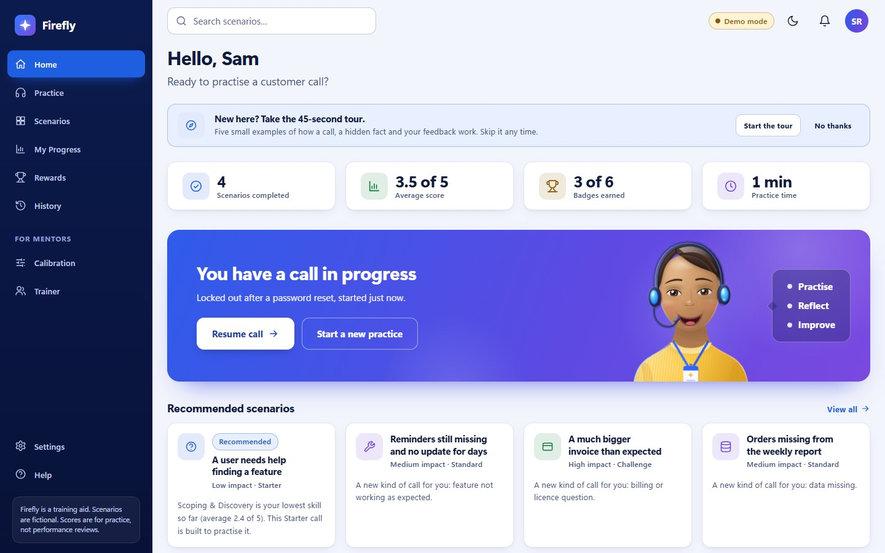
  </picture>
</p>

Firefly is a customer-call training simulator for new technical support engineers and apprentices. You choose a fictional customer, configure how difficult they are, hold an unscripted conversation (typed or, as a beta, spoken) with a simulated one, and get coaching tied to your own words. Technical knowledge alone does not make a good support experience, and learning conversation skills on live cases puts real customers at risk. Firefly lets trainees rehearse first.

| Status              | Detail                                                                                                                                                   |
| ------------------- | -------------------------------------------------------------------------------------------------------------------------------------------------------- |
| Application         | Working. The latest redesign is described below.                                                                                                         |
| Demo mode           | Available locally. No credentials needed: a built-in rules engine plays the customer and writes the coaching.                                            |
| Live model provider | Optional. Gemini has been run end to end against the real API; Azure OpenAI and OpenAI-compatible endpoints are tested only against a local fake server. |
| Voice               | Beta. Opt-in, works in Chromium-based browsers, and Firefly never records audio. See [Voice (Beta)](#voice-beta).                                        |
| Deployment          | Not deployed. Firefly runs on your own machine.                                                                                                          |

```bash
git clone https://github.com/snowjug/Firefly.git
cd Firefly
npm ci
npm run build
npm start
```

Then open <http://127.0.0.1:8787>. You need Node.js 24 or newer. [Getting started](#getting-started) covers development mode, live providers and tests.

**On this page:** [The experience](#the-experience) · [Why Firefly](#why-firefly) · [What it does](#what-firefly-does) · [Rewards](#rewards-for-practising) · [Voice](#voice-beta) · [Features](#key-features) · [Scenario model](#scenario-model) · [Coaching dimensions](#coaching-dimensions) · [Architecture](#architecture) · [Tech stack](#tech-stack) · [Project structure](#project-structure) · [Getting started](#getting-started) · [Accessibility and performance](#accessibility-and-performance) · [Responsible AI](#responsible-ai-and-data-safety) · [Calibration](#evaluation-and-calibration) · [Testing](#quality-and-testing) · [Limitations](#current-limitations) · [Roadmap](#roadmap) · [Contributing](#contributing)

## The experience

A walk through one practice session. Open a section to see its screen. Every picture is a real screenshot of the running app in demo mode, with a fictional learner and practice calls driven by a script, so call lengths read as a few seconds. [The steps to regenerate them](#regenerate-the-screenshots) are below.

<details open>
<summary><strong>1 · Start from a calm front door</strong></summary>

&nbsp;

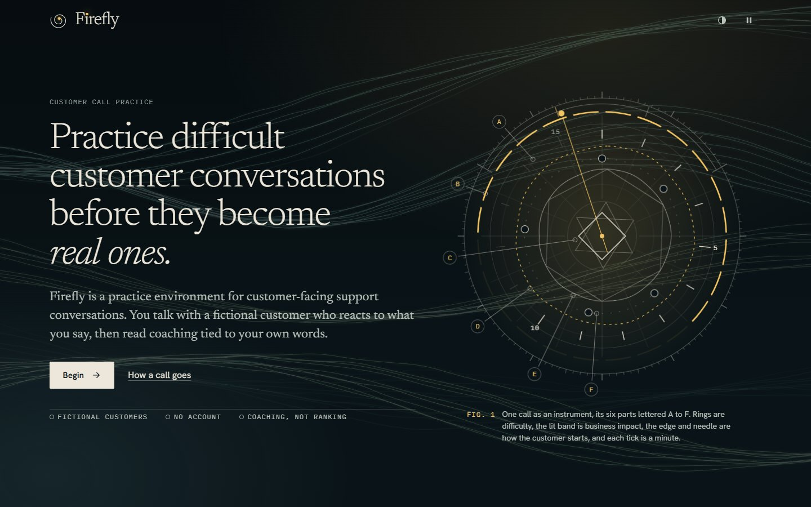

The landing page says what Firefly is and what it is not: fictional customers only, a profile that stays in your browser, coaching rather than ranking. **Sign-in is a local profile**: you give a name (a first name is enough) and it is saved in this browser. There is no account and no password, and organisation sign-in is shown as not available rather than pretended.

</details>

<details>
<summary><strong>2 · Configure the scenario</strong></summary>

&nbsp;


One page replaces the old wizard and the pre-call brief. Pick a quick start, then adjust the issue type, business impact, customer temperature, technical proficiency, communication style, call stage and curveballs. Hidden facts are always on, because every scenario has details the customer shares only when you ask. The preview shows what a trainee may know: the customer, the situation and your goal, never the hidden facts. The setup marks what you changed and can reset it.

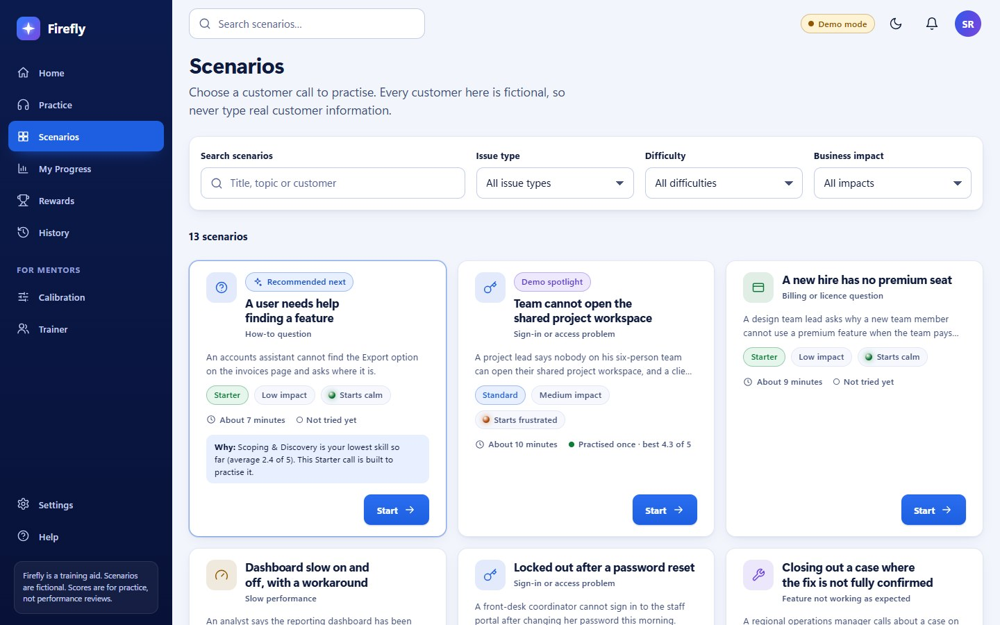

The library is a plain, searchable catalogue of the 13 scenarios. Each card says whether you have practised it and your best score, and one is recommended with the reason.

</details>

<details>
<summary><strong>3 · Hold the conversation (type it, or say it)</strong></summary>

&nbsp;

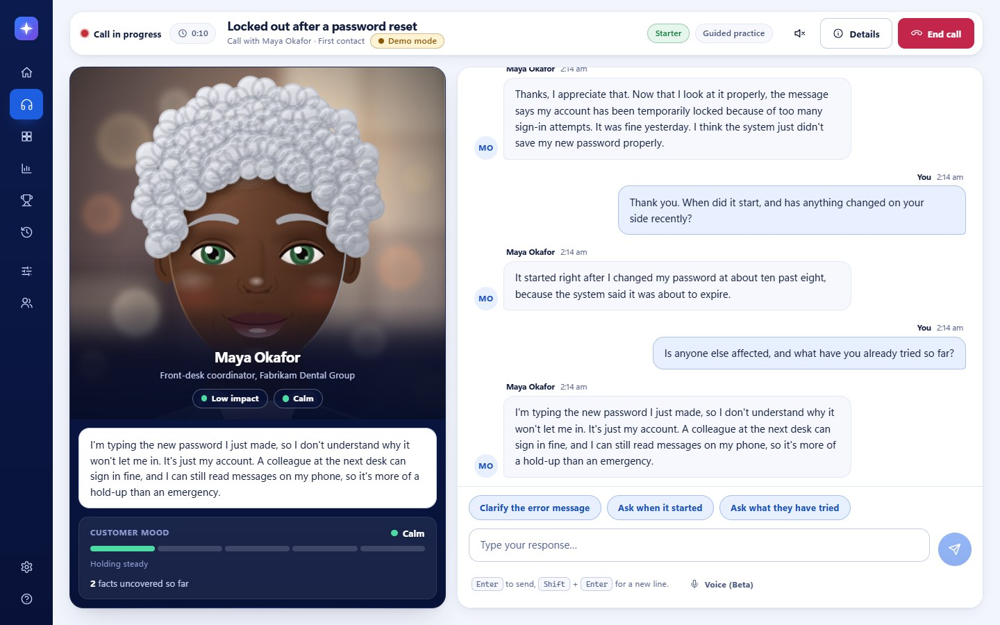

- The customer is an illustrated 2D portrait. Nothing is scripted: they react to what you say, hold facts back until you ask a fitting question, and may raise a curveball.
- **Guided practice** shows the mood in words and on a meter, how many hidden facts you have uncovered so far, a few hint chips that fill the message box without sending, and a portrait whose expression follows the mood. **Immersive practice** shows none of that and keeps the face calm, because a real call would not show you.
- **Voice (Beta)** adds a microphone and spoken replies. See [Voice (Beta)](#voice-beta).


</details>

<details>
<summary><strong>4 · Read the feedback (it opens as soon as you end the call)</strong></summary>

&nbsp;

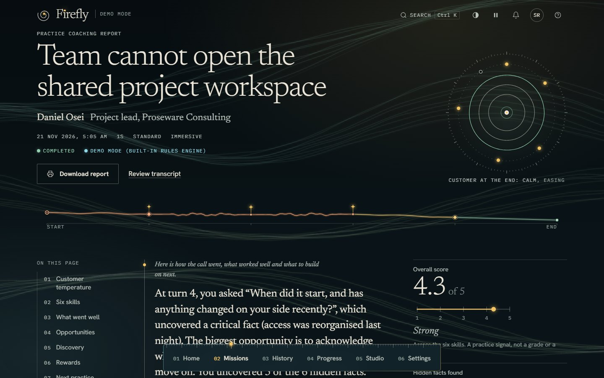

Ending a call locks the transcript, shows the real stages of evaluation, and then opens the full coaching report: six skill scores with evidence labels, what went well, skill details with quoted moments, opportunities with a stronger way to say it, a discovery review, the customer temperature timeline, the rewards the call earned, and one next practice target.


A call that ends early is labelled as such, and the report says its scores rest on limited evidence instead of inventing a complete assessment. **Report incorrect feedback** copies a note for a mentor (a session id, a skill and a turn number, never the transcript) and links to a public issue with a warning not to paste customer information.

</details>

<details>
<summary><strong>5 · Earn points, review history, track progress</strong></summary>

&nbsp;

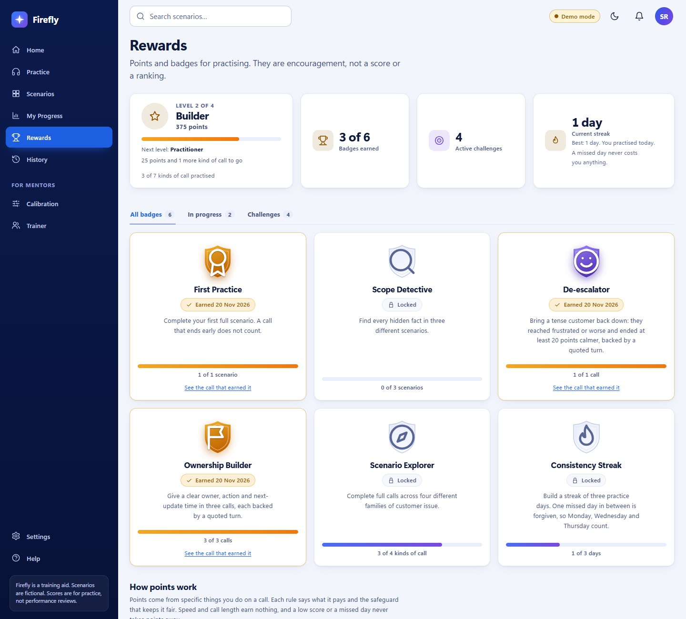

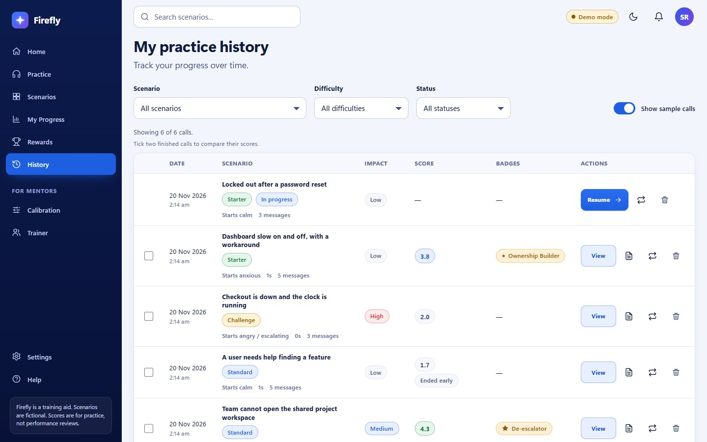


</details>

<details>
<summary><strong>6 · Make it yours, on every screen</strong></summary>

&nbsp;

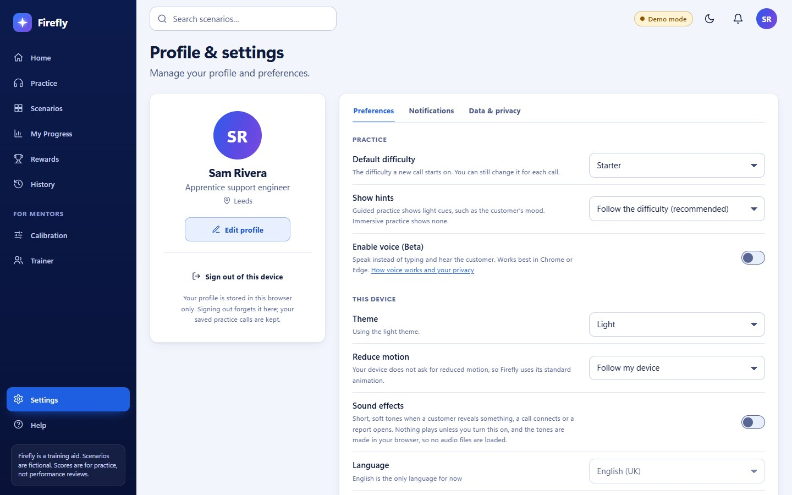


Phone to ultra-wide, light and dark themes, reduced motion from the device or the app, keyboard-only use, an optional tour, and a calm notice when the browser goes offline. See [Accessibility and performance](#accessibility-and-performance).

</details>

## Why Firefly?

Technical knowledge alone does not guarantee a strong support experience. Trainees also have to learn to:

- open calls professionally and establish business impact
- scope unclear issues with focused discovery questions
- communicate without unnecessary jargon
- handle frustrated or escalating customers and de-escalate
- take ownership, set expectations and agree on next steps
- close calls professionally

Practising these skills only on live cases creates risk for customers and delays useful feedback. Firefly gives trainees a place to rehearse as often as they like, and shows them where a call went well or badly, in their own words.

It is an FY27 apprentice team project. It focuses on customer-handling and support-conversation skills and is product-agnostic: it does not teach the details of any one product. All scenarios are fictional and every customer detail is synthetic. Firefly is a coaching tool, not an employee-performance assessment system.

## What Firefly does

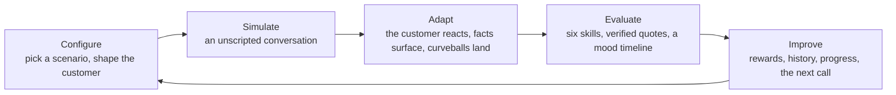

| Stage         | What happens                                                                                                                                                                                                              |
| ------------- | ------------------------------------------------------------------------------------------------------------------------------------------------------------------------------------------------------------------------- |
| **Configure** | Choose one of 13 fictional scenarios and set its business impact, customer temperature, technical proficiency, communication style, call stage and difficulty, with optional curveballs, on one page.                     |
| **Simulate**  | Start the call and hold an unscripted conversation with a simulated customer, typed or spoken. The preview never shows hidden facts.                                                                                      |
| **Adapt**     | The customer's mood, trust and patience move with what the trainee says. Hidden facts appear only for relevant questions, and a curveball may land mid-call.                                                              |
| **Evaluate**  | Ending the call opens a coaching report: six scored skills with verified quotes, strengths, improvements with alternative phrasing, a discovery review, a mood timeline, the rewards earned and one next practice target. |
| **Improve**   | Reopen any report from History, follow quotes into the transcript, earn points and badges for practising, and use My progress to see each skill's trend and what to work on next.                                         |

## Rewards for practising

Firefly rewards **practising**, never speed, volume or a high score on its own. Rewards are points, four levels, a streak and six badges. Each is worked out from your saved calls every time it is asked for, by plain tested rules (`shared/domain/rewards.ts`, served by `GET /api/rewards`), so nothing is stored, nothing can be paid twice, and deleting a call takes back exactly what it earned. Every entry in the points history gives the reason and, where there is one, the quoted moment. The full rules are in [docs/rewards.md](docs/rewards.md).

| Rule                              | Points          | Earned when                                                                                            |
| --------------------------------- | --------------- | ------------------------------------------------------------------------------------------------------ |
| **Complete a full scenario**      | 50 (repeats 10) | You take a call all the way to a close with enough said for real coaching. Ending early earns nothing. |
| **Uncover a hidden fact**         | 10              | A question of yours brought out something the customer had not volunteered. Each fact pays once.       |
| **Give a clear owner and update** | 10              | You named the owner, the next step and when the customer will hear back, and the report quotes you.    |
| **Lift a skill**                  | 15              | A skill scored a point above your own recent average at the same difficulty.                           |
| **Try a new scenario family**     | 20              | Your first full call in a kind of customer issue you have not practised.                               |
| **Practise on a day**             | 5               | At least one full call on a calendar day. A missed day never costs you anything.                       |
| **A mentor confirms the result**  | 25              | A mentor reviewed the call and scored every skill within one point of the rubric result.               |

**Levels** need both points and breadth: Foundation, Builder (150 points, 2 kinds of call), Practitioner (400, 4) and Confident Handler (800, 6). **Badges:** First Practice, Scope Detective, De-escalator, Ownership Builder, Scenario Explorer and Consistency Streak.

**Deliberately missing:** no leaderboard, no ranking, no comparison with colleagues, no points for speed or call length, no reward for the overall score alone, and nothing taken away for a retry or a missed day. Sample sessions never earn anything.

## Voice (Beta)

Voice lets you practise the way a call happens: you **speak**, and the simulated customer **answers out loud**. It is optional, **off until you turn it on in Settings or on the call screen**, and typing always keeps working.

- **How it works.** Your browser turns speech into text (the Web Speech API), and Firefly receives only that text, which goes through the same personal-data check as typed text. The customer's replies are read aloud with a voice from your browser. Short call tones are generated in the browser. The microphone is closed while the customer speaks.
- **Hands-free or push to talk.** Hands-free listens again by itself after the customer finishes. Push to talk listens when you press the button and lets you edit the text before sending. Every message also has a "Listen" button.
- **Privacy, plainly.** Firefly never records, keeps or uploads audio. In Chrome and Edge the browser itself usually sends your audio to its maker's online speech service, unless the device can recognise speech on-device (Firefly asks for that when the browser offers it). Some browser voices are online voices too. Turning voice on shows this first. See [docs/voice.md](docs/voice.md#what-leaves-your-device).
- **Honest limits.** Speech input works in Chromium-based browsers over https or localhost; speech output works in most. Recognition can mishear words, so a call that used voice carries a reminder to check the quotes against the transcript, and coaching reads words only, not tone, accent or pace. There is no recording, and you cannot interrupt the customer by speaking (use Stop or Talk to take the turn).

## Key features

| Area                                                                                  | Status                                                                                                                                             |
| ------------------------------------------------------------------------------------- | -------------------------------------------------------------------------------------------------------------------------------------------------- |
| Landing page, local profile, app shell, light and dark themes                         | Implemented and verified by unit and browser tests                                                                                                 |
| Scenario library, single-page setup, live call                                        | Implemented and verified by unit and browser tests                                                                                                 |
| Customer simulation, hidden facts, curveballs                                         | Implemented and verified (rules engine in demo mode)                                                                                               |
| Call feedback: scores, evidence, discovery, temperature timeline, next practice       | Implemented and verified (rules evaluator in demo mode)                                                                                            |
| Rewards: points, levels, streak, badges, challenges, points history                   | Implemented and verified (pure rules with tests; endpoint tested)                                                                                  |
| History, My progress, transcript review                                               | Implemented and verified                                                                                                                           |
| Voice (Beta): speech input, spoken replies, call tones                                | Implemented against fake browser speech APIs in tests. Not verified with a real microphone on every browser.                                       |
| Mentor review and calibration tooling, trainer tools                                  | Implemented and verified. No real mentor data exists yet.                                                                                          |
| Notifications (in the bell menu only), optional sound, first-run tour, offline notice | Implemented and verified                                                                                                                           |
| Live Gemini provider                                                                  | Implemented. Needs an API key. Run end to end against the real Gemini API in a few scripted calls; free-tier rate limits and data-use terms apply. |
| Live Azure OpenAI or OpenAI-compatible provider                                       | Implemented. Requires credentials. Tested only against a local fake server; not verified against a real service.                                   |
| Accessibility                                                                         | Automated checks and keyboard tests pass. No screen-reader validation.                                                                             |
| Hosted deployment, organisation sign-in, trainer-authored scenarios                   | Not implemented (future work)                                                                                                                      |

<details>
<summary><strong>Adaptive customer, hidden facts, curveballs, coaching and tools in detail</strong></summary>

### Configurable scenarios

There are 13 fictional scenarios (4 Starter, 5 Standard, 4 Challenge) across 7 issue types. Each can be reconfigured before a call, and the settings used are stored with the session so a call can be replayed and evaluated as it was configured. See [Scenario model](#scenario-model). Every scenario is checked by `npm run validate:scenarios` and the library tests, which fail if a hidden fact cannot be found or leaks into the customer's opening.

### Adaptive customer simulation

In demo mode the customer is produced by a deterministic rules engine. It classifies what the trainee did (empathy, ownership, next steps, jargon, blame, focused questions and more), updates the customer's state, and composes a reply grounded in the scenario's persona, communication style, proficiency and the facts the customer is allowed to share.

- **Customer state.** Seven bounded values (0-100), among them temperature, trust, patience, confidence and urgency, changed only by explicit rules. Trainees see the mood in words (Calm, Concerned, Frustrated, Angry, Escalating) and its trend, never the numbers.
- **Behaviour that matters.** Specific empathy, acknowledging impact, clear ownership and focused questions help. Blame, dismissal, unexplained jargon, repeated questions and premature fixes hurt.
- **Practice modes.** Guided practice shows light cues (mood, hints, areas worth exploring). Immersive practice shows none.

### Hidden-fact discovery

Each scenario holds facts the customer reveals only when asked an appropriate question. Some also need enough trust or an acknowledgement of the impact first. After the call, the report lists which facts were found, partly found or missed, the question that revealed each, and a better question for any that were missed.

### Controlled curveballs

Curveballs are optional. There are eight types: asks for a manager, threatens to cancel, imposes a deadline, changes the issue, goes quiet, mentions a bad experience, demands a guarantee and challenges credibility. Each fires deterministically when its conditions are met (a window of turns plus a state condition, such as ownership still being unclear), and the report says how the trainee handled it.

### Evidence-based coaching

Each report scores six dimensions from 1 to 5 and includes a rationale for every score with verified quotes from the trainee's own turns, strengths and improvement opportunities with alternative phrasing, discovery results (including what the customer held back), a customer temperature timeline with turning points linked to the transcript, an assessment of any curveball and one suggested next practice target. Short calls say that the report rests on limited evidence. See [Coaching dimensions](#coaching-dimensions).

### History, progress and the mentor tools

**History** stores individual practice sessions. Filter them, reopen a report or transcript, compare two sessions, retry a failed report or delete one. **My progress** shows each skill's trend with a text summary, where to focus next and the opportunities that keep repeating. It is for personal coaching: practice signals from a handful of calls, never an assessment, and never compared with other people. A mentor can score a completed session from its transcript alone and then see how the evaluator's scores compared; `npm run calibrate` compares scores kept in files. The Trainer page offers a spotlight scenario, a quick start, a demo checklist, the provider status, labelled sample sessions and confirmed resets. See [Evaluation and calibration](#evaluation-and-calibration).

### Demo and live provider modes

|                     | Demo mode (default)                                                | Live mode (optional)                                                                         |
| ------------------- | ------------------------------------------------------------------ | -------------------------------------------------------------------------------------------- |
| Set with            | `FIREFLY_PROVIDER=mock`, or leave it unset                         | `FIREFLY_PROVIDER=gemini`, `azure-openai` or `openai-compatible`                             |
| Credentials         | None                                                               | Required (see [Configure a live provider](#configure-a-live-provider))                       |
| Customer replies    | Rules engine, from phrase banks, scenario facts and customer state | A model, from what the engine has allowed the customer to say in that reply                  |
| Turn classification | Rules                                                              | A model                                                                                      |
| Coaching            | Rules evaluator                                                    | A model drafts it; the server verifies every quote and caps scores by the evidence           |
| Labelled in the app | "Demo mode (built-in rules engine)"                                | The configured provider                                                                      |
| Status              | Verified                                                           | Gemini: run end to end against the real API. Others: tested only against a local fake server |

If a live provider is requested but its variables are incomplete, Firefly starts in demo mode and prints a notice that names the missing variables (verified). Customer state, discovery, curveballs and the checks on the report stay in code in both modes. Details are in [docs/ai-providers.md](docs/ai-providers.md).

</details>

## How a simulation works

1. **Create a profile** (a name, kept in your browser) and open **Home**.
2. **Start practice** and configure the scenario on one page, or keep the recommended defaults.
3. **Start the call simulation.** Read the situation and your goal in the preview; hidden facts are never shown.
4. **Hold the conversation.** Type in your own words, or turn on voice. Nothing is scripted.
5. **Ask discovery questions:** what is happening, when it started, what changed, who is affected, what the screen says, what was tried and what it means for the business.
6. **Respond to changing behaviour and curveballs.** Acknowledge impact, take ownership and notice what moves the customer's mood.
7. **End the call.** Firefly asks for confirmation, locks the transcript and shows the stage of evaluation it has actually reached.
8. **Read the call feedback** and follow quotes into the transcript.
9. **See what you earned** on the report and in Rewards, reopen the call from History, and check My progress.

## Scenario model

| Parameter             | Purpose                                      | Options                                                                                                             |
| --------------------- | -------------------------------------------- | ------------------------------------------------------------------------------------------------------------------- |
| Issue type            | Defines the fictional support problem        | Sign-in or access, service outage, slow performance, data missing, billing or licence, how-to, feature not working  |
| Business impact       | Controls customer urgency                    | Low, medium, high                                                                                                   |
| Customer temperature  | Establishes starting behaviour               | Calm, anxious, frustrated, angry / escalating                                                                       |
| Technical proficiency | Controls vocabulary and technical depth      | Novice, intermediate, expert                                                                                        |
| Communication style   | Changes how the customer communicates        | Talkative, terse, demanding, vague, non-native English speaker                                                      |
| Call stage            | Establishes expectations and prior history   | First contact, follow-up, escalated, closure                                                                        |
| Hidden facts          | Tests discovery and scoping                  | Defined per scenario and always on. Starter has fewer in play and clearer clues; Challenge puts every fact in play. |
| Curveballs            | Introduces controlled complications          | Eight types. Up to one at Starter (off by default) and Standard, up to two at Challenge.                            |
| Difficulty            | Bundles scenario complexity                  | Starter, Standard, Challenge                                                                                        |
| Practice mode         | Sets how many cues are shown during the call | Guided (the Starter default) or immersive (the Standard and Challenge default)                                      |

Difficulty also sets the customer's starting trust and patience, how strongly good and bad behaviour moves them and how readily they volunteer context. Scenarios are written as TypeScript files; see [docs/scenario-authoring.md](docs/scenario-authoring.md).

## Coaching dimensions

Scores are whole numbers from 1 (not demonstrated) to 5 (excellent). The overall score is the mean of the six, rounded to one decimal place, and is left out when the call was too short to judge.

| #   | Dimension               | What it looks at                                                         | CARE behaviour (working mapping) |
| --- | ----------------------- | ------------------------------------------------------------------------ | -------------------------------- |
| 1   | Opening & Rapport       | Greeting, introduction, an open question, early connection               | Communicate, Be empathetic       |
| 2   | Scoping & Discovery     | Focused questions, hidden facts found, core topics covered               | Be resourceful                   |
| 3   | Empathy & De-escalation | Specific empathy, acknowledging impact, how the customer's mood moved    | Be empathetic                    |
| 4   | Clarity                 | Plain language, jargon explained, recap and check-ins                    | Communicate                      |
| 5   | Ownership & Next Steps  | Clear ownership, specific next steps with a time, realistic promises     | Be accountable                   |
| 6   | Closing                 | Recap of what was agreed, next contact confirmed, anything else, goodbye | Be accountable, Communicate      |

- **Evidence rules.** A 4 needs one verified quote and a 5 needs two. Quotes are checked against the trainee turn they cite before a report is saved.
- **Never penalised.** Short messages, grammar, spelling, an accent or non-native phrasing never lower a score.
- **Limited evidence.** Short calls are labelled as resting on limited evidence.
- **CARE mapping.** The rubric maps the dimensions loosely to the four CARE behaviours (communicate effectively, be accountable, be resourceful, be empathetic). It is a working aid for coaching conversations, not an official standard.

The full rules are in [docs/evaluation-rubric.md](docs/evaluation-rubric.md).

## Architecture

Firefly is a single Node.js process. It serves a JSON API and the built web app, and keeps everything in a local SQLite file.

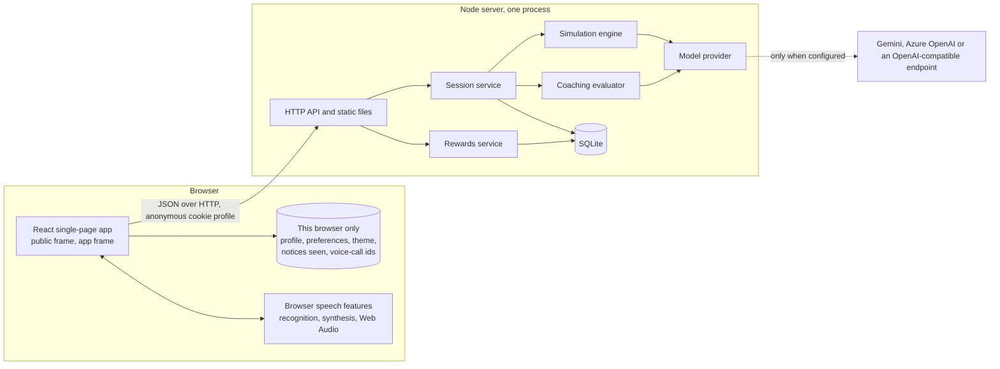

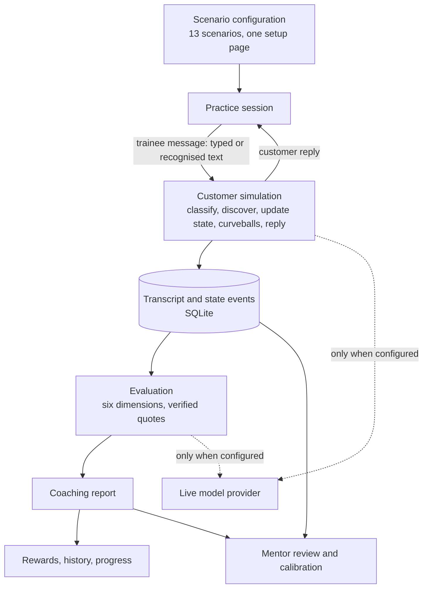

### One message, end to end

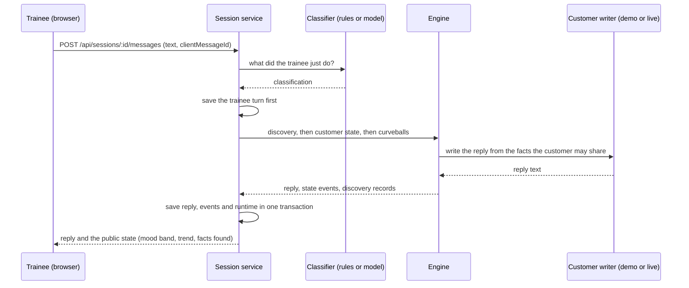

### Ending a call

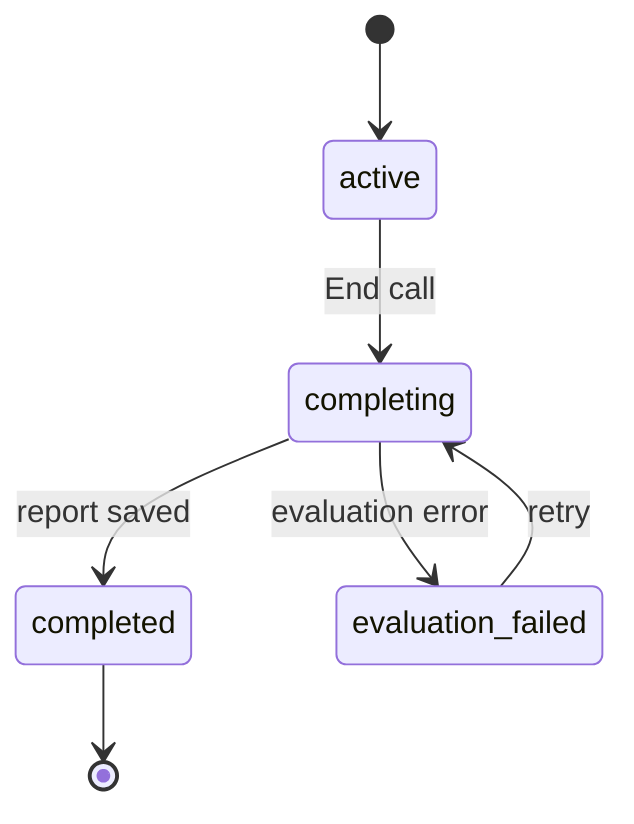

- **Frontend.** A React single-page app with a public frame (landing, sign-in) and an app frame (a sidebar, a top bar and the page). One lazy route per screen: Home, Practice setup, Scenarios, Call, Call feedback, Transcript, History, Rewards, My progress, Settings, Help, Calibration and Trainer. The tour is its own chunk, so it is not part of the first download.
- **Identity.** A local profile in `localStorage` (a name, an optional role and location, a few preferences). There is no account. The server separates one browser's practice from another's with an anonymous cookie.
- **Server and API.** A hand-written router on `node:http`, with a strict Content-Security-Policy, same-origin checks on writes and rate limits.
- **Simulation.** A deterministic rules engine runs every turn: classify, apply discovery rules, update the bounded customer state, check curveball triggers, then compose the reply. The trainee's message is saved before the reply, so a failed reply loses nothing and a retry creates no duplicate.
- **Evaluator.** Scores the transcript and the engine's records, verifies every quote and builds the report. Ending a call is a real state change with phases, and exactly one report is saved.
- **Rewards.** Pure functions over the saved calls, reports and mentor reviews; the only API addition of the redesign is `GET /api/rewards`.
- **Voice.** Browser speech features behind one hook (`useVoiceCall`); only recognised text reaches the server.
- **Live model provider.** Optional and off by default. A model can classify turns, write replies and draft the coaching, but the state, discovery, curveballs and checks stay in code.
- **Persistence.** SQLite through `node:sqlite`, with versioned migrations. Transcripts, state events, reports and mentor reviews are stored locally.
- **Visuals.** Hand-drawn 2D SVG illustrations (customers, an agent, the landing sphere and a building), plain CSS on design tokens, system fonts, no raster images.

See [docs/architecture.md](docs/architecture.md) for the full picture and [docs/experience-design.md](docs/experience-design.md) for the design.

## Tech stack

| Layer          | Technology                                                                                                         |
| -------------- | ------------------------------------------------------------------------------------------------------------------ |
| Frontend       | React 19, React Router 7, Vite 8, TypeScript 5.9 (strict)                                                          |
| Visuals        | Hand-drawn 2D SVG illustrations, CSS custom properties, system fonts. No animation, 3D, chart or icon library      |
| Audio          | Optional tones synthesised with the Web Audio API. Voice uses the browser's Web Speech API. No audio files         |
| Server and API | Node.js 24 or newer running TypeScript directly, `node:http` (no web framework), zod 4 for validation              |
| Simulation     | Deterministic TypeScript rules engine in `server/engine` (classifier, discovery, state, curveballs)                |
| AI provider    | Built-in demo provider by default. Optional Gemini, Azure OpenAI or OpenAI-compatible chat completions via `fetch` |
| Styling        | Plain CSS on design tokens, light and dark themes, no UI framework                                                 |
| Testing        | Vitest 5 with Testing Library and jsdom; Playwright 1.65 with axe-core                                             |
| Code quality   | ESLint 9 (typescript-eslint, jsx-a11y, react-hooks) and Prettier 3                                                 |
| CI             | GitHub Actions                                                                                                     |
| Storage        | SQLite file through `node:sqlite`; the browser's `localStorage` for the local profile and preferences              |

The runtime dependencies are React, React Router and zod. The redesign, rewards and voice added none.

## Project structure

```text
Firefly/
├── server/                 Node.js server, written in TypeScript
│   ├── engine/             Simulation engine and the demo-mode customer
│   ├── scenarios/          Scenario registry and the 13 built-in scenarios
│   ├── evaluator/          Coaching evaluator and verification of model drafts
│   ├── providers/          Demo and live model providers
│   ├── prompts/            Versioned prompts used in live mode
│   ├── services/           Sessions, progress, calibration, rewards, sample data
│   ├── db/                 SQLite schema, migrations and queries
│   └── http/               Router, API routes, security, static files
├── shared/domain/          Types, schemas and pure logic shared by server and web,
│                           including rewards, achievements and recommendations
├── web/src/
│   ├── pages/              One lazy-loaded route per screen
│   ├── components/         shell (sidebar, top bar), ui (cards, tabs, ring), illustration,
│   │                       call, voice, report, scenario, rewards, dashboard, progress,
│   │                       history, settings, trainer, calibration, tour and more
│   ├── lib/                API client, hooks, profile, theme, sound, voice engine, tour
│   └── styles/             Design tokens and plain CSS, one file per area
├── e2e/                    Playwright browser tests
├── calibration/samples/    Invented example records for the calibration tool
├── scripts/                Dev runner, scenario validation, calibration CLI, screenshot tool,
│                           secret and lockfile checks
├── docs/                   Architecture, experience design, rubric, providers, rewards, voice,
│   │                       calibration, design system, demo guide
│   └── images/             Screenshots used in this README
├── .github/workflows/      Continuous integration
├── .env.example            Configuration template with placeholders only
└── package.json            Scripts and dependencies. The tool configs (vite, vitest, playwright, eslint, tsconfig) sit beside it.
```

## Getting started

### Prerequisites

- **Node.js 24 or newer.** This is the `engines` requirement in `package.json`, because the server runs TypeScript directly and uses the built-in `node:sqlite`. Older versions are not supported.
- **npm**, which comes with Node.js.
- **No credentials** for demo mode.
- **A Chromium-based browser** to run the browser tests (see [Test](#test)) and to try voice input.

### Install and run in demo mode

```bash
git clone https://github.com/snowjug/Firefly.git
cd Firefly
npm ci
npm run build
npm start
```

No credentials are needed. Open <http://127.0.0.1:8787>, choose **Get started** and enter a name. The badge at the top right of the app says "Demo mode". Data is kept in `data/firefly.db`, which is git-ignored.

| Goal                    | Command                           | Opens at                                                                                  |
| ----------------------- | --------------------------------- | ----------------------------------------------------------------------------------------- |
| Use the built app       | `npm run build`, then `npm start` | <http://127.0.0.1:8787>                                                                   |
| Develop with hot reload | `npm run dev`                     | <http://localhost:5173> (the API runs on port 8787 and restarts when server files change) |

If port 8787 is busy, set `FIREFLY_PORT`. Firefly has no account system, so keep `FIREFLY_HOST` on its loopback default.

### Configure a live provider

Copy `.env.example` to `.env` (also git-ignored) and fill in **one** provider. Use your own values; never commit real keys.

For Google's Gemini API (a key from [Google AI Studio](https://aistudio.google.com/apikey); only the key is required):

```bash
FIREFLY_PROVIDER=gemini
GEMINI_API_KEY=<your-api-key>
```

Gemini defaults to `gemini-3.5-flash-lite`; set `GEMINI_MODEL` to use another model. A free-tier project is rate limited (15 requests per minute for that model when this was tested, and each message sent uses two), and Google's terms say it uses content sent through unpaid services to improve its products and that human reviewers may read it, so use fictional scenarios only. Details are in [docs/ai-providers.md](docs/ai-providers.md#gemini-google-ai-studio).

For Azure OpenAI:

```bash
FIREFLY_PROVIDER=azure-openai
AZURE_OPENAI_ENDPOINT=<https://your-resource.openai.azure.com>
AZURE_OPENAI_API_KEY=<your-api-key>
AZURE_OPENAI_DEPLOYMENT=<your-deployment-name>
AZURE_OPENAI_API_VERSION=<api-version>
```

For any OpenAI-compatible chat-completions endpoint:

```bash
FIREFLY_PROVIDER=openai-compatible
FIREFLY_LLM_BASE_URL=<https://your-endpoint/v1>
FIREFLY_LLM_API_KEY=<your-api-key>
FIREFLY_LLM_MODEL=<model-name>
```

The console prints which provider is running when the server starts, and the app labels it everywhere. Only Gemini has been run against a real service (see [Verified against the Gemini API](docs/ai-providers.md#verified-against-the-gemini-api)); run the smoke test in [docs/ai-providers.md](docs/ai-providers.md) with your own credentials before relying on Azure OpenAI or an OpenAI-compatible endpoint. To go back to demo mode, set `FIREFLY_PROVIDER=mock` and restart.

### Build

```bash
npm run build
```

This writes the production web app to `dist/web`.

### Test

| Purpose                                | Command                                                     |
| -------------------------------------- | ----------------------------------------------------------- |
| Everything below plus the build        | `npm run check`                                             |
| Unit, component and API tests          | `npm test`                                                  |
| Browser tests, including accessibility | `npm run test:e2e`                                          |
| Scenario validation                    | `npm run validate:scenarios`                                |
| Calibration on the bundled sample data | `npm run calibrate`                                         |
| Secret scan                            | `npm run check:secrets`                                     |
| Lockfile and registry check            | `npm run check:lockfile`                                    |
| Format, lint and type checks           | `npm run format:check`, `npm run lint`, `npm run typecheck` |

`npm run check` runs formatting, lint, types, scenario validation, tests, the build, the secret scan and the lockfile check in that order. Browser tests need a browser: install Playwright's with `npx playwright install chromium`, or reuse an installed Edge or Chrome by setting `PW_CHANNEL=msedge` (in PowerShell: `$env:PW_CHANNEL = 'msedge'`). See [docs/troubleshooting.md](docs/troubleshooting.md) if anything does not start.

### Regenerate the screenshots

The pictures in this README come from a script, so they can be refreshed after a design change. Start Firefly in demo mode with an empty in-memory database, then run the script (its options are documented at the top of the file):

```bash
FIREFLY_DB_PATH=:memory: FIREFLY_PROVIDER=mock FIREFLY_MOCK_DELAY_MS=120 FIREFLY_PORT=4444 npm start
node scripts/readme-screenshots.mjs --base http://127.0.0.1:4444
```

<details>
<summary><strong>Environment variables</strong></summary>

Firefly loads `.env` at startup, and variables already in the environment win. Nothing is required for demo mode.

| Variable                                                                                               | Required                         | Purpose                                                                                                                         |
| ------------------------------------------------------------------------------------------------------ | -------------------------------- | ------------------------------------------------------------------------------------------------------------------------------- |
| `FIREFLY_PROVIDER`                                                                                     | No (default `mock`)              | `mock` (demo mode), `gemini`, `azure-openai` or `openai-compatible`                                                             |
| `GEMINI_API_KEY`                                                                                       | Only with `gemini`               | Google Gemini API key. Keep it in the git-ignored `.env`.                                                                       |
| `GEMINI_MODEL`, `GEMINI_BASE_URL`                                                                      | No (with `gemini`)               | Model (default `gemini-3.5-flash-lite`) and OpenAI-compatible endpoint (default Google's)                                       |
| `AZURE_OPENAI_ENDPOINT`, `AZURE_OPENAI_API_KEY`, `AZURE_OPENAI_DEPLOYMENT`, `AZURE_OPENAI_API_VERSION` | Only with `azure-openai`         | Azure OpenAI chat-completions deployment                                                                                        |
| `FIREFLY_LLM_BASE_URL`, `FIREFLY_LLM_API_KEY`, `FIREFLY_LLM_MODEL`                                     | Only with `openai-compatible`    | Any OpenAI-compatible chat-completions endpoint                                                                                 |
| `FIREFLY_LLM_TIMEOUT_MS`                                                                               | No (default `30000`)             | Timeout for each model call                                                                                                     |
| `FIREFLY_LLM_MAX_RETRIES`                                                                              | No (default `1`, at most `3`)    | Retries for a failed model call                                                                                                 |
| `FIREFLY_PORT`                                                                                         | No (default `8787`)              | Port the server listens on                                                                                                      |
| `FIREFLY_HOST`                                                                                         | No (default `127.0.0.1`)         | Address the server listens on. Keep it on loopback: there is no sign-in.                                                        |
| `FIREFLY_DB_PATH`                                                                                      | No (default `./data/firefly.db`) | SQLite file. `:memory:` keeps data in memory.                                                                                   |
| `FIREFLY_LOG_LEVEL`                                                                                    | No (default `info`)              | `info`, `warn`, `error` or `silent`. Logs never contain transcripts.                                                            |
| `FIREFLY_MOCK_DELAY_MS`                                                                                | No (default `700`)               | Pause before demo-mode replies so the typing state is visible                                                                   |
| `FIREFLY_TEST_HOOKS`, `FIREFLY_DEV_DIAGNOSTICS`                                                        | No (off)                         | Failure injection and internal diagnostics for tests. Never enable on a shared host.                                            |
| `PW_CHANNEL`, `E2E_PORT`, `E2E_BASE_URL`                                                               | No (tests only)                  | Playwright: browser channel such as `msedge`, test server port (default `4321`), or the URL of a server that is already running |

</details>

## Accessibility and performance

**Accessibility.** WCAG 2.2 AA is a release requirement. The interface is built so that nothing depends on colour, motion or a pointer:

- Every score, mood, difficulty, status and badge is also written out in words, charts have a text or table alternative, and decorative illustrations are hidden from assistive technology.
- Everything works from the keyboard: setup, the call composer and voice controls, tabs (arrow keys), the temperature timeline (arrow keys between points), the menus and every dialog.
- Reduced motion is honoured from the device and from Settings: animation and transitions collapse to near zero, the score ring draws at its final value and the launch moment is skipped.
- Touch targets are at least 44 px for primary controls, and nothing scrolls sideways at 320 px.
- axe-core runs on every page in both themes in the browser tests (see [Quality and testing](#quality-and-testing)).
- Nobody has tested Firefly with a screen reader yet (see [Current limitations](#current-limitations)).

**Performance.** The app has no web font, no raster image and no UI framework. Every page is its own chunk, the page for the opening address is fetched before the first render, and optional pieces (the tour, the avatar artwork) load after the first paint. From the production build (gzip):

| Chunk                                                    | Size             |
| -------------------------------------------------------- | ---------------- |
| Shared app code (React, React Router, zod and the shell) | 93.1 kB          |
| Stylesheet shared by every page                          | 8.4 kB           |
| Largest page chunks: Call, Report                        | 20.7 kB, 16.8 kB |
| Typical page chunk (Home, Rewards, History, Settings)    | 4 to 6 kB        |

These are build sizes, not measured load times. No throttled or real-network timing has been taken for this release.

## Example training session

<details>
<summary><strong>An illustration written for this document</strong></summary>

&nbsp;

It is not taken from a built-in scenario, so it gives nothing away about the scenarios in the library.

| Setting               | Value                                                              |
| --------------------- | ------------------------------------------------------------------ |
| Issue                 | Production service unavailable (a customer-facing booking service) |
| Business impact       | High                                                               |
| Starting temperature  | Frustrated                                                         |
| Technical proficiency | Intermediate                                                       |
| Communication style   | Demanding                                                          |
| Difficulty            | Challenge                                                          |

- **What the trainee is told.** The preview says a fictional operations lead is calling because clients cannot make bookings. It gives the trainee a goal: find out what is happening and who is affected, take ownership, and agree what happens next and when. It never lists hidden facts.
- **A hidden fact.** Suppose the customer's team raised the same errors in a case yesterday and it was closed without a fix. The customer will not mention it unprompted. It comes out only if the trainee asks something like "Has anyone contacted support about this already?"
- **A possible curveball.** A few turns in, if no one has taken ownership, the customer may ask for a manager. The report later says whether the trainee acknowledged the request, explained what they would do and offered a route.
- **How feedback is produced.** When the trainee ends the call, Firefly locks the transcript, reviews which hidden facts were found, scores the six dimensions and builds a report. Each score is explained and, where there is something to quote, cites quotes from the trainee's own turns. The report names any fact that was missed together with a better question to ask, shows how the customer's temperature moved, lists the points and badges the call earned and suggests one thing to practise next.

</details>

## Responsible AI and data safety

Firefly is a training aid.

- **Fictional data only.** Use fictional and synthetic customer information. Do not enter real customer names, case details, logs, screenshots or identifiers.
- **Best-effort redaction.** Emails, phone numbers, long numbers and identifiers are removed from messages (typed or spoken) before they are saved or sent to a model, and the call screen warns before you send something that looks like one. This is pattern matching, so it will not catch everything.
- **Coaching can be wrong.** AI-generated coaching can be incomplete or wrong. Review it with a mentor.
- **Practice, not assessment.** Scores, points and badges are for practice and must not be treated as employee-performance assessments. Firefly never ranks or compares colleagues.
- **Honest labelling.** Demo mode is always labelled and never presented as a model. Quotes are verified against the transcript, and short calls say their reports rest on limited evidence.
- **Controlled model use.** A live model is given only what the engine has decided the customer may say in that reply. Model output is validated and shown as plain text, and API keys stay on the server.
- **Voice is opt-in and explained.** Firefly never records audio; the browser may send your speech to its maker's service, and the app says so before you turn voice on.
- **No telemetry.** There are no accounts, analytics or tracking. The local profile stays in the browser. Logs contain short ids and timings, never transcripts. With a live provider, redacted transcripts go to the endpoint you configure. With a free-tier Gemini key, Google's terms say it uses content sent through unpaid services to improve its products and that human reviewers may read it, so keep everything fictional.
- **Secrets stay out of Git.** Never commit secrets. `.env` is git-ignored, `.env.example` holds placeholders only and `npm run check:secrets` scans for common patterns, including Google API key shapes.

Firefly makes no compliance or certification claims. Data lives in a local SQLite file that Firefly does not encrypt. The full picture is in [docs/responsible-ai.md](docs/responsible-ai.md).

## Evaluation and calibration

<details>
<summary><strong>How scores are produced, and what is and is not validated</strong></summary>

&nbsp;

**How scores are produced.** In demo mode a rules evaluator reads the classified transcript and the engine's records and scores each dimension. With a live provider a model drafts the scores and wording, and the server then verifies every quote against the turn it cites, caps scores by the evidence, and builds discovery, the mood timeline, the curveball assessment and the overall score itself.

**How transcript evidence is used.** Every quoted moment is a real excerpt from a trainee turn and links to that turn in the transcript. A quote that cannot be found is dropped, and a score cannot rise above what its verified quotes support. Rewards use the same evidence: a reward for a clear owner and update, for example, needs a score of 4 or more, enough evidence and a quoted turn.

**How mentors score sessions.** On the Calibration page a mentor picks a completed session that has no review yet and scores the six dimensions from 1 to 5 using only the transcript and the rubric scale. The review screen never loads the evaluator's scores or the report, and the review queue does not carry them either. After saving, the page shows the evaluator's scores beside the mentor's. This blindness is a process aid, not an access control: anyone using the app can open a report from History, so mentors should score before they read it. A mentor review that agrees with the rubric result also earns the learner points, so that rule trusts the Calibration page, which has no sign-in.

**How the calibration command works.** `npm run calibrate` reads records from `calibration/samples/` by default, or from the files you give it (`npm run calibrate -- path/to/records.json`). It prints the mean absolute difference, the share of scores within one point and any consistent over- or under-scoring, overall and per dimension. The file format is described in [docs/calibration.md](docs/calibration.md).

**What calibration currently proves.** Nothing yet about real-world agreement. The only records in the repository are six invented examples, all marked as samples, and the tool says so and warns when there are fewer than 20 reviews. The tool, the file format and the in-app flow work; there is no real mentor data.

**What remains unvalidated.** Agreement between the evaluator and real mentors, and the quality of coaching from a live model (Gemini has been run end to end, but its coaching has not been compared with mentors' scoring). Treat every score as a starting point for a conversation.

</details>

## Quality and testing

Last verified on commit [`b116eb5`](https://github.com/snowjug/Firefly/commit/b116eb577c68600ee83cd60e3a726dc3fccc536a) on 2026-11-19. Commits after it change only documentation, images and the screenshot script.

| Check                                                             | Result                                                                                                         |
| ----------------------------------------------------------------- | -------------------------------------------------------------------------------------------------------------- |
| Formatting, lint, types and scenario validation (`npm run check`) | Pass                                                                                                           |
| Unit, component and API tests (`npm test`)                        | 1,461 passed in 68 files                                                                                       |
| Browser tests (`npm run test:e2e`)                                | 36 passed: 34 on a desktop viewport, 2 on a phone                                                              |
| Accessibility                                                     | axe-core on 25 page states in both themes (WCAG 2.0 to 2.2, A and AA rules): no serious or critical violations |
| Layout                                                            | No sideways scrolling at 320 px or 1440 px on the same page states                                             |
| Secret scan and lockfile check                                    | No findings                                                                                                    |
| Calibration command on the bundled sample (`npm run calibrate`)   | Runs. Its six records are invented samples and prove nothing about agreement with mentors.                     |
| Continuous integration (GitHub Actions, Ubuntu, Node 24)          | Green: [run 44615211147](https://github.com/snowjug/Firefly/actions/runs/44615211147)                          |

The unit tests cover the domain rules (customer state, discovery, curveballs, scoring, rewards, recommendations), the evaluator and its quote checks, the HTTP API and database, the providers (against a local fake model server), the voice engine (against fake browser speech APIs), and every page and component. The browser tests run real journeys against the production build with an in-memory database, then sweep every page for accessibility and sideways scrolling. See [CONTRIBUTING.md](CONTRIBUTING.md) for how to run them and [docs/troubleshooting.md](docs/troubleshooting.md) if a browser will not start.

## Current limitations

- The Gemini provider has been run end to end against the real API only in a few scripted calls, and free-tier rate limits apply (about 15 requests a minute for the default model when tested). Azure OpenAI and other OpenAI-compatible services were tested only against a local fake server.
- No real mentor calibration dataset exists, so nothing is known about how closely the scores agree with people.
- Voice input needs a Chromium-based browser (Chrome or Edge) on https or localhost. It is tested against fake speech APIs, not on every browser or microphone, and recognition accuracy varies with accent, noise and microphone. You cannot interrupt the customer by speaking; use Stop or Talk.
- Accessibility is checked by automated tools, keyboard tests and review. Nobody has tested with a screen reader or voice control.
- Browser tests run in Chromium (Edge and Chromium). Other browser engines are not tested.
- Demo mode is pattern-based. It can miss unusual phrasing, and it cannot answer small-talk questions about itself, such as the customer's name or phone number, so the customer carries on with the call instead. It is less flexible than a person or a model.
- When a curveball lands, guided practice says only that the conversation changed, never which kind of curveball it was, and immersive practice shows nothing. Mood shifts and silence are shown in guided practice the same way, and the report explains the curveball afterwards.
- The local profile is a name for greetings, not a login: there is no account, no password and no organisation sign-in. Keep Firefly on a trusted network.
- "Practice time" on the home page adds up the length of each call from start to end, so a call left open for hours inflates it.
- Firefly is not deployed. There is no hosting configuration. The interface is English only.

## Roadmap

✅ **Available**

- 13 configurable scenarios with a single-page setup, a scenario library and a live call
- Adaptive demo-mode customer with hidden facts and curveballs
- Evidence-based call feedback with a mood timeline, rewards from the call and a report-incorrect-feedback path
- Points, levels, a streak and badges that explain themselves, History, My progress and transcript review
- Voice (Beta): speech input, spoken customer replies and call tones, opt-in
- Blind mentor review and calibration tooling, trainer tools and labelled sample sessions
- Local profile, notifications in the app, optional sound, a first-run tour and an offline notice
- Live-provider integration for Gemini, Azure OpenAI and OpenAI-compatible endpoints (Gemini run against the real API; the others tested against a fake server only)

🚧 **In progress**

- None right now.

🔭 **Future possibilities**

- Validating Azure OpenAI or another OpenAI-compatible service against a real endpoint, and measuring coaching quality from a live model
- Collecting real mentor reviews to calibrate the scores
- A hosted deployment with real sign-in for panel demonstrations
- Richer progress analytics
- Trainer-managed scenario libraries and wider scenario coverage
- Deeper accessibility validation with assistive technology and wider voice testing

The future items are possibilities, not commitments.

## Documentation

| Document                                                 | Contents                                                                          |
| -------------------------------------------------------- | --------------------------------------------------------------------------------- |
| [docs/architecture.md](docs/architecture.md)             | Components, data flow, persistence, API, security, the web app                    |
| [docs/experience-design.md](docs/experience-design.md)   | Design concept, principles, route by route, motion, accessibility, visual review  |
| [docs/design-system.md](docs/design-system.md)           | Tokens, surfaces, components, accessibility checklist                             |
| [docs/rewards.md](docs/rewards.md)                       | Points, levels, badges, challenges, the endpoint and what is deliberately missing |
| [docs/voice.md](docs/voice.md)                           | Voice mode: behaviour, browser support, what leaves your device, troubleshooting  |
| [docs/evaluation-rubric.md](docs/evaluation-rubric.md)   | How each dimension is scored and what is never penalised                          |
| [docs/ai-providers.md](docs/ai-providers.md)             | Configuring a live model, what is sent to it, failure behaviour                   |
| [docs/calibration.md](docs/calibration.md)               | Comparing evaluator and mentor scores                                             |
| [docs/scenario-authoring.md](docs/scenario-authoring.md) | Writing and testing scenarios                                                     |
| [docs/responsible-ai.md](docs/responsible-ai.md)         | Safeguards and limits                                                             |
| [docs/demo-guide.md](docs/demo-guide.md)                 | A 20-minute demo runbook                                                          |
| [docs/troubleshooting.md](docs/troubleshooting.md)       | Common problems                                                                   |

## Contributing

1. **Branch from `main`.** Name the branch for the change, for example `feature/short-description` or `fix/short-description`.
2. **Make focused changes.** One idea per pull request.
3. **Run the checks.** `npm run check`, plus `npm run test:e2e` for anything visible, and try the change in the browser in both themes, at phone width and with the keyboard only. For a design change, regenerate and review the screenshots (see [Regenerate the screenshots](#regenerate-the-screenshots)).
4. **Open a pull request** that says what changed, why and how you tested it.
5. **Update the docs** whenever behaviour changes.

[CONTRIBUTING.md](CONTRIBUTING.md) has the conventions. Use fictional data only and never commit secrets.

## Team

Firefly is a collaborative FY27 apprentice project. See the [GitHub contributors page](https://github.com/snowjug/Firefly/graphs/contributors) for the people who have contributed.

## License

This repository does not currently specify a license: there is no `LICENSE` file, so no license is granted to others by the repository itself. Ask the repository owner before reusing the code.
