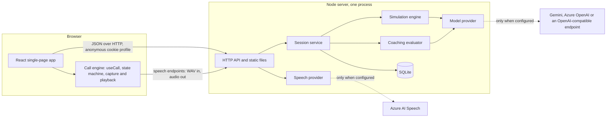
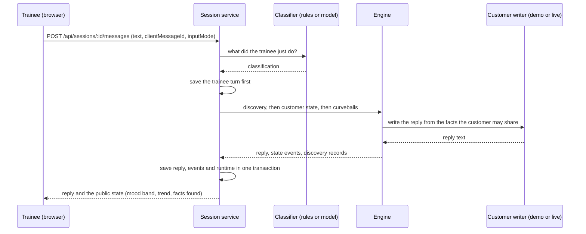
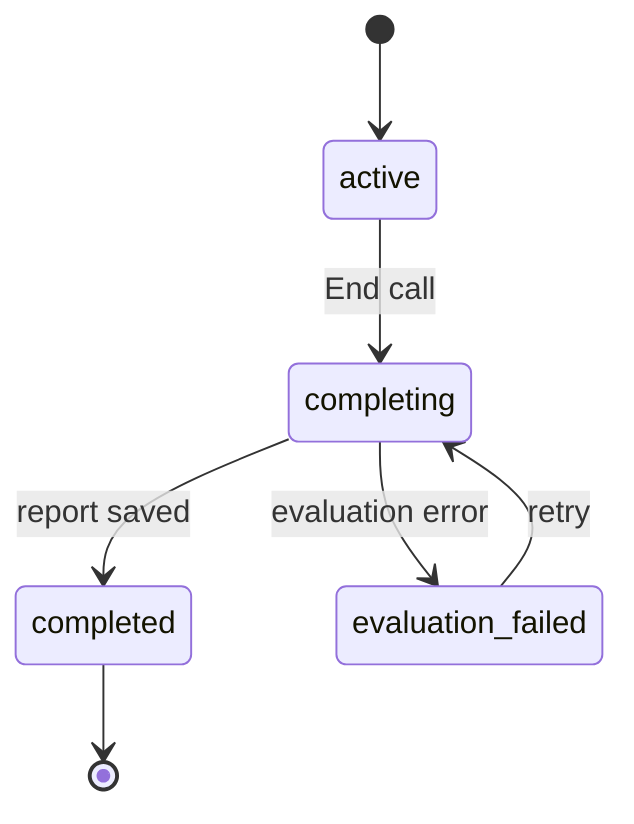
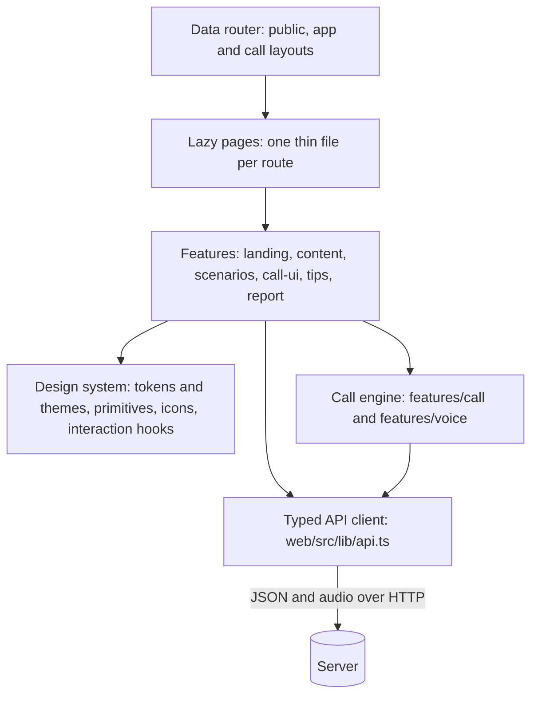

# Architecture

Firefly is one Node.js process and one React single-page app, written in TypeScript. The server exposes a JSON API, serves the built web app, and stores everything in a local SQLite file. There is no external service in the default setup: the customer and the coaching come from a built-in rules engine ("demo mode"), and speech is off. A live language model and a speech provider are optional, and each is configured separately.

## Components

| Area               | Where                                  | What it does                                                                                                                                                                                                                                                                                                                |
| ------------------ | -------------------------------------- | --------------------------------------------------------------------------------------------------------------------------------------------------------------------------------------------------------------------------------------------------------------------------------------------------------------------------- |
| Shared domain      | `shared/domain/`                       | The contract between server and web: vocabulary, zod schemas for scenarios, reports and classifications, the API and speech types, scenario configuration (`applyConfig`), the four customer voices (`voices.ts`) and the spoken-text sanitiser (`spoken-text.ts`). Pure, no I/O.                                           |
| Scenario library   | `server/scenarios/`                    | Synthetic scenarios as TypeScript objects, validated when the server starts. Each has a short card title and an internal provenance record that is never sent to the web app. See [scenario-authoring.md](scenario-authoring.md).                                                                                           |
| Simulation engine  | `server/engine/`                       | Classifies what the trainee did, decides which hidden facts may be revealed, updates the customer's state and memory, fires curveballs and makes the reply plan that both writers follow. Demo mode writes the reply itself. See [customer-realism.md](customer-realism.md).                                                |
| Model provider     | `server/providers/`, `server/prompts/` | One interface with a demo implementation and a live one for Azure OpenAI, Google's Gemini API or any OpenAI-compatible endpoint. See [ai-providers.md](ai-providers.md).                                                                                                                                                    |
| Coaching evaluator | `server/evaluator/`                    | Scores the six skills from the transcript and the engine's records, reads the CARE behaviours and milestones, verifies every quote, and builds the report. It also answers the neutral [closing check](#before-the-call-ends-the-closing-check). See [care-cbcf-rubric.md](care-cbcf-rubric.md).                            |
| Speech             | `server/speech/`                       | Two speech ports (speech to text, text to speech) with `none`, a scripted demo and Azure AI Speech over REST adapters; the voice catalogue and mood direction; use cases in `service.ts`; a fake Azure server for tests. See [speech-providers.md](speech-providers.md) and [voice-architecture.md](voice-architecture.md). |
| Services           | `server/services/`                     | Session lifecycle, idempotency, evaluation jobs, and the mapping from stored rows to the public DTOs.                                                                                                                                                                                                                       |
| Persistence        | `server/db/`                           | SQLite through `node:sqlite`, versioned migrations, profile-scoped queries.                                                                                                                                                                                                                                                 |
| HTTP layer         | `server/http/`                         | A small router with validation, security headers, rate limits and static file serving. No web framework.                                                                                                                                                                                                                    |
| Web app            | `web/`                                 | React 19 and React Router 7 (a data router), built with Vite. Lazy route chunks, plain CSS on design tokens. See [Web app](#web-app) and [design-system.md](design-system.md).                                                                                                                                              |
| Tests              | `*.test.ts(x)`, `e2e/`                 | Vitest for logic, the API and components. Playwright for browser journeys and accessibility checks.                                                                                                                                                                                                                         |

The web app imports shared code only through `#shared/...`, never from `server/`, and only types and plain constants from the modules that hold zod schemas, so the browser bundle contains no schema library. The voice catalogue and the spoken-text sanitiser are their own modules (`shared/domain/voices.ts`, `shared/domain/spoken-text.ts`) so that they travel only with the pages and the server that use them, not with the first load. `web/src/features/voice/entry-weight.test.ts` checks that the entry chunk never reaches them.

## One message, end to end

A spoken turn takes the same path. The browser first sends the recording to `POST /api/speech/transcribe`, gets text back, and then sends that text as an ordinary message with `inputMode: "voice"`. The customer's voice is a separate request (`POST /api/sessions/:id/turns/:index/speech`) made after the reply is stored, so a voice that fails never loses a reply.

Things worth knowing:

- **The trainee's words are saved before the customer replies.** If the reply fails, nothing is lost. The call reports `awaitingReply`, and resending the same `clientMessageId` resumes the exchange without a duplicate.
- **A model never decides the customer's state.** In live mode a model classifies the turn and writes the reply, but the customer's temperature, trust and patience, which hidden facts are revealed and when a curveball fires are computed in code. Model output is validated before it is used. With a live model the evaluation draft also comes from the model, which proposes the six skill scores; the server checks every quote, lowers a score that lacks evidence, and computes CARE, milestones, discovery and the overall score itself.
- **Hidden facts are protected by construction.** Only facts the engine has decided the customer may share reach the reply writer. The trainee sees a mood band and a trend, and in Guided practice a count of "context found", never the underlying numbers, a total or the facts themselves. **Guided practice** (the default at Starter; **Assessment practice** is the other mode) adds that count and a short list of areas worth exploring to the case panel, along with the tips strip and the thin state trace; Assessment practice shows none of them, because a count that ticks up while the trainee asks would be a cue about what is hidden.
- **Demo mode is never disguised.** The provider label ("Demo mode (built-in rules engine)") is part of every session and report, and the app shows it on every relevant screen: the app header, the pre-flight (a "Customer AI" row), Voice settings and, from 360 px wide up, the call bar (below that the bar has no room for it).
- **Speech never carries session information.** A speech provider receives a recording, or one customer line with a voice direction, and nothing else. See [privacy-audio.md](privacy-audio.md).

## Ending a call

Ending a call is a real state change, not just navigation. The transcript is locked, the session moves through evaluation phases the interface can show, and exactly one report is saved.

While `completing`, the session reports its current phase: transcript locked, discovery review, scoring, building the report, saved. Calling end again while evaluation runs, or after it finishes, never creates a second report (a unique constraint on the evaluation table backs this up). If evaluation fails, the transcript is kept and the call can be evaluated again. A server restart during evaluation marks the call retryable rather than leaving it stuck.

A call that stopped quickly, before any wrap-up, is labelled "ended early" and the report says it rests on limited evidence instead of inventing a complete assessment.

### Before the call ends: the closing check

When the trainee presses End call in guided practice, the web app may show a neutral completion check first: has a plan, an owner and a time for the next update been stated, and did the customer agree? It never blocks ending, and it does not say what to say.

On the call screen it is the end dialog of Guided practice, titled "Ready to close?", with four rows (Plan stated, Owner stated, Update time stated, Customer agreement confirmed), each an icon and the word "Done" or "Not yet". The dialog asks once when it opens (`api.closingCheck` in `web/src/lib/api.ts`), shows a short skeleton while it waits, and leaves the rows out without any message if the request fails or takes longer than a second. **End and review** is there from the start and is never dimmed by it. Assessment practice keeps "End the call?" and never asks (`web/src/features/call-ui/ClosingCheck.tsx`, `EndCallDialog.tsx`).

`GET /api/sessions/:id/closing-check` returns `ClosingCheckDTO` (`shared/domain/api.ts`): the session id, the number of trainee turns, and `checks`, four booleans named `plan`, `owner`, `updateTime` and `agreement`. Nothing else: no quote, no wording, no score and nothing about the scenario. It works like the other session reads. The call belongs to the browser's profile (another profile's call is a 404), the call must be `active` (any other status is a 409 `session_not_active`), the response is `no-store`, and it counts against the same per-profile allowance as every other read. It asks no model and stores nothing, so asking again changes nothing. It costs a few milliseconds for a call of the longest allowed length (60 trainee turns).

The pure function is `closingCheck` in `server/evaluator/closingCheck.ts`, run over the stored transcript by `SessionService.getClosingCheck`. It reads the evaluator's own accountable behaviours: `plan` is `accountable.next-action`, `owner` is `accountable.named-owner` or `accountable.ownership` (taking it on outright, "I'll own this"), and `updateTime` is `accountable.update-time`. Three deliberate differences: a bare "I'll look into it" is set aside and counts as nothing, an escalated call is read as a plain one (a named time is a time, whatever cadence the report also asks for), and ownership counts as an owner. So "I'll own this and update you by 3 PM" is a plan, an owner and a time, and "I'll look into it" is none of them.

`agreement` is read from the customer's words after the trainee's latest such statement. Their first reply must not push back, and the last thing they said about it must accept it: asking for it back ("So you'll ...?") and then accepting counts, asking again and stopping there does not. It is conservative on purpose: wording the rules do not recognise is not agreement, so it can say "not confirmed" when a customer agreed in unusual words. The wording rules were checked against the demo customer's lines for accepting, asking again and pushing back (a one-off sweep of its phrase bank) and against the written replies in `server/evaluator/closingCheck.test.ts`. They have not been checked against the replies of a live model.

## Persistence

SQLite via `node:sqlite`. The default file is `data/firefly.db` (git-ignored); `FIREFLY_DB_PATH=:memory:` keeps everything in memory for tests. Tables:

| Table                | Holds                                                                                                                     |
| -------------------- | ------------------------------------------------------------------------------------------------------------------------- |
| `sessions`           | The scenario snapshot and settings, status, timings, provider, evaluator and rubric versions                              |
| `turns`              | The transcript, each trainee turn with its classification and `input_mode` (`voice` or `text`, added by migration 2)      |
| `state_events`       | Every customer-state change with its reason, used for markers and the temperature timeline                                |
| `discovery_events`   | Which hidden facts were found, partly found or missed, and the question that revealed them                                |
| `evaluations`        | One coaching report per session                                                                                           |
| `mentor_evaluations` | Created by migration 1 so that existing databases stay valid. Nothing in the current interface or API reads or writes it. |

Each session stores the exact scenario configuration it was run with, so a call can always be replayed and evaluated as it was. The schema version is tracked with `PRAGMA user_version`; migrations are appended, never edited. Deleting a session removes its rows in every child table. **No audio is stored anywhere.**

There are no accounts. Each browser gets an anonymous `firefly_profile` cookie (HttpOnly, SameSite=Lax, one year) and can only see the sessions created under it. This separates one learner's practice from another's on a shared host; it is not authentication, and Firefly should not be exposed beyond a trusted network.

## API

All routes are under `/api`. Writes accept JSON up to 64 KB, except the recording upload.

| Method and path                                            | Purpose                                                                                                                                                                 |
| ---------------------------------------------------------- | ----------------------------------------------------------------------------------------------------------------------------------------------------------------------- |
| `GET /health`, `GET /config`                               | Liveness; non-secret configuration (provider and speech labels and capabilities, the four voices, limits)                                                               |
| `GET /scenarios`, `GET /scenarios/:id`                     | Public scenario details (never hidden facts, never the internal provenance record)                                                                                      |
| `POST /sessions`                                           | Start a call (idempotent with `clientRequestId`)                                                                                                                        |
| `GET /sessions/:id`, `DELETE /sessions/:id`                | One session with transcript, state and report; delete it and everything stored for it                                                                                   |
| `POST /sessions/:id/messages`                              | Send a trainee message (`inputMode` is `text` or `voice`)                                                                                                               |
| `POST /sessions/:id/end`, `POST /sessions/:id/evaluate`    | End the call; run or retry evaluation                                                                                                                                   |
| `GET /sessions/:id/report`, `GET /sessions/:id/transcript` | The coaching report; the conversation only, with no report, scores or customer state                                                                                    |
| `GET /sessions/:id/closing-check`                          | Active calls only: yes or no for a plan, an owner, an update time and the customer's agreement, and the number of trainee turns. Rules only, no model call              |
| `POST /speech/transcribe?lang=`                            | One utterance (`audio/wav`, 16 kHz mono 16-bit, at most 30 s and 1,500,000 bytes) in, `{status, text, durationMs}` out                                                  |
| `POST /sessions/:id/turns/:index/speech?lang=&voice=`      | One stored customer turn spoken aloud, in the chosen voice (`voice-a` to `voice-d`, optional); audio out, with `x-firefly-speech-*` headers saying what was really used |
| `POST /speech/preview?lang=&voice=`                        | "Test voice": one fixed sentence in the chosen voice; audio out. No call is needed                                                                                      |

There is no route that lists calls: the web app has no history screen.

Every scenario carries an internal `grounding` record: when it was written, which public documentation categories its product wording rests on, how far that wording has been checked and who reviewed it. The schema requires it, and no response carries it. The public scenario is built field by field in `toPublicScenario` (`server/services/dto.ts`), which has no field for it; a saved call stores the effective scenario, which has none either; and the logger drops its field names (`server/log.ts`). Only `npm run validate:scenarios` shows any of it: a table with one line for each scenario (id, product family, date written, how far its behaviour was checked and the review state). Tests walk every scenario in the library through the scenario, session, transcript, closing-check and report responses and through the log lines, and fail if a provenance field name or value turns up (`server/http/api.test.ts`, `server/scenarios/library.test.ts`). The source categories a record can name are public ones (`microsoft-learn`, `microsoft-support`, `product-blog`, `tech-community`) and `author-experience`, the author's own knowledge of how support calls go. The internal Microsoft support wiki was not reachable when the scenarios were written, so none of it was read, copied or paraphrased. See [scenario-authoring.md](scenario-authoring.md).

Errors are always JSON with a stable `code`, a message that is safe to show, and a `retryable` flag. Two groups of extra routes exist only when an environment flag is set: `/api/test/*` (failure injection for automated tests, including `transcribe` and `synthesize`) and `/api/dev/*` (diagnostics that expose internal state). Both are off by default and must never be enabled on a shared host. Speech endpoints are specified in [speech-providers.md](speech-providers.md).

## Security and privacy

- A strict Content-Security-Policy (`script-src 'self'`, `style-src 'self'`, `media-src 'self' blob:`, no inline script or style), `nosniff`, frame denial and a restrictive Permissions-Policy (camera, location and payment off; the microphone for Firefly's own pages only, which spoken calls need).
- Writes must come from the same origin; request bodies are size-limited and validated; token-bucket rate limits protect the API, session creation, messages, ending a call and the three speech endpoints (which also share one server-wide bucket).
- API keys live only in the server's environment. They are never sent to the browser and never logged. Provider errors do not contain keys, endpoints, audio or transcript text.
- Obvious personal data (email addresses, phone numbers, long numbers, identifiers) is removed from trainee text before it is saved or sent to a model. This applies to recognised speech too, after recognition.
- Everything a model returns is rendered as plain text; the web app never uses `innerHTML`.
- No analytics, tracking or telemetry. Logs contain short session ids, codes and timings, never transcripts or audio.

## Web app

A single-page app built with Vite into `dist/web` and served by the Node server.

| Address                     | Page                                                                                                 |
| --------------------------- | ---------------------------------------------------------------------------------------------------- |
| `/`                         | Landing                                                                                              |
| `/responsible-ai`, `/about` | Responsible AI (speech, AI and coaching, what is kept, security) and About (the six skills)          |
| `/scenarios`                | Scenario workspace: product rail, carousel of scenarios, details and call setup                      |
| `/scenarios/:id/brief`      | Call brief, with the configuration in the address                                                    |
| `/calls/:id`                | The call: pre-flight, then the workspace. `?input=voice` or `?input=text` chooses which action leads |
| `/sessions/:id/report`      | The report, including the evaluating, failed and not-found states, and the transcript                |
| `*`                         | A designed not-found page                                                                            |

- **Where things are.** `web/src/pages/` has one thin file per route. `web/src/features/` holds each feature's components, pure models and tests together: `landing`, `content` (Responsible AI and About), `scenarios` (workspace and brief), `call` (the engine contract, state machine and controller), `voice` (capture, playback and test fakes), `call-ui` (the call screen), `tips` (the strip of tips in Guided practice) and `report`. `web/src/design/` is the design system ([design-system.md](design-system.md)): the tokens for both themes, the primitives, the theme runtime (`design/theme/`), the interaction hooks (`design/interaction/`) and the carousel (`design/carousel/`). `web/src/app/` is the shell and router, and `web/src/lib/` holds the API client and small hooks.
- **Providers and layouts.** `AppProviders` (`web/src/App.tsx`) wraps the router in `ThemeProvider`, `ConfigProvider` and `AnnouncerProvider`, outermost first. The data router (`web/src/app/router.tsx`) has three layouts: public (landing, Responsible AI, About, not found), app (scenarios, brief, report) and call, which has no header or footer. Both headers have the theme switch, and the footer of the public and app layouts has the theme choice.
- **The call screen never touches the microphone.** `call-ui` reads a `CallSnapshot` and calls `CallActions` (`web/src/features/call/contract.ts`). The state machine is pure, the controller makes the browser match it, and the adapters in `features/voice` are the only code that touches `getUserMedia`, audio elements and the speech APIs. See [voice-architecture.md](voice-architecture.md).
- **No state library.** Server data comes through the typed client, and the rest is React state and context plus the call controller. The web app uses no IndexedDB, cache or service worker. What it keeps in the browser is listed in [privacy-audio.md](privacy-audio.md#what-the-browser-keeps): two `localStorage` entries (`firefly.voice-notice-seen`, set when you dismiss the first-use microphone notice, and `firefly.theme`, set only when you choose Light or Dark), two `sessionStorage` entries that React Router writes (page scroll offsets, and the page addresses of the view transitions it has run), and the profile cookie. None holds text from a call. `e2e/landing.spec.ts` checks what is stored after a scenario and a brief have been read and after the notice has been dismissed.
- **Interaction and the carousel.** Pointer and scroll behaviour comes from a few hooks in `web/src/design/interaction/`: card tilt, mouse drag, in-view, page visibility and the clock behind the landing page's call preview. Mouse effects are on only for a fine hovering pointer when nobody has asked for less motion or less data. The scenario cards, on the landing page and in the workspace, are one `Carousel` (`web/src/design/carousel/`). See [design-system.md](design-system.md#interaction).
- **Tips.** `web/src/features/tips/` draws the "During the call" strip, in Guided practice only. A tip is chosen from the call stage the brief set and the number of messages the trainee has sent, and from nothing else: the folder imports no scenario and no call state (a test reads its imports), runs no timer and stores nothing.
- **Configuration travels in the address.** The scenario configuration is parsed from query parameters by a small hand-written parser (`features/scenarios/config-params.ts`), so a call can be repeated or shared as a link.
- **Styles and themes.** Plain CSS on tokens, one stylesheet per component, with a class-ownership test. There are two themes, light and an authored dark one, both in `web/src/design/tokens.css` and chosen by a `data-theme` attribute on `<html>`. A small script, `web/public/theme-init.js`, sets it before the first paint (it is a file and not an inline script because the content security policy allows scripts from this origin only), and `ThemeProvider` keeps it in step with the person's choice and the device's setting. The choice is stored only in this browser (`localStorage`, `firefly.theme`), and the footer says so when the browser would not keep it. The stylesheet, not a script, sets `color-scheme`, and only for screens, so a printed page is always light. See [design-system.md](design-system.md#themes).
- **Bundle budgets.** `npm run check:budgets` (`scripts/check-budgets.mjs`, limits in `scripts/budgets.json`) runs after `npm run build` and fails when the first load or a chunk grows past its limit. See [performance.md](performance.md).
- **Building and running.** `npm run dev` starts the API server and the Vite dev server (port 5173), which proxies `/api` to the server. `npm run build` writes `dist/web`, which `npm start` serves. Several copies can run side by side: `FIREFLY_WEB_PORT` changes the Vite dev port, `FIREFLY_OUT_DIR` (relative to `web/`) changes where a build is written, and the server's `FIREFLY_WEB_DIR` changes which build it serves.
- **Galleries.** Four development pages mount real components with their server replaced by fixtures, so every state can be looked at without a server. They load the theme script but mount no theme provider, so they follow the saved or the system theme and have no switch. Only the Vite dev server serves them; the production build contains only `index.html`.

  | Page                         | What it shows                                                                                                                                                                                                                                                                                                                                                                                                                         |
  | ---------------------------- | ------------------------------------------------------------------------------------------------------------------------------------------------------------------------------------------------------------------------------------------------------------------------------------------------------------------------------------------------------------------------------------------------------------------------------------- |
  | `web/gallery.html`           | The design system: tokens and primitives ([design-system.md](design-system.md)).                                                                                                                                                                                                                                                                                                                                                      |
  | `web/gallery-call.html`      | The call screen. With no query it lists every state. `?state=<name>` shows one full screen; `&animate=1` moves the levels, `&provider=live` labels a live model and `&online=0` goes offline.                                                                                                                                                                                                                                         |
  | `web/gallery-report.html`    | The report page. `?state=<name>` shows one state.                                                                                                                                                                                                                                                                                                                                                                                     |
  | `web/gallery-scenarios.html` | The real app layout with the real scenario workspace and brief pages. `?state=<name>` chooses what the pretend server does (`default`, `azure`, `azure-shared`, `old-server`, `no-speech`, `loading`, `slow`, `unreachable`, `empty`, `preview-fails`, `start-fails`, `start-fails-once`, `start-slow`). `?path=<route>` is where to start, URL-encoded (default `/scenarios`). Call, report and Responsible AI routes are stand-ins. |

## Why these choices

- **TypeScript everywhere, run natively.** Node 24 runs `.ts` files directly, so the server has no build step. Code is limited to erasable TypeScript syntax (no enums, no constructor parameter properties).
- **No server framework.** The API surface is small; a hand-written router keeps validation, errors and security in one readable place.
- **Rules first, model optional.** A product that needs credentials to run is hard to review, test and demo. The rules engine makes the whole product runnable and testable offline, and the live provider is a drop-in for the three judgement calls.
- **Speech behind its own boundary.** The simulation never depends on how speech is produced. A provider can be swapped, switched off or faked, and every call can be typed.
- **A pure state machine for the call.** What should be true (phase, microphone, recording, voice, requests, timers) is a function of the state, so the rules can be proved with plain tests and a failed browser step can never leave two recordings or two voices behind.
- **Evidence over opinion.** Reports cite turns, and a quote that does not appear in the turn it cites is rejected before a report is saved.
