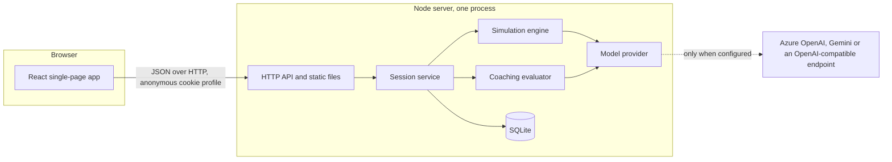
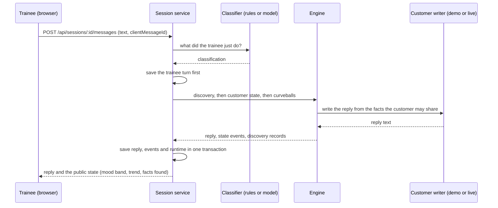
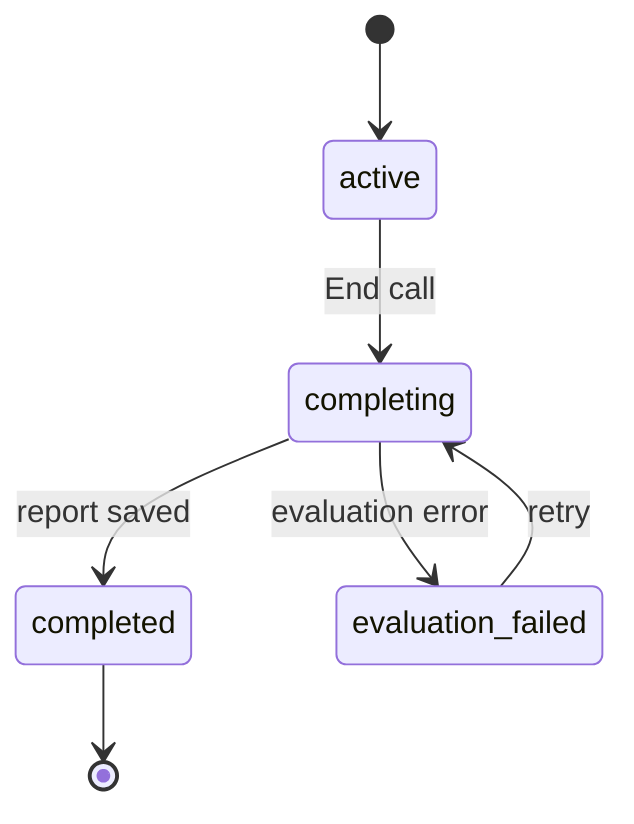
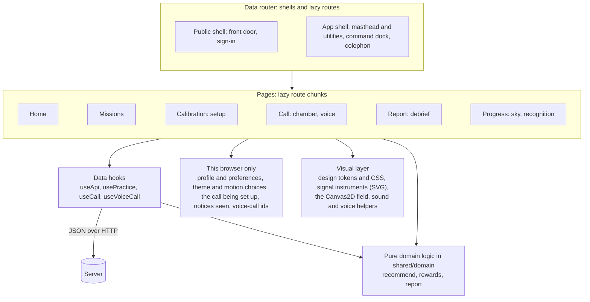

# Architecture

Firefly is one Node.js process and one React single-page app, written in TypeScript. The server exposes a JSON API, serves the built web app, and stores everything in a local SQLite file. There is no external service in the default setup: the customer and the coaching come from a built-in rules engine ("demo mode"). A live language model is optional.

## Components

| Area               | Where                                  | What it does                                                                                                                                                                                              |
| ------------------ | -------------------------------------- | --------------------------------------------------------------------------------------------------------------------------------------------------------------------------------------------------------- |
| Shared domain      | `shared/domain/`                       | The contract between server and web: vocabulary, zod schemas for scenarios, reports and classifications, the API types, scenario configuration (`applyConfig`), and calibration maths. Pure, no I/O.      |
| Scenario library   | `server/scenarios/`                    | Thirteen synthetic scenarios as TypeScript objects, validated when the server starts. See [scenario-authoring.md](scenario-authoring.md).                                                                 |
| Simulation engine  | `server/engine/`                       | Classifies what the trainee did, decides which hidden facts may be revealed, updates the customer's state, fires curveballs and writes the reply (demo mode). Deterministic for a given seed.             |
| Model provider     | `server/providers/`, `server/prompts/` | One interface with a demo implementation and a live one for Azure OpenAI, Google's Gemini API or any OpenAI-compatible endpoint. See [ai-providers.md](ai-providers.md).                                  |
| Coaching evaluator | `server/evaluator/`                    | Scores the six coaching dimensions from the transcript and the engine's records, verifies every quote, and builds the report. See [evaluation-rubric.md](evaluation-rubric.md).                           |
| Services           | `server/services/`                     | Session lifecycle, idempotency, evaluation jobs, progress, calibration and rewards, sample data.                                                                                                          |
| Persistence        | `server/db/`                           | SQLite through `node:sqlite`, versioned migrations, profile-scoped queries.                                                                                                                               |
| HTTP layer         | `server/http/`                         | A small router with validation, security headers, rate limits and static file serving. No web framework.                                                                                                  |
| Web app            | `web/`                                 | React 19 and React Router 7 (a data router), built with Vite. Pages are lazy route chunks. Styling is plain CSS built on design tokens. See [Web app](#web-app) and [design-system.md](design-system.md). |
| Tests              | `*.test.ts(x)`, `e2e/`                 | Vitest for logic, the API and components. Playwright for browser journeys and automated accessibility checks.                                                                                             |

The web app imports shared code only through `#shared/...` and never imports from `server/`. The one exception is a test (`web/src/components/atlas/atlas.fixtures.test.ts`) that checks the atlas fixtures against the real scenario registry.

## One message, end to end

Things worth knowing:

- **The trainee's words are saved before the customer replies.** If the reply fails, nothing is lost. The call reports `awaitingReply`, and resending the same `clientMessageId` resumes the exchange without a duplicate.
- **A model never decides the numbers.** In live mode a model classifies the turn and writes the reply, but the customer's temperature, trust and patience, which hidden facts are revealed, when a curveball fires and every score are computed in code. Model output is validated before it is used.
- **Hidden facts are protected by construction.** Only facts the engine has decided the customer may share reach the reply writer. The trainee sees a mood band, a trend and a count of facts found, never the underlying numbers or the facts themselves.
- **Demo mode is never disguised.** The provider label ("Demo mode (built-in rules engine)") is part of every session and report, and the app shows it on every relevant screen.

## Ending a call

Ending a call is a real state change, not just navigation. The transcript is locked, the session moves through evaluation phases the interface can show, and exactly one report is saved.

While `completing`, the session reports its current phase: transcript locked, discovery review, scoring, building the report, saved. Calling end again while evaluation runs, or after it finishes, never creates a second report (a unique constraint on the evaluation table backs this up). If evaluation fails, the transcript is kept and the call can be evaluated again. A server restart during evaluation marks the call retryable rather than leaving it stuck.

A call that stopped quickly, before any wrap-up, is labelled "ended early" and the report says it rests on limited evidence instead of inventing a complete assessment.

## Persistence

SQLite via `node:sqlite`. The default file is `data/firefly.db` (git-ignored); `FIREFLY_DB_PATH=:memory:` keeps everything in memory for tests. Tables:

| Table                | Holds                                                                                        |
| -------------------- | -------------------------------------------------------------------------------------------- |
| `sessions`           | The scenario snapshot and settings, status, timings, provider, evaluator and rubric versions |
| `turns`              | The transcript, each trainee turn with its classification                                    |
| `state_events`       | Every customer-state change with its reason, used for markers and the temperature timeline   |
| `discovery_events`   | Which hidden facts were found, partly found or missed, and the question that revealed them   |
| `evaluations`        | One coaching report per session                                                              |
| `mentor_evaluations` | Mentor scores for calibration, marked as a mentor review or a labelled sample                |

Each session stores the exact scenario configuration it was run with, so a call can always be replayed and evaluated as it was. The schema version is tracked with `PRAGMA user_version`; migrations are appended, never edited.

There are no accounts. Each browser gets an anonymous `firefly_profile` cookie (HttpOnly, SameSite=Lax) and can only see the sessions created under it. This separates one learner's practice history from another's on a shared host; it is not authentication, and Firefly should not be exposed beyond a trusted network.

## API

All routes are under `/api`. Writes accept JSON only, up to 64 KB.

| Method and path                                         | Purpose                                                                                                                                       |
| ------------------------------------------------------- | --------------------------------------------------------------------------------------------------------------------------------------------- |
| `GET /health`, `GET /config`                            | Liveness and non-secret configuration (provider label, limits)                                                                                |
| `GET /scenarios`, `GET /scenarios/:id`                  | Public scenario details (never hidden facts)                                                                                                  |
| `POST /sessions`, `GET /sessions`                       | Start a call (idempotent with `clientRequestId`); list with filters                                                                           |
| `GET /sessions/:id`, `DELETE /sessions/:id`             | One session with transcript, state and report; delete                                                                                         |
| `POST /sessions/:id/messages`                           | Send a trainee message                                                                                                                        |
| `POST /sessions/:id/end`, `POST /sessions/:id/evaluate` | End the call; run or retry evaluation                                                                                                         |
| `GET /sessions/:id/report`                              | The coaching report                                                                                                                           |
| `GET /sessions/:id/transcript`                          | The conversation only, with no report, scores or customer state                                                                               |
| `POST /sessions/:id/mentor-score`                       | Record a mentor review for calibration                                                                                                        |
| `GET /progress`, `GET /calibration`                     | Progress and calibration; the review queue carries no AI scores                                                                               |
| `GET /rewards?tzOffset=<minutes>`                       | Points, level, streak, badges, challenges and the points history, worked out from saved calls on every request (see [rewards.md](rewards.md)) |
| `GET /demo`, `POST /demo/samples`, `POST /demo/reset`   | Trainer tools: labelled sample sessions and safe resets                                                                                       |

Errors are always JSON with a stable `code`, a message that is safe to show, and a `retryable` flag. Two groups of extra routes exist only when an environment flag is set: `/api/test/*` (failure injection for automated tests) and `/api/dev/*` (diagnostics that expose internal state). Both are off by default and must never be enabled on a shared host.

## Security and privacy

- A strict Content-Security-Policy (`script-src 'self'`, no inline script or style), `nosniff`, frame denial and a restrictive Permissions-Policy (camera, location and payment off; the microphone for Firefly's own pages only, which Voice needs).
- Writes must come from the same origin; request bodies are size-limited and validated; token-bucket rate limits protect the API, session creation and messages.
- API keys live only in the server's environment. They are never sent to the browser and never logged. The provider layer's errors do not contain keys, endpoints or transcript text.
- Obvious personal data (email addresses, phone numbers, long numbers, identifiers) is removed from trainee messages before they are saved or sent to a model, and the composer warns before sending.
- Everything a model returns is rendered as plain text; the web app never uses `innerHTML`.
- No analytics, tracking or telemetry. Logs contain short session ids, codes and timings, not transcripts.

## Web app

A single-page app, built with Vite into `dist/web` and served by the Node server. It has two frames: a public shell for the front door and sign-in, and an app shell for everything else, both on the same animated field. The app shell has a masthead (the wordmark, the provider badge and a utility cluster for search, theme, Pause ambient motion, notices, profile and help), the page, a colophon and a command dock along the bottom with six numbered destinations: Home, Missions, History, Progress, Studio and Settings. There is no sidebar, and a live call takes the whole screen. This section is how it is wired. [design-system.md](design-system.md) covers the tokens and components, and [experience-design.md](experience-design.md) covers each screen and the reasoning behind it.

| Address                                            | Page                                                                                                                                 |
| -------------------------------------------------- | ------------------------------------------------------------------------------------------------------------------------------------ |
| `/`, `/sign-in`                                    | Public shell: the front door, and the local sign-in (a name saved in this browser)                                                   |
| `/home`                                            | Home                                                                                                                                 |
| `/scenarios`                                       | Missions: the scenario library as an atlas, as a chart or a list                                                                     |
| `/practice`, `/scenarios/:id/setup`                | Calibration: where a call is set up and started (`/scenarios/:id/brief` redirects here)                                              |
| `/calls/:id`                                       | The live call, then its wrap-up                                                                                                      |
| `/sessions/:id/report`, `/sessions/:id/transcript` | The coaching report ("Call feedback") and the transcript                                                                             |
| `/history`                                         | History                                                                                                                              |
| `/progress`                                        | Progress: the skill constellation, then Recognition (points, badges and challenges). `/rewards` redirects to `/progress#recognition` |
| `/trainer`, `/calibration`                         | Studio: the Trainer tools and mentor Calibration                                                                                     |
| `/help`, `/settings`                               | Help and Responsible AI (`/about` redirects here), and Settings                                                                      |
| `*`                                                | A designed not-found page                                                                                                            |

### How it is wired

- **Where things are.** `web/src/pages/` has one thin file per route. `web/src/components/` is organised by feature (`shell`, `frame`, `signal`, `world`, `atlas`, `scenario`, `call`, `report`, `progress`, `rewards`, `history`, `dashboard`, `trainer`, `calibration`, `settings`, `voice` and so on), with each feature's components, hooks, pure models and tests together. `web/src/lib/` holds the API client and hooks, the local profile and storage, theme, `motion/`, `voice/` and the performance tier. Logic that can be tested without a browser (the atlas layout, the call's atmosphere, the journey, the tiers) lives in pure modules, and the components stay thin.
- **Router and lazy pages.** `web/src/App.tsx` builds a React Router **data router**, because a view transition is only started by `<Link viewTransition>` and `navigate(..., { viewTransition: true })` in data mode. Every page except the not-found page is a lazy route (`lazyPage`) with its own chunk. The router, not `React.lazy`, waits for a page's code before it commits a navigation, and `main.tsx` fetches the opening page before the first render (waiting at most 1.5 seconds). The command palette, the first-run tour and the animated field load on demand too, so none of them is part of the first download. A page that fails inside the app shell is replaced by an error screen there, so the dock stays; anywhere else the error screen stands alone, and neither prints a stack trace.
- **Providers and state.** `web/src/main.tsx` wraps the router, outermost first, in `ThemeProvider` (theme and reduced motion), `AmbientProvider` (the persisted Pause ambient motion choice), `PerfTierProvider` (the performance tier), `ConfigProvider` (the server's non-secret configuration), `ToastProvider` and an error boundary, and calls `installViewTransitionSkip()` once. There is no state library: server data comes through `useApi` and the typed client in `web/src/lib/api.ts`, and the rest is React state and context plus a few small module-level stores (the local profile, sound, the field's pose).
- **Styles.** Plain CSS on tokens. `web/src/styles/index.css` imports the global layers: `tokens.css` (custom properties for both themes and for each mood; it pulls in the self-hosted `fonts.css`), `base.css` (a small reset, focus and the rules that make reduced motion real), `type.css` (the type roles), `materials.css` (`.glass`, `.plate`, `.rule`), `transitions.css` (view-transition styles) and `world.css` (the field). Each component or page imports its own sheet (`frame.css`, `shell.css`, `signal.css`, `atlas.css` and so on), with a short class prefix per page so rules never collide.
- **Signal instruments.** `web/src/components/signal` draws the one recurring object as SVG: `SignalGlyph` for a mission or a call, `SignalCore` with `CoreLegend` for the calibration, `SignalPresence` for the customer (held still with `frozen` in the report), and `KeyToPlate`, the legend. `describeGlyph` and `describeCore` write the same facts as words. They show public settings only.
- **The field.** `web/src/components/world` is the animated background. `WorldLayer` is mounted once per shell. It paints the still gradient from the tokens first, and requests `WorldField` (a Canvas2D drawing, a separate lazy chunk) once the browser is idle, and not at all on the low tier. Pages ask for a pose with `useWorldPose` (the call passes its customer's mood), and `pulseWorld` adds one short event. While motion is reduced, ambient motion is paused or the tab is hidden, the field holds a still frame.
- **View transitions.** `web/src/lib/motion/transitions.ts` names what keeps its identity across routes (`signal-mission`, so a mission's instrument becomes the calibration core, and `firefly-dock`) and skips a running transition on the first pointer press or key press, because the browser blocks pointer events while one runs. The field is deliberately not named.
- **Performance tiers.** `web/src/lib/perf-tier.ts` and `PerfTierProvider` give every effect a budget at one of three tiers (high, medium, low). The tier starts from what the browser reports (data saver, cores, memory, a touch screen), and a frame monitor only ever steps it down. `data-perf` is set on `<html>` so CSS can drop blur on the low tier, and `?perf=high`, `?perf=medium` or `?perf=low` in the address pins a tier. Ambient motion has its own persistent pause (`web/src/lib/motion/ambient.tsx`), and reduced motion is honoured from the system and from Settings.
- **Bundle budgets.** `npm run check:budgets` (`scripts/check-budgets.mjs`, limits in `scripts/budgets.json`) runs after `npm run build` and checks the gzip sizes of `dist/web`: first-load JavaScript and CSS, the largest route chunk and CSS file, the preloaded fonts, all fonts, and that no source map was built. It is part of `npm run check`, and raising a limit is a visible change to `budgets.json`.
- **Building and running.** `npm run dev` starts the API server and the Vite dev server (port 5173), which proxies `/api` to the server. `npm run build` writes `dist/web`, which `npm start` serves. Several copies can run side by side: `FIREFLY_WEB_PORT` changes the Vite dev port, `FIREFLY_OUT_DIR` (relative to `web/`) changes where a build is written, and the server's `FIREFLY_WEB_DIR` changes which build it serves. `check:budgets` always reads `dist/web`. `web/gallery.html`, `web/gallery-ui.html` and `web/world.html` are development pages that only the Vite dev server serves; they are not part of the build.

### Behaviour worth knowing

- **The API change for rewards is additive.** `GET /api/rewards` is the only new route; everything else on screen is derived in the browser from data the app already loads. `PublicStateDTO` (the call state the browser sees) still carries only what a trainee may know.
- **Rewards are pure functions.** `shared/domain/rewards.ts` works out points, levels, the streak, badges and challenges from the saved calls, their coaching reports and any mentor reviews, every time it is asked. Nothing is stored, so asking twice can never pay twice and deleting a call takes back exactly what it earned. `recommend.ts` chooses the recommended scenario and says why. They have no I/O and are covered by tests. See [rewards.md](rewards.md).
- **Identity is local.** `web/src/lib/profile.ts` keeps a name, an optional role and location and a few preferences in `localStorage`. There is no account and no password. The anonymous profile cookie on the server is what separates one browser's practice from another's.
- **Live call.** Messages appear immediately and are confirmed by the server; a failed message keeps its id so Retry is safe. The conversation is set along a filament, with one list item per message. It follows new messages only while the reader is at the latest one, and a Jump to latest button appears otherwise. New customer replies are announced politely once, as a whole. The customer is an abstract presence, not a face. In guided practice its rings and edge, the filament and the field behind the page follow the customer's mood, and the call shows the mood in a word, a count of signals found and a few Ideas that only fill the message box. Immersive practice shows none of that and the presence stays neutral; `cueLevelFor` decides this in one place.
- **Voice (Beta).** An opt-in layer over the same call: speech input and output come from the browser's own speech features (`web/src/lib/voice/`), call tones are generated with Web Audio, and only the recognised text is sent, through the same path as typed text. Firefly never records or stores audio. See [voice.md](voice.md).
- **Call feedback.** The report is one long page. Its masthead has the call's title, the customer held still as they were at the end and the whole call as one line, and a numbered section rail follows it. The sections are Customer temperature, Curveball (when one landed), Six skill scores, What went well, Opportunities to improve (each with a stronger way to say it), Discovery, Rewards from this call, Next practice target and About this report. Quotes link to their turn in the transcript, and each quoted moment can be opened with the turns around it.
- **Customer temperature.** The journey as a filament across five labelled bands: an accessible SVG with a data-table alternative, drawn from the report's journey points.
- **Themes, motion and sound.** Two designed themes (a dark night field and a light parchment), reduced-motion support from both the system setting and Settings, a persistent Pause ambient motion control, and optional synthesised sound that is off until switched on.
- **Connection.** An offline notice appears when the browser loses its connection (a live call explains a failed send where it happens instead); failed requests offer Try again, and a failed message is kept for Retry.

The web app still depends only on React, React Router and zod: the redesign, rewards and voice added no runtime dependency.

## Why these choices

- **TypeScript everywhere, run natively.** Node 24 runs `.ts` files directly, so the server has no build step. Code is limited to erasable TypeScript syntax (no enums, no constructor parameter properties).
- **No server framework.** The API surface is small; a hand-written router keeps validation, errors and security in one readable place.
- **Rules first, model optional.** A product that needs credentials to run is hard to review, test and demo. The rules engine makes the whole product runnable and testable offline, and the live provider is a drop-in for the three judgement calls.
- **Evidence over opinion.** Reports cite turns, and a quote that does not appear in the turn it cites is rejected before a report is saved.
