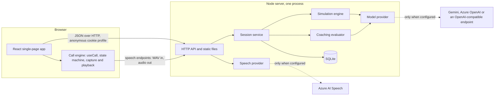
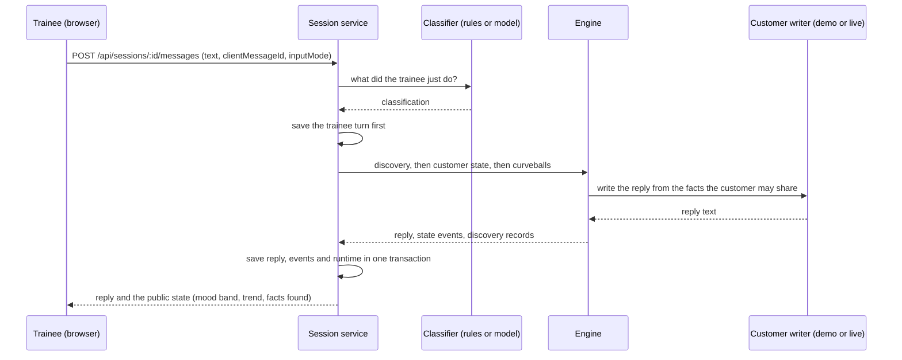
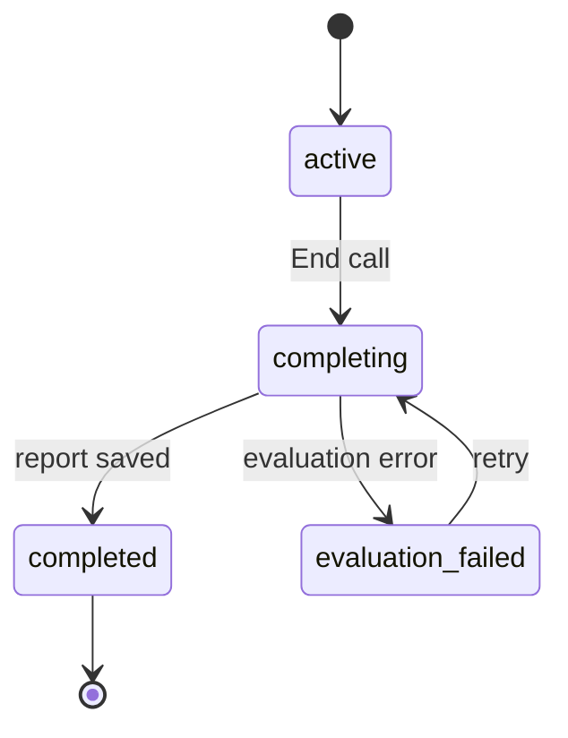
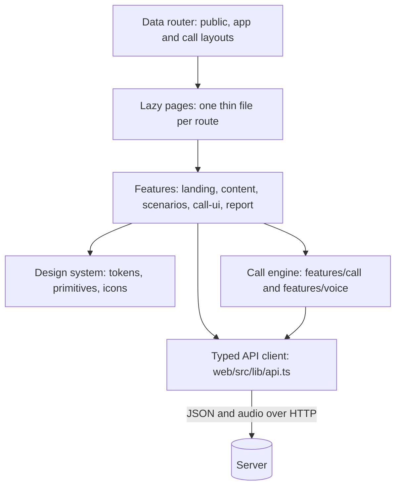

# Architecture

Firefly is one Node.js process and one React single-page app, written in TypeScript. The server exposes a JSON API, serves the built web app, and stores everything in a local SQLite file. There is no external service in the default setup: the customer and the coaching come from a built-in rules engine ("demo mode"), and speech is off. A live language model and a speech provider are optional, and each is configured separately.

## Components

| Area               | Where                                  | What it does                                                                                                                                                                                  |
| ------------------ | -------------------------------------- | --------------------------------------------------------------------------------------------------------------------------------------------------------------------------------------------- |
| Shared domain      | `shared/domain/`                       | The contract between server and web: vocabulary, zod schemas for scenarios, reports and classifications, the API and speech types, scenario configuration (`applyConfig`). Pure, no I/O.      |
| Scenario library   | `server/scenarios/`                    | Thirteen synthetic scenarios as TypeScript objects, validated when the server starts. See [scenario-authoring.md](scenario-authoring.md).                                                     |
| Simulation engine  | `server/engine/`                       | Classifies what the trainee did, decides which hidden facts may be revealed, updates the customer's state, fires curveballs and writes the reply (demo mode). Deterministic for a given seed. |
| Model provider     | `server/providers/`, `server/prompts/` | One interface with a demo implementation and a live one for Azure OpenAI, Google's Gemini API or any OpenAI-compatible endpoint. See [ai-providers.md](ai-providers.md).                      |
| Coaching evaluator | `server/evaluator/`                    | Scores the six coaching dimensions from the transcript and the engine's records, verifies every quote, and builds the report. See [scoring-rubric.md](scoring-rubric.md).                     |
| Speech             | `server/speech/`                       | A provider interface with `none`, a scripted demo and Azure AI Speech over REST; voice and mood direction; a fake Azure server for tests. See [speech-providers.md](speech-providers.md).     |
| Services           | `server/services/`                     | Session lifecycle, idempotency, evaluation jobs, and the mapping from stored rows to the public DTOs.                                                                                         |
| Persistence        | `server/db/`                           | SQLite through `node:sqlite`, versioned migrations, profile-scoped queries.                                                                                                                   |
| HTTP layer         | `server/http/`                         | A small router with validation, security headers, rate limits and static file serving. No web framework.                                                                                      |
| Web app            | `web/`                                 | React 19 and React Router 7 (a data router), built with Vite. Lazy route chunks, plain CSS on design tokens. See [Web app](#web-app) and [design-system.md](design-system.md).                |
| Tests              | `*.test.ts(x)`, `e2e/`                 | Vitest for logic, the API and components. Playwright for browser journeys and accessibility checks.                                                                                           |

The web app imports shared code only through `#shared/...`, never from `server/`, and only types and plain constants from the modules that hold zod schemas, so the browser bundle contains no schema library.

## One message, end to end

A spoken turn takes the same path. The browser first sends the recording to `POST /api/speech/transcribe`, gets text back, and then sends that text as an ordinary message with `inputMode: "voice"`. The customer's voice is a separate request (`POST /api/sessions/:id/turns/:index/speech`) made after the reply is stored, so a voice that fails never loses a reply.

Things worth knowing:

- **The trainee's words are saved before the customer replies.** If the reply fails, nothing is lost. The call reports `awaitingReply`, and resending the same `clientMessageId` resumes the exchange without a duplicate.
- **A model never decides the numbers.** In live mode a model classifies the turn and writes the reply, but the customer's temperature, trust and patience, which hidden facts are revealed, when a curveball fires and every score are computed in code. Model output is validated before it is used.
- **Hidden facts are protected by construction.** Only facts the engine has decided the customer may share reach the reply writer. The trainee sees a mood band, a trend and a count of facts found, never the underlying numbers or the facts themselves.
- **Demo mode is never disguised.** The provider label ("Demo mode (built-in rules engine)") is part of every session and report, and the app shows it on every relevant screen.
- **Speech never carries session information.** A speech provider receives a recording, or one customer line with a voice direction, and nothing else. See [privacy-and-audio.md](privacy-and-audio.md).

## Ending a call

Ending a call is a real state change, not just navigation. The transcript is locked, the session moves through evaluation phases the interface can show, and exactly one report is saved.

While `completing`, the session reports its current phase: transcript locked, discovery review, scoring, building the report, saved. Calling end again while evaluation runs, or after it finishes, never creates a second report (a unique constraint on the evaluation table backs this up). If evaluation fails, the transcript is kept and the call can be evaluated again. A server restart during evaluation marks the call retryable rather than leaving it stuck.

A call that stopped quickly, before any wrap-up, is labelled "ended early" and the report says it rests on limited evidence instead of inventing a complete assessment.

## Persistence

SQLite via `node:sqlite`. The default file is `data/firefly.db` (git-ignored); `FIREFLY_DB_PATH=:memory:` keeps everything in memory for tests. Tables:

| Table                | Holds                                                                                                                     |
| -------------------- | ------------------------------------------------------------------------------------------------------------------------- |
| `sessions`           | The scenario snapshot and settings, status, timings, provider, evaluator and rubric versions                              |
| `turns`              | The transcript, each trainee turn with its classification and `input_mode` (`voice` or `text`, added by migration 2)      |
| `state_events`       | Every customer-state change with its reason, used for markers and the temperature timeline                                |
| `discovery_events`   | Which hidden facts were found, partly found or missed, and the question that revealed them                                |
| `evaluations`        | One coaching report per session                                                                                           |
| `mentor_evaluations` | Created by migration 1 so that existing databases stay valid. Nothing in the current interface or API reads or writes it. |

Each session stores the exact scenario configuration it was run with, so a call can always be replayed and evaluated as it was. The schema version is tracked with `PRAGMA user_version`; migrations are appended, never edited. Deleting a session removes its rows in every child table. **No audio is stored anywhere.**

There are no accounts. Each browser gets an anonymous `firefly_profile` cookie (HttpOnly, SameSite=Lax, one year) and can only see the sessions created under it. This separates one learner's practice from another's on a shared host; it is not authentication, and Firefly should not be exposed beyond a trusted network.

## API

All routes are under `/api`. Writes accept JSON up to 64 KB, except the recording upload.

| Method and path                                            | Purpose                                                                                                                |
| ---------------------------------------------------------- | ---------------------------------------------------------------------------------------------------------------------- |
| `GET /health`, `GET /config`                               | Liveness; non-secret configuration (provider and speech labels and capabilities, limits)                               |
| `GET /scenarios`, `GET /scenarios/:id`                     | Public scenario details (never hidden facts)                                                                           |
| `POST /sessions`, `GET /sessions`                          | Start a call (idempotent with `clientRequestId`); list with filters                                                    |
| `GET /sessions/:id`, `DELETE /sessions/:id`                | One session with transcript, state and report; delete it and everything stored for it                                  |
| `POST /sessions/:id/messages`                              | Send a trainee message (`inputMode` is `text` or `voice`)                                                              |
| `POST /sessions/:id/end`, `POST /sessions/:id/evaluate`    | End the call; run or retry evaluation                                                                                  |
| `GET /sessions/:id/report`, `GET /sessions/:id/transcript` | The coaching report; the conversation only, with no report, scores or customer state                                   |
| `POST /speech/transcribe?lang=`                            | One utterance (`audio/wav`, 16 kHz mono 16-bit, at most 30 s and 1,500,000 bytes) in, `{status, text, durationMs}` out |
| `POST /sessions/:id/turns/:index/speech?lang=`             | One stored customer turn spoken aloud; audio out, with `x-firefly-speech-*` headers saying what was really used        |

Errors are always JSON with a stable `code`, a message that is safe to show, and a `retryable` flag. Two groups of extra routes exist only when an environment flag is set: `/api/test/*` (failure injection for automated tests, including `transcribe` and `synthesize`) and `/api/dev/*` (diagnostics that expose internal state). Both are off by default and must never be enabled on a shared host. Speech endpoints are specified in [speech-providers.md](speech-providers.md).

## Security and privacy

- A strict Content-Security-Policy (`script-src 'self'`, `style-src 'self'`, `media-src 'self' blob:`, no inline script or style), `nosniff`, frame denial and a restrictive Permissions-Policy (camera, location and payment off; the microphone for Firefly's own pages only, which spoken calls need).
- Writes must come from the same origin; request bodies are size-limited and validated; token-bucket rate limits protect the API, session creation, messages and the two speech endpoints.
- API keys live only in the server's environment. They are never sent to the browser and never logged. Provider errors do not contain keys, endpoints, audio or transcript text.
- Obvious personal data (email addresses, phone numbers, long numbers, identifiers) is removed from trainee text before it is saved or sent to a model. This applies to recognised speech too, after recognition.
- Everything a model returns is rendered as plain text; the web app never uses `innerHTML`.
- No analytics, tracking or telemetry. Logs contain short session ids, codes and timings, never transcripts or audio.

## Web app

A single-page app built with Vite into `dist/web` and served by the Node server.

| Address                     | Page                                                                                                 |
| --------------------------- | ---------------------------------------------------------------------------------------------------- |
| `/`                         | Landing                                                                                              |
| `/responsible-ai`, `/about` | Responsible AI (speech, AI and coaching, what is kept, security) and About (the six skills)          |
| `/scenarios`                | Scenario workspace: search, filters, details and call setup; recent calls                            |
| `/scenarios/:id/brief`      | Call brief, with the configuration in the address                                                    |
| `/calls/:id`                | The call: pre-flight, then the workspace. `?input=voice` or `?input=text` chooses which action leads |
| `/sessions/:id/report`      | The report, including the evaluating, failed and not-found states, and the transcript                |
| `*`                         | A designed not-found page                                                                            |

- **Where things are.** `web/src/pages/` has one thin file per route. `web/src/features/` holds each feature's components, pure models and tests together: `landing`, `content` (Responsible AI and About), `scenarios` (workspace and brief), `call` (the engine contract, state machine and controller), `voice` (capture, playback and test fakes), `call-ui` (the call screen) and `report`. `web/src/design/` is the design system ([design-system.md](design-system.md)), `web/src/app/` is the shell and router, and `web/src/lib/` holds the API client and small hooks.
- **The call screen never touches the microphone.** `call-ui` reads a `CallSnapshot` and calls `CallActions` (`web/src/features/call/contract.ts`). The state machine is pure, the controller makes the browser match it, and the adapters in `features/voice` are the only code that touches `getUserMedia`, audio elements and the speech APIs. See [voice-architecture.md](voice-architecture.md).
- **No state library.** Server data comes through the typed client, and the rest is React state and context plus the call controller. The web app uses no `localStorage`, IndexedDB, cache or service worker. The one thing it leaves in the browser is React Router's scroll offsets, in `sessionStorage` under `react-router-scroll-positions`: a number for each page visited in that tab (no text), so that Back and a reload return to where you were. It is gone when the tab closes, and `e2e/landing.spec.ts` checks it.
- **Configuration travels in the address.** The scenario configuration is parsed from query parameters by a small hand-written parser (`features/scenarios/config-params.ts`), so a call can be repeated or shared as a link.
- **Styles.** Plain CSS on tokens, one stylesheet per component, with a class-ownership test. Light theme only.
- **Bundle budgets.** `npm run check:budgets` (`scripts/check-budgets.mjs`, limits in `scripts/budgets.json`) runs after `npm run build` and fails when the first load or a chunk grows past its limit. See [performance.md](performance.md).
- **Building and running.** `npm run dev` starts the API server and the Vite dev server (port 5173), which proxies `/api` to the server. `npm run build` writes `dist/web`, which `npm start` serves. Several copies can run side by side: `FIREFLY_WEB_PORT` changes the Vite dev port, `FIREFLY_OUT_DIR` (relative to `web/`) changes where a build is written, and the server's `FIREFLY_WEB_DIR` changes which build it serves. `web/gallery.html`, `web/gallery-call.html` and `web/gallery-report.html` are development pages that only the Vite dev server serves; they are not part of the build.

## Why these choices

- **TypeScript everywhere, run natively.** Node 24 runs `.ts` files directly, so the server has no build step. Code is limited to erasable TypeScript syntax (no enums, no constructor parameter properties).
- **No server framework.** The API surface is small; a hand-written router keeps validation, errors and security in one readable place.
- **Rules first, model optional.** A product that needs credentials to run is hard to review, test and demo. The rules engine makes the whole product runnable and testable offline, and the live provider is a drop-in for the three judgement calls.
- **Speech behind its own boundary.** The simulation never depends on how speech is produced. A provider can be swapped, switched off or faked, and every call can be typed.
- **A pure state machine for the call.** What should be true (phase, microphone, recording, voice, requests, timers) is a function of the state, so the rules can be proved with plain tests and a failed browser step can never leave two recordings or two voices behind.
- **Evidence over opinion.** Reports cite turns, and a quote that does not appear in the turn it cites is rejected before a report is saved.
