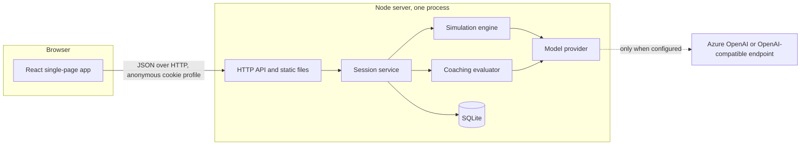
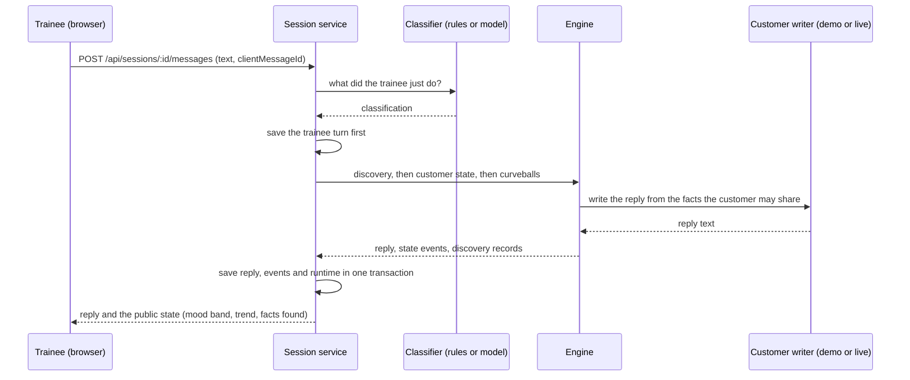
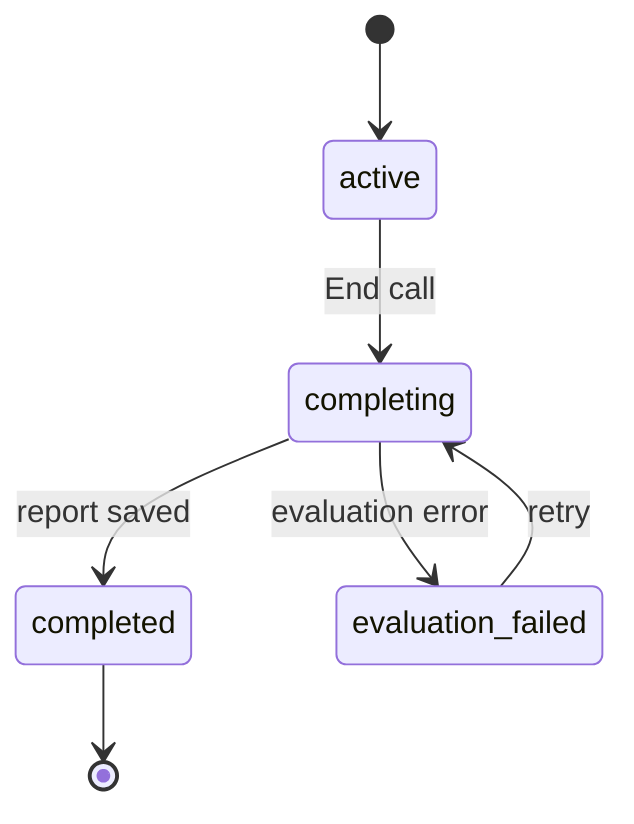

# Architecture

Firefly is one Node.js process and one React single-page app, written in TypeScript. The server exposes a JSON API, serves the built web app, and stores everything in a local SQLite file. There is no external service in the default setup: the customer and the coaching come from a built-in rules engine ("demo mode"). A live language model is optional.

## Components

| Area               | Where                                  | What it does                                                                                                                                                                                         |
| ------------------ | -------------------------------------- | ---------------------------------------------------------------------------------------------------------------------------------------------------------------------------------------------------- |
| Shared domain      | `shared/domain/`                       | The contract between server and web: vocabulary, zod schemas for scenarios, reports and classifications, the API types, scenario configuration (`applyConfig`), and calibration maths. Pure, no I/O. |
| Scenario library   | `server/scenarios/`                    | Thirteen synthetic scenarios as TypeScript objects, validated when the server starts. See [scenario-authoring.md](scenario-authoring.md).                                                            |
| Simulation engine  | `server/engine/`                       | Classifies what the trainee did, decides which hidden facts may be revealed, updates the customer's state, fires curveballs and writes the reply (demo mode). Deterministic for a given seed.        |
| Model provider     | `server/providers/`, `server/prompts/` | One interface with a demo implementation and a live one for Azure OpenAI or any OpenAI-compatible endpoint. See [ai-providers.md](ai-providers.md).                                                  |
| Coaching evaluator | `server/evaluator/`                    | Scores the six coaching dimensions from the transcript and the engine's records, verifies every quote, and builds the report. See [evaluation-rubric.md](evaluation-rubric.md).                      |
| Services           | `server/services/`                     | Session lifecycle, idempotency, evaluation jobs, progress and calibration, sample data.                                                                                                              |
| Persistence        | `server/db/`                           | SQLite through `node:sqlite`, versioned migrations, profile-scoped queries.                                                                                                                          |
| HTTP layer         | `server/http/`                         | A small router with validation, security headers, rate limits and static file serving. No web framework.                                                                                             |
| Web app            | `web/`                                 | React 19 and React Router 7, built with Vite. Every page is a separate lazy chunk. Styling is plain CSS built on design tokens. See [design-system.md](design-system.md).                            |
| Tests              | `*.test.ts(x)`, `e2e/`                 | Vitest for logic, the API and components. Playwright for browser journeys and automated accessibility checks.                                                                                        |

The web app imports shared code only through `#shared/...`. It never imports from `server/`.

## One message, end to end

Things worth knowing:

- **The trainee's words are saved before the customer replies.** If the reply fails, nothing is lost. The call reports `awaitingReply`, and resending the same `clientMessageId` resumes the exchange without a duplicate.
- **A model never decides the numbers.** In live mode a model classifies the turn and writes the reply, but the customer's temperature, trust and patience, which hidden facts are revealed, when a curveball fires and every score are computed in code. Model output is validated before it is used.
- **Hidden facts are protected by construction.** Only facts the engine has decided the customer may share reach the reply writer. The trainee sees a mood band, a trend and a count of facts found, never the underlying numbers or the facts themselves.
- **Demo mode is never disguised.** The provider label ("Demo mode (built-in rules engine)") is part of every session and report, and the app shows it on every relevant screen.

## Ending a call

Ending a call is a real state change, not just navigation. The transcript is locked, the session moves through evaluation phases the interface can show, and exactly one report is saved.

While `completing`, the session reports its current phase: transcript locked, discovery review, scoring, building the report, saved. Calling end again while evaluation runs, or after it finishes, never creates a second report (a unique constraint on the evaluation table backs this up). If evaluation fails, the transcript is kept and the call can be evaluated again. A server restart during evaluation marks the call retryable rather than leaving it stuck.

A call that stopped quickly, before any wrap-up, is labelled "ended early" and the report says it rests on limited evidence instead of inventing a complete assessment.

## Persistence

SQLite via `node:sqlite`. The default file is `data/firefly.db` (git-ignored); `FIREFLY_DB_PATH=:memory:` keeps everything in memory for tests. Tables:

| Table                | Holds                                                                                        |
| -------------------- | -------------------------------------------------------------------------------------------- |
| `sessions`           | The scenario snapshot and settings, status, timings, provider, evaluator and rubric versions |
| `turns`              | The transcript, each trainee turn with its classification                                    |
| `state_events`       | Every customer-state change with its reason, used for markers and the temperature timeline   |
| `discovery_events`   | Which hidden facts were found, partly found or missed, and the question that revealed them   |
| `evaluations`        | One coaching report per session                                                              |
| `mentor_evaluations` | Mentor scores for calibration, marked as a mentor review or a labelled sample                |

Each session stores the exact scenario configuration it was run with, so a call can always be replayed and evaluated as it was. The schema version is tracked with `PRAGMA user_version`; migrations are appended, never edited.

There are no accounts. Each browser gets an anonymous `firefly_profile` cookie (HttpOnly, SameSite=Lax) and can only see the sessions created under it. This separates one learner's practice history from another's on a shared host; it is not authentication, and Firefly should not be exposed beyond a trusted network.

## API

All routes are under `/api`. Writes accept JSON only, up to 64 KB.

| Method and path                                         | Purpose                                                             |
| ------------------------------------------------------- | ------------------------------------------------------------------- |
| `GET /health`, `GET /config`                            | Liveness and non-secret configuration (provider label, limits)      |
| `GET /scenarios`, `GET /scenarios/:id`                  | Public scenario details (never hidden facts)                        |
| `POST /sessions`, `GET /sessions`                       | Start a call (idempotent with `clientRequestId`); list with filters |
| `GET /sessions/:id`, `DELETE /sessions/:id`             | One session with transcript, state and report; delete               |
| `POST /sessions/:id/messages`                           | Send a trainee message                                              |
| `POST /sessions/:id/end`, `POST /sessions/:id/evaluate` | End the call; run or retry evaluation                               |
| `GET /sessions/:id/report`                              | The coaching report                                                 |
| `GET /sessions/:id/transcript`                          | The conversation only, with no report, scores or customer state     |
| `POST /sessions/:id/mentor-score`                       | Record a mentor review for calibration                              |
| `GET /progress`, `GET /calibration`                     | Progress and calibration; the review queue carries no AI scores     |
| `GET /demo`, `POST /demo/samples`, `POST /demo/reset`   | Trainer tools: labelled sample sessions and safe resets             |

Errors are always JSON with a stable `code`, a message that is safe to show, and a `retryable` flag. Two groups of extra routes exist only when an environment flag is set: `/api/test/*` (failure injection for automated tests) and `/api/dev/*` (diagnostics that expose internal state). Both are off by default and must never be enabled on a shared host.

## Security and privacy

- A strict Content-Security-Policy (`script-src 'self'`, no inline script or style), `nosniff`, frame denial and a restrictive Permissions-Policy.
- Writes must come from the same origin; request bodies are size-limited and validated; token-bucket rate limits protect the API, session creation and messages.
- API keys live only in the server's environment. They are never sent to the browser and never logged. The provider layer's errors do not contain keys, endpoints or transcript text.
- Obvious personal data (email addresses, phone numbers, long numbers, identifiers) is removed from trainee messages before they are saved or sent to a model, and the composer warns before sending.
- Everything a model returns is rendered as plain text; the web app never uses `innerHTML`.
- No analytics, tracking or telemetry. Logs contain short session ids, codes and timings, not transcripts.

## Web app

A single-page app with one route per screen: Home, Scenarios, Setup, Brief, the live Call, Report, Transcript, History, Progress, Calibration, Trainer, About and Settings. Each page is its own chunk and loads on demand.

- **Live call.** Messages appear immediately and are confirmed by the server; a failed message keeps its id so Retry is safe. The conversation follows new messages only while the reader is at the bottom. New customer replies are announced politely once, as a whole.
- **Temperature timeline.** An accessible SVG with a data-table alternative, drawn from the report's journey points.
- **Themes and motion.** Two designed themes (dark and light), glass surfaces with solid fallbacks, and reduced-motion support from both the system setting and Settings.

## Why these choices

- **TypeScript everywhere, run natively.** Node 24 runs `.ts` files directly, so the server has no build step. Code is limited to erasable TypeScript syntax (no enums, no constructor parameter properties).
- **No server framework.** The API surface is small; a hand-written router keeps validation, errors and security in one readable place.
- **Rules first, model optional.** A product that needs credentials to run is hard to review, test and demo. The rules engine makes the whole product runnable and testable offline, and the live provider is a drop-in for the three judgement calls.
- **Evidence over opinion.** Reports cite turns, and a quote that does not appear in the turn it cites is rejected before a report is saved.
