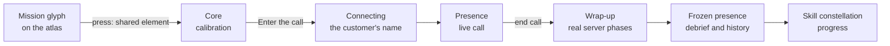

# Firefly experience design

This is the design reasoning behind what a learner sees and does: the concept, the one object the
interface is built around, how the customer's state becomes the atmosphere of the room, each screen,
and how motion, input, accessibility and performance are handled. The mechanics live elsewhere:
[design-system.md](design-system.md) for tokens and components, [accessibility.md](accessibility.md),
[performance.md](performance.md), [architecture.md](architecture.md) for how it is built,
[attribution.md](attribution.md) for fonts, packages and what was studied, and
[rewards.md](rewards.md) and [voice.md](voice.md) for those two features.

## Creative concept

**Firefly is a living simulation space where conversation signals become visible.**

A learner is rehearsing a hard conversation. The product should feel like a quiet, well-lit room in
which something is listening: it shows how composed the customer is, what has been found, what shifted,
and afterwards what the evidence says. It should not feel like a dashboard with a chat box in it.

- **A deep mineral field, lit by a few meaningful lights.** The background is a blue-green black, never
  pure black. **Amber** means _discovery_ (something was found; the recommended next mission; the
  primary action). **Aqua** means _focus_. **Sage** means _stable_. **Coral and ember** mean _tension_.
  The light theme is a luminous parchment with the same lights turned to ink-safe tones. It is designed
  separately, not inverted.
- **Editorial type.** Very large serif next to small monospaced telemetry. Scale contrast does most of
  the work that boxes do in a dashboard.
- **Hairlines, tick scales and space instead of cards.** Nothing is put in a rounded rectangle because
  it is a section. Reading surfaces are opaque; glass is used only for things that float (the dock, the
  palette, an inspector, a dialog).
- **One object.** The Signal instrument (below) appears at every scale, so a mission, a calibration, a
  live customer and a finished call read as the same thing.
- **Feedback is evidence.** Every score sits next to the words from the call that support it, and every
  quote links to the exact turn in the transcript.

What it is deliberately not: a card grid, a row of stat tiles, a gradient banner, a navy sidebar, a
cartoon or stock-photo customer, sparkles, confetti, or an "AI" badge.

## Design principles

1. **Signals, not decoration.** Every animation must answer one question: what changed, where did it
   come from, where did it go, what is selected, what happened, what is connected, what is important,
   what state am I in, what did I achieve. If it answers none, it is removed. Idle motion is a slow
   breath, nothing more, and it can be paused.
2. **Honest.** Demo mode is always labelled and never presented as a model. No fake progress, fake
   metrics or disguised mock output; a new learner sees intentional empty states, not invented history.
   Identity is a local profile, not an account. Voice is labelled Beta and is opt-in.
3. **Evidence over opinion.** Scores, strengths, opportunities and rewards each carry the reason and,
   where one exists, the quoted moment.
4. **Practice, not performance.** Scores are practice signals. There is no leaderboard, no ranking, no
   comparison with colleagues, and no reward for speed or volume. Every report and many screens say so.
5. **Calm.** No countdown pressure, no streak shaming, no confetti. A missed day costs nothing.
6. **Cues are a training aid.** Guided practice shows the customer's mood, discoveries and shifts.
   Immersive practice shows none of it, because a real call would not.
7. **Never reveal what the learner is meant to discover.** The interface cannot show a hidden fact, the
   kind of curveball, an evaluator criterion, or how many hidden facts there are before the report.
8. **Private by default.** The profile and preferences stay in the browser. Notices are derived locally.
   Voice never records audio.
9. **Accessible by default.** WCAG 2.2 AA is a release requirement, and reduced motion is a first-class
   mode, not an afterthought.
10. **Performance is part of the aesthetic.** A simpler thing that stays smooth beats an ambitious thing
    that stutters; effects adapt to the device.

## The object: the Signal instrument

One drawing, with one grammar, used at four scales.

| Mark                       | Meaning                                                                                                             |
| -------------------------- | ------------------------------------------------------------------------------------------------------------------- |
| Rings                      | Difficulty: Starter one ring, Standard two, Challenge three                                                         |
| Overall size               | Business impact: Low, Medium, High                                                                                  |
| Edge texture               | How the customer starts: calm is a smooth line, anxious round dashes, frustrated long and short dashes, angry teeth |
| Heart shape                | Call stage: first contact a circle, follow-up a diamond, escalated a triangle, closure a square                     |
| Heart fill                 | Status: new is an outline, attempted is half filled, completed is solid                                             |
| Ticks around the rim       | Duration: one tick is a minute, a long tick every five                                                              |
| Glint (four amber strokes) | The recommended next mission                                                                                        |

Every mark is also written out (`describeGlyph`, `describeCore`, and the key to the plate), so nothing
is carried by shape or colour alone.

| Scale        | Where                              | What it does                                                                                                                                                                             |
| ------------ | ---------------------------------- | ---------------------------------------------------------------------------------------------------------------------------------------------------------------------------------------- |
| **Glyph**    | Mission atlas, history trail, home | A static mark per mission or call. Legible at 28 px, drawn up to 140 px                                                                                                                  |
| **Core**     | Calibration                        | An engraved instrument with lettered marks A to F and a legend. It turns live as the settings change                                                                                     |
| **Presence** | The live call                      | The customer. Mood sets compression, edge and fragmentation; easing back widens the rings and rejoins fragments; a curveball kinks the rings; a discovery lights the next dot on the rim |
| **Frozen**   | Report, history                    | The presence held at the moment that matters                                                                                                                                             |

The same stars, at sky scale, are the progress constellation.

The hand-offs are real transitions, not cuts. Pressing a mission star starts a view transition in which
the star becomes the core (see [Motion language](#motion-language)).

## Customer state becomes atmosphere

The customer's public state (mood band, trend, discoveries, silence, how many times the conversation
has shifted) drives the room. Mood is always shown by **shape, word and movement together**, never by
colour alone.

| Mood        | Word in guided practice | Presence                                      | Filament (the spine of the conversation) | The room            |
| ----------- | ----------------------- | --------------------------------------------- | ---------------------------------------- | ------------------- |
| Calm        | Calm, steady            | Wide, smooth concentric rings                 | Straight, slow travelling light          | Open, cool, slow    |
| Concerned   | Concerned               | Rings tighten, dashed edge                    | A slight sway                            | Warms towards amber |
| Frustrated  | Frustrated              | Compressed and uneven, long and short dashes  | A visible tremor                         | Warmer, narrower    |
| Angry       | Angry                   | Crossed and compressed, toothed edge          | Kinks                                    | Hot and tight       |
| Escalating  | Escalating              | A fragmenting edge (never flashing)           | Broken segments                          | Closed, ember       |
| Easing back | "…, easing"             | Rings widen, fragments rejoin, movement slows | Straightens                              | Cool returns        |

The numbers behind each mood live in `web/src/components/call/atmosphere.ts` and mirror the
`[data-mood]` blocks in `tokens.css`; a test parses the stylesheet so they cannot drift apart. Nothing
flashes, and nothing changes faster than three times a second.

**Guided practice** shows the mood word with a rising, steady or easing mark, the presence and the room,
"N signals found" against a fixed pool of dots, a "Signal found" mark on the filament, a "The
conversation changed." line when a curveball lands (never what kind), and a few hint ideas that only
ever fill the message box. **Immersive practice** shows none of it: a neutral presence that still
breathes, and one line saying that mood cues are off. The cue level is decided in one place
(`cueLevelFor`), and anything other than guided fails closed.

## Route by route

### Front door and sign-in

The engraved instrument alone in the field, the positioning statement in display serif, and five steps
(Configure, Simulate, Adapt, Evaluate, Improve) that describe only what Firefly really does. Below
them, an unembellished list of what it is not: not an assessment, not a real customer, not an account,
not always right. The first visit has a short ignition (the wordmark lights once, at most 1.2 seconds,
skipped by any key, by reduced motion and by the low effects tier, and it never animates text).
**Sign-in is a local profile**: a name, saved in this browser. There is no password and no organisation
sign-in is pretended.

### Home

A calm console, not a stats wall. An editorial greeting, then one hero: the call you left open (with
"Return to your call"), or the recommended mission as a large glyph with the reason it was recommended
and one action. Below it: a practice ledger that says plainly when there is nothing yet, the last call
as one line, the skill to work on next, and where to go next. A new learner sees an intentional first-run
state and an offer of the short introduction.

### Missions

The scenario library as an atlas of stars at stable positions: grouped into families, labelled by a
deterministic, collision-checked solver, with the recommended mission glinting. A pointer light follows
fine pointers only; arrow keys move across the plane; a detail card resolves on hover or focus. **The
chart always has a list alternative** (the default under 640 px) with the same information, a "Find a
signal" search, a lens (difficulty, status, family) and a key to the plate.

### Calibration

The scenario's setup, around the engraved core. One row per setting, typographic rather than boxed, each
with a sentence on what the choice does (announced politely). Presets, curveballs, practice mode, the
brief, and the draft that is saved as you go. The core changes live as settings change. **Enter the
call** starts the call; if the server takes longer than 350 ms, an honest connecting view shows the
customer's name and one line of true state, never fake progress.

### The call

The customer is the presence beside a name, a role and a mood word. The conversation is typeset on the
filament: speaker and turn in a monospaced margin, the latest customer line large, earlier lines
smaller but never below AA contrast, your own lines italic. The reply field is an underlined serif
line. Long calls stay fast (older turns use `content-visibility`, scrolling never yanks the reader, and
there is a "Jump to latest" control). Voice (Beta) adds a microphone and spoken replies; see
[voice.md](voice.md). While a call is live the dock and utility cluster leave the screen and the tab
order; leaving goes through **End call**.

### Wrap-up and the debrief

Ending a call locks the transcript, lists the real server phases as they happen, and opens the report.
The report is one long editorial page: a masthead with the frozen presence, a numbered section rail, the
customer's journey as a filament line with turning points (arrow keys move between points; a list is
always available), six skills as a small constellation that doubles as navigation, evidence quotes that
link to the exact transcript turn, a word-level diff between what you said and a stronger way to say it
(labelled in text, never colour alone), a discovery review, one next practice target, rewards earned
for the call, and an honest "About this report". A first view replays the journey once (2.4 seconds,
skippable, never under reduced motion or on the low tier). A call that ends early is labelled as such
and says its scores rest on limited evidence.

### Evidence lens (transcript)

The whole conversation typeset like the call. Turns that the report cites are marked with the reason,
and arriving from a quote focuses the exact turn.

### Progress and recognition

A sky of six clusters of fourteen stars, one cluster per coaching skill, lit only as far as the
evidence supports (a dormant star means _no evidence yet_, not zero). Selecting a cluster opens its
reading: trend, what moved, the report it came from, repeated opportunities and a link to practise. A
list is the default under 640 px. **Recognition** lives below the sky (`/progress#recognition`; `/rewards`
redirects there): points (never XP), badges as engraved marks that say Earned, In progress or Locked in
words, challenges as plain rows, the rules, and the points history. Nothing is ranked or compared.

### History

A month-grouped trail: each call is a glyph on a hairline with its date, title, customer, duration,
difficulty, status (in words and shape), score and links. Status tabs show counts; a Refine disclosure
holds the other filters; comparing two finished calls and deleting a call keep their behaviour.

### Studio, Settings and Responsible AI

The studio (trainer tools and mentor calibration) and the reading pages are the quietest in the
product: type, hairlines, ledgers and almost no ambient motion. The Responsible AI page keeps its
reviewed copy in a long-form reading layout. Settings has four tabs, an **Ambient motion** row that
mirrors the control in the top-right cluster, and "Replay the introduction".

### States

Loading is hairlines with end ticks where the text will be. Empty states are one sentence and at most
one action. Errors say what happened and what to do, and offer a retry only when retrying can help.
There is a designed 404, router and page error screens that never print a stack trace and keep the dock
where the page failed inside the app, and a calm line when the browser goes offline.

## Shell and navigation

There is no sidebar and no top bar. A **command dock** at the bottom holds six numbered destinations
(Home, Missions, History, Progress, Studio, Settings) as real links in a `nav` list, with an amber pip
that glides to the active or hovered or focused item. The **utility cluster** at the top right holds
search, theme, a persistent **Pause ambient motion** control, notices, the account and help.
**Ctrl or Cmd + K** opens a palette to go anywhere, start practice, switch theme or pause motion, find a
mission, or search missions. A quiet colophon at the foot of every page carries the training-aid line
and links to Responsible AI and Settings. On phones the dock is a full-width bottom bar.

## Motion language

Motion explains what changed. It never blocks input and never carries essential information.

- **Durations:** response 100 ms, micro 160 ms, component 260 ms, route 440 ms, cinematic 800 ms (the
  longest anything may take, and always skippable). Idle drift is slow and non-essential.
- **Easing:** named tokens, including three damped springs sampled into CSS `linear()` (a gentle
  spatial spring, a discovery settle, and a press with half a percent of overshoot).
- **Native first:** CSS transitions, the Web Animations API for choreography, the View Transitions API
  for route changes, and a few small `requestAnimationFrame` tweens for the instruments. There is no
  animation library.
- **Route transitions** are a short cross-dissolve. The dock is a named element so it stays still above
  the page; the mission star carries a shared name so it flies into the calibration core. The animated
  field is _not_ named (a named group is painted above the page snapshot and would hide it). **The first
  press or key skips a running transition**, because the browser blocks pointer events while one runs.
- **Ambient motion** (the breathing presence, drifting light, the field) is paused by a persistent
  control, by reduced motion, by a hidden tab, and by the low effects tier.
- **Reduced motion** is honoured from the device and from Settings (`data-motion="reduce"`): movement
  stops and state changes are instant, with the same information in words. It is designed and tested as a
  real mode.
- **Sound** is optional and off by default (`web/src/lib/sound.ts`): short tones synthesised in the
  browser. Voice is a separate opt-in.

## Input and the pointer

The native cursor is never hidden. Physical feedback is local: the atlas has a pointer light that
brightens the nearest star, buttons press with a spring, and the dock pip leans towards hover. These are
for **fine pointers only** (`(hover: hover) and (pointer: fine)`); touch gets taps and visible
alternatives, and keyboard focus gets the same feedback as hover. Dragging or panning never has no
alternative. Pointer handlers are coalesced to one per animation frame, write only transforms and custom
properties, and are off on the low tier and under reduced motion.

## Accessibility approach

The details, the criteria that shaped the design and the honest gaps are in
[accessibility.md](accessibility.md). In short: semantic landmarks and one `h1` per page; every spatial
view has a semantic alternative (atlas to list, instrument to text, constellation to list, journey to
list); colour is never the only channel; visible focus everywhere; targets of at least 44 px; polite
live regions for discoveries and shifts; reflow from 320 px; and reduced motion, increased contrast,
forced colours and reduced transparency each have a defined result.

## Responsive strategy

- Designed from 320 px (no sideways scrolling) to wide screens, with a content column of at most 1360 px
  that the masthead aligns to.
- **Below 720 px** the dock becomes a full-width bottom bar with labels only. Charts offer their list
  first; the call becomes a compact presence strip above a full-height conversation with the composer
  fixed at the bottom, clear of the on-screen keyboard and safe areas.
- Short landscape screens keep **End call** reachable.

## Performance strategy

Budgets are enforced in CI (`npm run check:budgets`); numbers and method are in
[performance.md](performance.md). The shape of it: fonts are self-hosted, subset and preloaded for the
first paint; every page is its own lazily loaded chunk; the animated field is a separate lazy chunk
requested when the browser is idle; and a **performance tier** (high, medium, low) chosen from device
hints and a frame monitor that only steps down decides how much decoration is drawn (blur, the field,
pointer light). `?perf=low`, `?perf=medium` and `?perf=high` pin a tier for testing.

## How the direction was chosen

Three directions were built as real, interactive browser prototypes before any production code, each
with the missions universe, the node-to-core hand-off and the live call:

| Direction               | Idea                                                              | What was kept                                                                                                  | What was not                                                              |
| ----------------------- | ----------------------------------------------------------------- | -------------------------------------------------------------------------------------------------------------- | ------------------------------------------------------------------------- |
| **A: Editorial Signal** | A page-like interface; the instrument at three scales             | **The base.** The grammar, the editorial type, the margin-and-filament conversation, the star-to-core hand-off | Greedy runtime label placement; a heavy pointer lens; a grain overlay     |
| **B: Cinematic Signal** | A WebGL field of luminous strands that re-weave into the customer | The idea of an atmosphere driven by the customer's state, as a Canvas2D field limited in intensity             | WebGL, strands behind text at full strength, conversation cards           |
| **C: Tactile Material** | One glass lens with physical controls and refraction              | Micro-physics: the press spring, the magnetic dock pip                                                         | Skeuomorphic materials, per-token backdrop blur, Chromium-only refraction |

The prototypes were scored on originality, identity, readability, usefulness, craft, maintainability,
accessibility, performance and scalability. A won on readability and accessibility; B was the most
cinematic and the heaviest; C had the most expensive pointer path. The decision and the fixes it
required are recorded in the plan that guided the rebuild.

## What was not adopted

| Tempting                               | What Firefly does instead                                                                                  |
| -------------------------------------- | ---------------------------------------------------------------------------------------------------------- |
| "Sign in with Microsoft"               | A local profile (a name). Nothing pretends to be an account                                                |
| XP, levels and a "Top Performer" label | Points with a reason for each, four levels that need breadth as well as points, and no ranking of any kind |
| "AI-powered" practice                  | Plain language: demo mode is a rules engine and says so; a live model is named when one is configured      |
| A cartoon, stock or 3D customer        | An abstract presence that follows the customer's mood. It is not a face and not a person                   |
| Push notifications                     | A bell menu with notices worked out in the browser; nothing is emailed or pushed                           |
| three.js, a physics engine, a UI kit   | Hand-written Canvas2D, SVG and CSS. No runtime dependency was added for this redesign                      |

## Dependency choices

No runtime dependency was added for the redesign. The runtime dependencies remain React, React DOM,
React Router and zod.

| Considered                                   | Decision                                                                                                                                |
| -------------------------------------------- | --------------------------------------------------------------------------------------------------------------------------------------- |
| three.js and React Three Fiber               | Not used. About 250 kB gzipped for a scene that Canvas2D and SVG draw at about 1 ms per frame                                           |
| Animation libraries (Motion, GSAP, Anime.js) | Not used. CSS transitions, the Web Animations API, View Transitions and small tweens cover every need. Revisit only for a measured need |
| Radix or another primitives kit              | Not used. The primitives are small, typed and tested in `components/frame`; dialogs, tabs, menus and the palette are ours               |
| Web fonts from a CDN                         | Not used. Three families are self-hosted, subset and served from our own origin (the Content-Security-Policy allows `font-src 'self'`)  |
| Chart libraries                              | Not used. The journey, the sky and the sparklines are small SVG components with text alternatives                                       |
| Component marketplaces                       | Studied for ideas only; no component was copied (see [attribution.md](attribution.md))                                                  |

The router moved from declarative routes to a **data router**, because the View Transitions API is only
started by `<Link viewTransition>` and `navigate(..., { viewTransition: true })` in data mode. In the
declarative mode the option is silently ignored (measured in a real browser: zero calls).

## Visual review

Design changes are checked in a real browser, in both themes, on a phone-sized, a laptop-sized and a
wide screen, with reduced motion and with `?perf=low`. Passing tests is not visual approval. Tools:

- `node scripts/readme-screenshots.mjs` regenerates the README and documentation images from a running
  demo-mode Firefly with a clean in-memory database (the command is at the top of the file). After
  running it, `git diff --stat docs/images` shows what changed; open those pictures and review them.
  There are no pixel-comparison baselines.
- `node scripts/shot.mjs` captures any single state (it can create calls, send messages, end a call and
  load sample sessions first). Its options are documented at the top of the file.

The automated guards are the unit tests (including pure models for layout, atmosphere, the journey and
perf tiers), the browser tests (accessibility in both themes on every page, no sideways scrolling at
320 and 1440 px, reduced motion, theme persistence, the palette, the dock, the profile and voice
opt-in, keyboard setup and the full trainee journey), and the bundle budgets.

A design change should also be reviewed against these questions: does it look like the rest of the
product, does every animation answer one of the questions above, does every reward explain itself, does
it work with the keyboard and with reduced motion, does it stay legible over the field, and does it stay
fast.

## Limitations

- Nobody has used Firefly with a screen reader, a magnifier or voice control; accessibility is checked by
  automated tools, keyboard walkthroughs, contrast computed from the tokens, and review.
- Browser coverage is Chromium (Edge and Chromium). View transitions and CSS `linear()` easing are
  progressive enhancements: other engines get the same pages without the animation. Voice input needs a
  Chromium-based browser.
- The atlas label placement is tuned and tested at five viewport sizes; unusual sizes can still place a
  label less well, which is why the list alternative is always one tab away.
- The animated field is drawn on a 2D canvas and measured on one machine. Real-device frame times
  (including phones) have not been measured.
- The local profile is a name for greetings, not a login.
- Rewards and recommendations are practice signals from a handful of calls, derived from rules-based or
  model-drafted coaching, and they have not been calibrated against real mentor scoring (see
  [calibration.md](calibration.md)).
- "Practice time" adds up the length of each call from start to end, so a call left open for hours
  inflates it.
