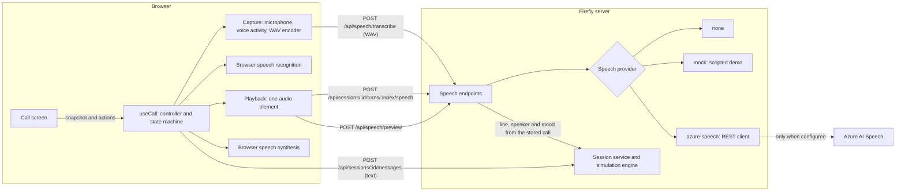

# Voice architecture

How a spoken call works in Firefly: the three ports it is built on, which part does what, how a call moves between states, how turns are taken, how the customer's voice is delivered, what happens when something fails, and what has and has not been verified. Paths start at the repository root. What leaves the device and what is stored is in [privacy-audio.md](privacy-audio.md).

Status words used on this page:

| Word              | Meaning                                                                                                                       |
| ----------------- | ----------------------------------------------------------------------------------------------------------------------------- |
| Tested            | Covered by automated tests in this repository. The tests use fakes: no real microphone, speech service or speech recognition. |
| Demo only         | Works only with the scripted demo speech provider (`FIREFLY_SPEECH_PROVIDER=mock`).                                           |
| Needs credentials | Needs an Azure AI Speech resource and key.                                                                                    |
| Not verified      | Written against documentation, but never run against the live service or with real speech. See [Verification](#verification). |

## The short version

- A call can be **spoken or typed**. Typing always works, and a failed voice step never blocks the call.
- The trainee's speech becomes text in one of two places: Firefly's **server speech provider** (Azure AI Speech, when configured) or the **browser's own speech recognition** when it is not. If neither exists the call is typed.
- The customer's replies are spoken by the server speech provider, by the browser's own voices, or not at all (captions only). The customer's words are in the transcript before any voice starts, so a voice that fails loses nothing.
- Everything the customer says and does comes from the simulation, not the voice layer. A speech provider only turns audio into text and text into audio.
- The microphone opens only after an explicit press: **Check microphone** on the brief (optional; it shows the level for up to eight seconds and records nothing) or **Start voice call** on the call's pre-flight page. Audio is never written to disk, and the server never stores it.
- **Speaking over the customer (barge-in) is not supported.** Turn-taking is controlled: see [Turn-taking](#turn-taking).

## Three ports

A spoken call has three separate seams. Each has a small interface, an adapter for each way it can be done, and fakes for tests.

| Port                   | Interface                                         | Adapters                                                                                                                                                                              | Fakes                                                                                                           |
| ---------------------- | ------------------------------------------------- | ------------------------------------------------------------------------------------------------------------------------------------------------------------------------------------- | --------------------------------------------------------------------------------------------------------------- |
| Speech to text         | `SpeechToTextPort` (`server/speech/types.ts`)     | `none`, `mock` (`server/speech/mock.ts`), `azure-speech` (`server/speech/azure.ts`). In the browser, the browser's own recognition (`web/src/features/voice/capture/recognition.ts`). | In-memory (`server/speech/testing/fakes.ts`), a fake Azure server (`server/speech/fake-azure-speech-server.ts`) |
| Text to speech         | `TextToSpeechPort` (same file), with `listVoices` | The same three. In the browser, the browser's own voices (`web/src/features/voice/playback/browser-playback.ts`).                                                                     | The same                                                                                                        |
| The customer's replies | `ModelProvider` (`server/providers/types.ts`)     | The demo rules provider and a live provider for Azure OpenAI, an OpenAI-compatible endpoint or Gemini (`server/providers/`).                                                          | A fake model server (`server/providers/fake-llm-server.ts`)                                                     |

`SpeechProvider` is the two speech ports together, with a `kind`, a `label`, a `demo` flag and `capabilities()`. The speech layer imports nothing from HTTP, the database, the model or the session service, and the model port mentions no speech. `server/speech/boundary.test.ts` reads the source files to check this.

**The composition root** is `createRuntime` in `server/bootstrap.ts`. It takes the configuration (`server/config.ts`) and builds one adapter for each port: `createProvider` (`server/providers/index.ts`) for the model and `createSpeechProvider` (`server/speech/index.ts`) for speech. Tests pass their own fakes through its `options` instead. Outside the speech layer, nothing imports an adapter, and only the composition root and the HTTP test harness import the speech factory; the boundary test checks that too. The speech routes call small use cases in `server/speech/service.ts` (`transcribeRecording`, `speakLine`, `previewVoice`) that take the port and plain values.

In the browser, `chooseCapture` and `choosePlayback` (`web/src/features/voice/support.ts`) pick the path at the click that starts the call, from what `GET /api/config` says the server can do and what the browser offers. They never open the microphone.



| Boundary                      | Rule                                                                                                                                                                                                                  |
| ----------------------------- | --------------------------------------------------------------------------------------------------------------------------------------------------------------------------------------------------------------------- |
| Call screen and engine        | The screen reads one `CallSnapshot` and calls `CallActions`. It never touches the microphone, audio elements or speech APIs. Contract: `web/src/features/call/contract.ts`.                                           |
| Engine and the world          | A pure state machine (`machine.ts`) decides what should be true: which phase, whether the microphone is held, whether anything is recording or speaking. The controller (`controller.ts`) makes the browser match it. |
| Web app and server            | Text and audio over the JSON and HTTP API. The browser never sees a provider key, and the server never sees the browser's own speech services.                                                                        |
| Server and the speech service | The provider receives a recording, or one customer line plus a voice direction, and nothing else. See [privacy-audio.md](privacy-audio.md).                                                                           |

## Choosing how a call is spoken

| Server speech provider                   | Capture (trainee to text)                                                                                                                                                       | Playback (customer to sound)                                                                                           | Status                                                           |
| ---------------------------------------- | ------------------------------------------------------------------------------------------------------------------------------------------------------------------------------- | ---------------------------------------------------------------------------------------------------------------------- | ---------------------------------------------------------------- |
| `azure-speech`                           | Firefly records one utterance, encodes it as a 16 kHz mono WAV in memory and sends it to the server. Needs `getUserMedia`, `AudioContext`, `AudioWorklet` and a secure context. | The server returns synthetic speech (MP3) for one stored customer turn. The browser plays it in one `<audio>` element. | Tested with a fake server. Needs credentials. Not verified live. |
| `mock`                                   | As above, but the server ignores the audio and answers with the next of eight fixed sentences.                                                                                  | A short soft sound whose length follows the line. It is not speech.                                                    | Tested. Demo only.                                               |
| `none` (default), in Edge or Chrome      | The browser's own speech recognition.                                                                                                                                           | The browser's own `speechSynthesis` voices.                                                                            | Tested with fakes. Not verified with real speech.                |
| `none`, in a browser with no recognition | Typed only.                                                                                                                                                                     | The browser's voices if it has them, otherwise captions only.                                                          | Tested.                                                          |

If the audio worklet cannot be loaded, a call that would use the server provider uses the browser's recognition if there is any, and otherwise is typed (`controller.ts`). The pre-flight page and the call controls say which path is in use. The label comes from what is really in use, never from what was hoped for.

## The four neutral voices

The trainee chooses between four synthetic voices (`voice-a` to `voice-d`, `shared/domain/voices.ts`). The labels describe delivery only: never a person, a gender, an accent or an age. The only difference between them in delivery is pace.

| Choice             | Description on the brief             | Pace against the plain voice |
| ------------------ | ------------------------------------ | ---------------------------- |
| Voice A - Warm     | A relaxed, friendly pace.            | 2% slower                    |
| Voice B - Direct   | A brisk pace that gets to the point. | 4% faster                    |
| Voice C - Measured | A slow, steady pace.                 | 6% slower                    |
| Voice D - Concise  | A crisp, even pace.                  | 2% faster                    |

- The default for a scenario is a hash of the scenario's id (`defaultVoiceFor`), so it never follows a gender or accent, and the same scenario always starts with the same voice. The trainee can pick another on the brief.
- The server maps each choice to one synthetic provider voice per language (`VOICE_CATALOGUE` in `server/speech/voices.ts`). Where the provider has fewer than four standard voices in a language (en-IE has two), a choice shares an earlier choice's voice and differs by pace alone. `GET /api/config` says so (`speech.voices`), and the brief says "Some of these voices share one synthetic voice and differ only in pace."
- When the browser's own voices speak the customer, each choice gets one of the browser's best-ranked English voices, dealt out in a fixed order. A browser with one English voice cannot make four voices sound different, and the brief says so ("This browser has one English voice, so the four choices differ only in pace.", or a similar sentence when it has two or three).
- **Test voice** on the brief plays one fixed sentence in the chosen voice (`POST /api/speech/preview`). The sentence is fixed on the server, so the endpoint cannot be used to speak anything else.
- The chosen voice travels as `?voice=` on the speech request. A call saved before voices could be chosen, and a client that names none, gets the older pairing of one female and one male voice per language, picked by the persona's `speaker` hint (`speakerFor`, which derives one from the persona's name when the hint is missing). The hint is never shown and never decides behaviour.

## The call as a state machine

`web/src/features/call/machine.ts` is a pure function: no React, no browser APIs, no clock. It takes the current state and one event and returns the next state. It never throws, and an event that makes no sense in the current phase returns the same state object.

Three vocabularies describe a call, each derived from the one before:

1. **Phases** (`CALL_PHASES`, `web/src/features/call/contract.ts`) are what the machine keeps.
2. **Stages** (`CALL_STAGES`, derived by `stageOf` in `web/src/features/call/stage.ts`) are the turn-taking states: one at a time, with pause, mute, retry and offline folded in.
3. **Statuses** (`describeStatus` in `web/src/features/call-ui/call-model.ts`) are the words on the screen. Their wording is the voice layer's (`VOICE_STATE_TEXT` in `web/src/features/voice/states.ts`) wherever it has a state of the same name.

| Phase                   | What is happening                                                               | Microphone recording                     |
| ----------------------- | ------------------------------------------------------------------------------- | ---------------------------------------- |
| `idle`                  | Pre-flight. Nothing has started and the microphone has not been requested.      | No                                       |
| `requesting-microphone` | The browser's permission prompt is open.                                        | No                                       |
| `ready`                 | Permission granted and audio primed; the opening line is about to play.         | No                                       |
| `listening`             | Waiting for the trainee, or hearing them.                                       | Yes                                      |
| `transcribing`          | The trainee stopped; the speech is being turned into text.                      | Only to let a last browser result arrive |
| `processing`            | The text was sent; the customer's reply is being produced.                      | No                                       |
| `customer-speaking`     | The customer's voice is playing. The words are already in the transcript.       | No                                       |
| `ready-for-next-turn`   | The customer finished. The microphone has not reopened yet.                     | No                                       |
| `ending`                | End and review was confirmed. Capture and audio stop; the call is being closed. | No                                       |
| `completed`             | The call is closed on the server and the screen moves on to the report.         | No                                       |

The stage adds what the phase cannot say on its own: `paused`, `muted`, `retrying` (a message is being sent again), `offline`, `endpointing` (the trainee has stopped and the utterance is being finished), and, while ending, `ending` (a message in flight is being finished) or `evaluating` (the call is being closed and the review prepared).

How a stage becomes a status the trainee sees (`describeStatus`). The end of the call wins over everything, then being offline, then a pause. A problem that stops the call replaces the quiet states, so the screen never says it is the trainee's turn when it is not.

| Stage                               | Status shown                                                                                                                                                                                  |
| ----------------------------------- | --------------------------------------------------------------------------------------------------------------------------------------------------------------------------------------------- |
| `idle`                              | "Microphone off". After a refusal, "Microphone blocked". After a missing, busy or unsupported microphone, "Unavailable".                                                                      |
| `mic-permission`                    | "Waiting for permission".                                                                                                                                                                     |
| `ready`                             | "Connecting" while the opening line is prepared. Then "Microphone ready" on the trainee's turn, "Typing" in a text call, "Try again" after a voice step failed, "Message limit" at the limit. |
| `listening`                         | "Listening", or "Hearing you" while speech is detected. "Microphone ready" until the microphone is really open.                                                                               |
| `endpointing`, `transcribing`       | "Processing speech".                                                                                                                                                                          |
| `processing`                        | "Customer is replying".                                                                                                                                                                       |
| `customer-speaking`                 | "Customer speaking".                                                                                                                                                                          |
| `paused`, `muted`                   | "Paused", "Muted".                                                                                                                                                                            |
| `retrying`                          | "Retrying".                                                                                                                                                                                   |
| `offline`                           | "Offline" while the browser is offline. "Try again" when the browser is online but the last step failed.                                                                                      |
| `ending`, `evaluating`, `completed` | "Ending call", "Preparing your review", "Call complete".                                                                                                                                      |

The voice layer also has its own small state function, `nextVoiceStatus` in `web/src/features/voice/states.ts`: seventeen named states (microphone not requested, requesting permission, permission denied, microphone ready, listening, speech detected, processing speech, transcript available, generating customer reply, customer speaking, paused, muted, retry required, text fallback, ending call, evaluating, completed), and the capture, transcription or playback signal each of the first ten comes from. Its tests show that each of those ten is reachable from an event the capture, the transcriber or the playback really produces. "Speech detected" is visual only and is never announced to a screen reader, because it flips many times a call and would talk over the trainee. Transcript available has no status of its own on the screen: the trainee's words appear in the transcript while the status says the customer is replying.

Rules the tests hold the machine to (`web/src/features/call/machine.test.ts`, including random event sequences):

- Nothing records before an explicit start, after the call is ending, while muted or paused, or while the customer is speaking. At most one recording and one voice exist at a time.
- One spoken or typed message is one **exchange** with one client message id. It cannot become two trainee turns, and a reply is applied only to the attempt still waiting for it.
- A message that did not send always keeps its Retry. Only one notice shows at a time, so another notice (a failed attempt to end the call, a lost microphone) can take its place and then be put away. Whenever the call is under way, the message has failed and no notice is showing, the notice for the message comes back (`keepRetry` in `machine.ts`). The random sequences check this after every event.
- Every waiting phase has a timer, and firing it always leads to a state the trainee can act in. Ending the call is idempotent.

Timers (`TIMINGS` in `machine.ts`):

| Timer                    | Value                 | When it fires                                                                                  |
| ------------------------ | --------------------- | ---------------------------------------------------------------------------------------------- |
| Permission prompt        | 60 s                  | The browser's microphone prompt is left unanswered.                                            |
| Customer voice to start  | 15 s                  | The voice (or opening line) does not start.                                                    |
| Customer voice to finish | length estimate + 5 s | The voice stops reporting progress; it is cut off.                                             |
| Nothing heard            | 15 s                  | The microphone opened and no speech began.                                                     |
| Speech too long          | 35 s                  | Someone is "speaking" for longer than an utterance can be.                                     |
| Finish not answered      | 5 s                   | The trainee pressed Done speaking and the microphone did not answer the finish request.        |
| Speech to text           | 20 s                  | Transcription does not answer.                                                                 |
| Customer reply           | 45 s                  | The customer's reply does not arrive.                                                          |
| Settle after the voice   | 350 ms                | The pause before the microphone reopens, so it does not hear the tail of the customer's voice. |
| Ready but not started    | 5 s                   | The call is ready and nothing has started.                                                     |
| Message in flight at end | 8 s                   | Ending waits for an exchange in flight to finish or fail.                                      |
| Closing the call         | 30 s                  | The server does not answer the end request.                                                    |

## Turn-taking

Turn-taking is **controlled, not interruptive**. The customer speaks. The trainee takes the turn after the customer's voice has ended, or sooner with **Stop customer audio**. Nothing records while the customer speaks, and nothing stops the customer on a sound.

- A turn gate (`createTurnGate`, `web/src/features/voice/turn-taking.ts`) says whose turn it is. It stays closed while the customer's voice is wanted, playing or only just over, and a guarded capture refuses to open the microphone then. The call machine enforces the same rule on its own, so a caller that forgets is still held.
- **Stop customer audio** stops playback at once. If the voice was audible and had not finished, that customer turn is tagged **Audio stopped** in the call's transcript. The words are already in the transcript in full. **Talk** stays disabled while the customer's voice is being prepared or played.
- **Done speaking** ends the trainee's turn immediately. Without it, the turn ends after a generous silence (`endpointSilenceMs`).
- Hands-free listening reopens the microphone after a customer reply, and again after an empty pass, up to three times in a row (`MAX_SILENT_RETRIES`). After a fourth empty pass it waits for the trainee to press **Talk**, so a recogniser that never returns words is not reopened for ever. Words, or the trainee's own action, start the count again.

### Why barge-in is not supported

A microphone next to speakers hears the speakers. To stop the customer when the trainee starts to speak, the detector would have to tell the trainee from the customer's own voice coming back. `web/src/features/voice/barge-in.test.ts` shows that the detector Firefly uses cannot, with synthetic signals:

- The customer's voice leaking into the microphone at levels from 0.01 to 0.08 RMS is heard as the trainee starting to speak, and once the reply ends it becomes a whole utterance made of the customer's own words.
- Only a leak quieter than the detector can hear at all is ignored.
- No loudness threshold tried separates a soft-spoken trainee from a louder leak. A threshold that ignores the leak is deaf to the quiet trainee, and one that hears the trainee is triggered by the leak.
- With the gate, nothing listens while the customer speaks, so there is no leak to hear, and the customer is not stopped by any of it.
- A last group of checks reads the source. The capture code (microphone, detector) imports nothing from playback or the turn gate, and playback imports only the level and WAV helpers from capture, never the detector. So nothing in the voice layer can connect a sound to stopping the customer.

**What this evidence is not.** It is a simulation with synthetic signals, not a measurement of any laptop, speaker, browser or echo canceller. The microphone is opened with echo cancellation on, and how well that works depends on the device. These tests cannot show that it works or that it fails. They show that Firefly has no way of knowing. Real barge-in would need evidence from real hardware in real browsers, and none has been collected.

### Voice activity tuning

Every number that decides when a spoken turn starts, ends or is thrown away as noise is in one place: `CAPTURE_TUNING` in `web/src/features/voice/capture/tuning.ts`.

| Constant                  | Value     | What it does                                                                                |
| ------------------------- | --------- | ------------------------------------------------------------------------------------------- |
| `frameMs`                 | 20 ms     | Audio is cut into frames this long, and each frame's loudness is judged on its own.         |
| `speechStartMs`           | 120 ms    | Speech starts after this long above the start threshold, so a single click never starts it. |
| `startRatio`              | 3         | The start threshold is this many times the room's noise floor.                              |
| `stopRatio`               | 1.8       | The stop threshold is lower, so a word that dips does not end speech.                       |
| `minStartRms`             | 0.006     | The start threshold is never lower than this loudness.                                      |
| `endpointSilenceMs`       | 1400 ms   | How long the trainee must be quiet before the turn ends by itself.                          |
| `preRollMs`, `tailMs`     | 300 ms    | Audio kept from before the start was noticed, and silence kept after the last word.         |
| `maxUtteranceMs`          | 30 000 ms | The longest single turn. It is cut here, sent, and listening carries on.                    |
| `minSpeechMs`             | 400 ms    | Speech shorter than this is a cough, a click or a bump, and is dropped.                     |
| `minVoicedMs`             | 250 ms    | Of that, at least this much must be voiced.                                                 |
| `minSpeechRms`            | 0.015     | An utterance whose loudest moment is quieter than this is room noise.                       |
| `recognitionResultWaitMs` | 8000 ms   | How long to wait for the browser's final words after the trainee stops.                     |
| `settleAfterPlaybackMs`   | 350 ms    | How long after the customer's voice ends before the microphone may open.                    |

These are Firefly's own choices, tuned with synthetic signals in tests (`web/src/features/voice/capture/vad.test.ts`). They have not been tuned on real rooms or real microphones.

## Capture

**With the server's speech provider.**

1. **Microphone.** `getUserMedia` with echo cancellation, noise suppression and automatic gain on, one channel and no video (`web/src/features/voice/capture/microphone.ts`). An `AudioContext` at 16 kHz (or the device's own rate if the browser refuses, with the recording resampled afterwards) measures the level and feeds an **audio worklet** (`web/public/audio/capture-worklet.js`, served from the same origin so the content security policy allows it). The microphone stream is held while the call is under way, so the browser's recording indicator stays on; audio is read only while a listening pass is open. **Mute** disables the track. **Pause** releases the stream.
2. **Voice activity detection** (`capture/vad.ts`, pure and deterministic) uses the numbers above.
3. **Encoding.** The utterance is resampled if necessary and encoded as a 16-bit mono 16 kHz WAV in memory (`capture/wav.ts`).
4. **Upload.** `POST /api/speech/transcribe?lang=...` with the WAV. The server validates it again, sends it to the provider and returns `{status, text, durationMs}`. `no-speech` means nothing recognisable: the trainee is told, nothing is sent to the customer and no empty turn is created. A transcript that holds only filler sounds such as "um", or single letters, is never sent as a message either: the trainee is told that no words were made out. The recording is held only while a retry may still be needed (see below).
5. The recognised text is then sent as a normal message (`POST /api/sessions/:id/messages`, `inputMode: "voice"`), so spoken and typed turns follow the same path from there on.

**With the browser's own recognition.** It listens for one sentence at a time and shows the words as they come (`capture/recognition.ts`). It uses on-device recognition when the browser offers it (recent Chromium) and otherwise the browser's default engine, which in Chromium is normally the browser maker's online service. Firefly does not record or send audio on this path: where the audio is processed is up to the browser. An empty or missing result is treated as "nothing heard": nothing is sent and no empty turn appears. Whether recognition returns words in a real signed-in browser is not verified.

## Playback

- **Server voice.** The speech endpoint returns audio for one stored customer turn. The request names a turn and cannot supply words. The browser plays it in a **single** `<audio>` element that is created and unlocked inside the click that starts the call. Every blob URL is revoked as soon as it is no longer needed. Generating the voice has a 15 second timeout. If the browser still refuses to play, the trainee sees a **Replay** control instead of an error (`web/src/features/voice/playback/server-playback.ts`).
- **Browser voice.** `speechSynthesis`, with the voice list awaited for up to 1.5 seconds. The code records that Chromium stops an utterance after about fifteen seconds, so text is spoken a sentence or two at a time, and each part has a watchdog because some voices never report that they started or ended. A voice is judged by what the browser says about it (language, local or online, default), never by name (`playback/voices.ts`, `playback/browser-playback.ts`).
- **Captions.** The customer's words are in the transcript before any voice starts.

## How the customer's voice follows their mood

The server chooses the voice from the stored call, so the request cannot influence the words (`server/speech/direction.ts`, `voices.ts`). The mood is the customer's temperature band when the line was said, found from the starting temperature and every stored change before it.

| Mood band  | Pace and intensity | Style, only where the voice lists it | Rate (no voice chosen) | Pitch (when no style is applied) |
| ---------- | ------------------ | ------------------------------------ | ---------------------- | -------------------------------- |
| calm       | measured, 0        | none                                 | -4%                    | none                             |
| concerned  | brisk, 0.25        | none                                 | +6%                    | +3%                              |
| frustrated | firm, 0.5          | `unfriendly`, degree 0.55            | +8%                    | -2%                              |
| angry      | firm, 0.75         | `angry`, degree 0.73                 | +11%                   | -3%                              |
| escalating | firm, 1            | `angry`, degree 0.9                  | +14%                   | -4%                              |

The limits, all in `server/speech/voices.ts`:

- A style is applied only when the voice's entry in `VOICE_STYLES` lists it. That table is copied from the "Text to speech voices" table of Microsoft's language support page (checked against the page dated 18 November 2026 according to the code's comment; no voice was heard or called live). In the built-in catalogue only the four en-US voices list `angry` and `unfriendly`. The en-GB, en-IE, en-AU and en-IN voices list neither, so for them mood is rate and pitch only. With the built-in voices `GET /api/config` reports `expressiveStyles: false` for that reason.
- The style degree runs from 0.2 up with the intensity and never exceeds 0.9, and `shouting` is never requested. The tone is firm, never theatrical.
- The chosen voice adds its own pace to the rate (see the table of choices). A customer who is **cooling down** gets no style, a rate that is halved if it was above zero and then 3% lower, and half the pitch change. A customer counts as cooling down when their temperature fell with the latest change and now stands at least 8 points below where it stood before any of the last three changes (`recoveringAtTurn` in `server/speech/direction.ts`).
- However these add up, delivery stays inside a rate of -15% to +22% and a pitch of at most 6% either way.
- **Pauses are not varied.** The documentation describes SSML breaks and sentence-boundary silence, but how each voice treats them has not been checked against the live service, so Firefly leaves every voice's own pauses alone.
- The browser path changes only rate and pitch (`deliveryFor` in `playback/voices.ts`: a little quicker and higher when tense), because the code treats a browser voice as having no expressive styles.

No test or measurement in this repository checks whether the output sounds like the intended mood, and the interface does not claim that it does: the call's voice settings show the voice and style used, or say that mood is approximated by pace and pitch. The response headers `x-firefly-speech-voice`, `x-firefly-speech-style` and `x-firefly-speech-voice-id` say which voice and style Firefly put in the request, not what the service did with them. Nothing here clones or imitates a person, and nothing is inferred from the trainee's voice.

## When something fails

Every voice problem is one typed error (`web/src/features/voice/errors.ts`) with fixed plain sentences. It says what happened, what was kept and what to do, and it carries the recovery actions as data. It never carries audio, a transcript, a key, an address or anything a provider said. The call machine turns it into one problem card (`web/src/features/call/problems.ts`, `web/src/features/call-ui/Recovery.tsx`).

| Failure                                                                    | What the trainee can do                                            |
| -------------------------------------------------------------------------- | ------------------------------------------------------------------ |
| Microphone blocked, missing or busy                                        | **Retry** (ask for the microphone again), or **Use text**          |
| Browser cannot record here                                                 | **Use text**                                                       |
| No speech detected, or no words made out                                   | **Retry** (speak again), or **Use text**                           |
| Speech to text timed out, failed, offline or rate limited                  | **Retry** (the same recording again), or **Use text**              |
| The customer's voice timed out, could not be made, offline or rate limited | **Retry**, or **Continue without audio**                           |
| The browser blocked or could not play the voice                            | **Replay**, or **Continue without audio**                          |
| Spoken calls not available on this server                                  | **Use text**; for the customer's voice, **Continue without audio** |
| The voice preview could not play                                           | **Retry**, or **Continue without audio**                           |

"Retry the same recording again" applies only while the recording is still held. When it is not, Retry asks the trainee to speak again.

Typing a reply always works, and every error says so. The customer's words are in the transcript before their voice plays, so a voice failure loses nothing. A message that did not send always keeps its **Retry** notice, even after another notice has taken its place and been put away (see [the rules the tests hold the machine to](#the-call-as-a-state-machine)).

**Retry is idempotent.** One utterance gets one client message id when the trainee stops speaking, and the same id is used through every retry (`web/src/features/voice/transcriber.ts`). The same id while a request runs shares that request, and after it succeeded gives back the same answer without asking the server again. The message that is finally sent carries the same id, and the server treats a resent id as the same message and returns the stored answer without processing it again (`server/services/sessions.ts`). A retried voice request asks for audio for an existing stored turn, so it cannot create a turn.

## Audio lifecycle

A spoken call acquires a microphone stream, an audio context, a worklet, object URLs, an audio element and timers. All are released on every way a call can end: finished, failed, abandoned, the screen left or the call ended. **Pause** releases the microphone, and resuming takes it again. `release` is safe to call twice.

**A hidden tab pauses a spoken call by itself.** When the browser reports the page as hidden (`document.hidden`), the call is paused as if the trainee had pressed **Pause**: the microphone is released and the customer's voice stops. Coming back to the tab does not reopen the microphone. The call stays paused until the trainee presses **Resume**, which also plays a customer line that was cut off or had not yet played. A typed call has no microphone and is left alone (`onVisibility` in `web/src/features/call/controller.ts`). A unit test sets the hidden flag and checks that no track or listening worklet is left, that coming back changes nothing, and that a typed call is not paused (`web/src/features/call/useCall.flows.test.tsx`). It does not switch a real browser tab.

`web/src/features/voice/lifecycle.test.ts` checks this on the fakes: each test first proves the path really acquired something, then ends the path and checks that nothing is held (no track, context, worklet, URL, playing element, listener, recognition session, speech or timer). Those tests prove the call's own logic, not a browser's behaviour.

## The server speech layer

Provider kinds, environment variables, endpoints, errors, limits, retries and the verification status are in [speech-providers.md](speech-providers.md). In brief:

- `FIREFLY_SPEECH_PROVIDER` is `none` (the default when it is unset), `mock` or `azure-speech`. A wrong or incomplete Azure configuration turns speech off with a notice that names the variable and never its value, and the app stays usable by typing. The provider is chosen once at start-up: there is no fallback from one speech provider to another while the server runs.
- The speech endpoints accept POST only, check that a write comes from the same origin, and are rate limited per profile and, for all profiles together, by one server-wide bucket. The speech code never logs audio, words or keys, and a test checks the log keys against a short list of identifiers, sizes and timings.
- The Azure key is read from an environment variable (`AZURE_SPEECH_KEY`) and goes only in a request header to the speech service.

## Verification

| Area                                                              | Tested (automated, with fakes)                                                                                                                                                                                                       | Not verified                                                                                                                   |
| ----------------------------------------------------------------- | ------------------------------------------------------------------------------------------------------------------------------------------------------------------------------------------------------------------------------------ | ------------------------------------------------------------------------------------------------------------------------------ |
| State machine, the call engine, the voice states                  | Every state change, the timers, retries, ending from every phase, pausing when the page is hidden (with a faked flag), and random event sequences that visit every phase and stage. Each of the first ten voice states is reachable. | Behaviour in a real browser for every path, including a real hidden tab.                                                       |
| Microphone capture, voice activity detection, WAV encoding        | Against fake microphones and synthetic signals.                                                                                                                                                                                      | Real rooms and microphones, permission prompts in a real browser, device unplugging, Firefox, Safari, phones.                  |
| Server voice playback, the voice preview, browser voices          | Against fake audio elements and fake voice lists.                                                                                                                                                                                    | A real MP3 from Azure, whether a real browser blocks playback, long lines, the browser's real voice list.                      |
| Browser speech recognition                                        | Against fakes, including a result with no words.                                                                                                                                                                                     | Whether it returns text in a real signed-in browser, and on-device recognition.                                                |
| Server endpoints, provider selection, limits, logs, failure hooks | Against a fake Azure speech server, in memory.                                                                                                                                                                                       | Everything about the live Azure AI Speech service (see [speech-providers.md](speech-providers.md#verification-status)).        |
| The scripted demo journey                                         | Browser journeys in `e2e/` with a fake microphone and the demo speech provider, in Chromium.                                                                                                                                         | Real speech recognition, a natural-sounding voice, and how the customer's mood sounds. Firefox and Safari have not been tried. |

An optional smoke test (`server/speech/azure.live.test.ts`) speaks one short sentence and transcribes it back through the real service. It is skipped unless `FIREFLY_LIVE_SPEECH_SMOKE=1` and Azure settings are present, never runs in CI, and writes no audio to disk. **It has not been run.**

## Running the checks

```
npm test                                                           # all unit and API tests
npx vitest run server/speech server/http/speech.test.ts            # the server speech layer
npx vitest run web/src/features/call web/src/features/voice        # the call engine and the voice layer (the filter also matches call-ui)
npm run test:e2e                                                   # browser journeys against the production build
```

To try the whole product without Azure: `FIREFLY_SPEECH_PROVIDER=mock npm run dev`, then start a voice call. The microphone is real, but the recognised text and the customer's "voice" are the scripted demo. To try the browser's own speech, leave `FIREFLY_SPEECH_PROVIDER` unset and use Edge or Chrome.

## Limits you should know about

- Barge-in is not supported (see above).
- **The microphone stays live while the "End the call?" dialog is open.** Pressing **End call** only opens the dialog: the call is not ended until **End and review**. On a spoken call, speech heard in the meantime is still turned into text and sent, so the dialog's message count can go up (for example from 0 to 1). This is a known limitation and has not been changed. Pressing **Pause** before **End call**, or choosing **Continue call** or **End and review** quickly, avoids it.
- One language setting is used for both recognition and the customer's voice (en-GB, en-US, en-IE, en-AU or en-IN). The interface is English only.
- Browser recognition quality, privacy and availability are the browser maker's.
- Nothing has been run against live Azure AI Speech, so latency and recognition quality with real people are unmeasured.
- Voice quality and mood delivery have not been judged by a listener.
