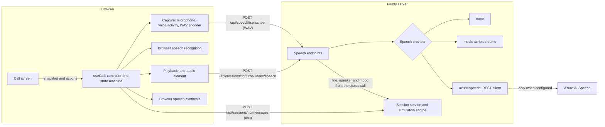
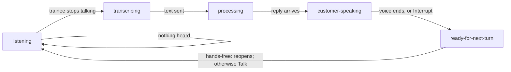

# Voice architecture

How a spoken call works in Firefly, which part is responsible for what, and which parts have and have not been verified. What leaves the device and what is stored is in [privacy-and-audio.md](privacy-and-audio.md).

Status words used on this page:

| Word              | Meaning                                                                                                                                                                  |
| ----------------- | ------------------------------------------------------------------------------------------------------------------------------------------------------------------------ |
| Tested            | Covered by automated tests in this repository.                                                                                                                           |
| Real browser      | Also run in Microsoft Edge 158 and Google Chrome 157 on one Windows laptop (21 November 2026), headless, with a recorded file as the fake microphone.                    |
| Demo only         | Works only with the scripted demo speech provider (`FIREFLY_SPEECH_PROVIDER=mock`).                                                                                      |
| Needs credentials | Needs an Azure AI Speech resource and key.                                                                                                                               |
| Not verified      | Written against the service's or the browser's documentation, but never run against the live service or in that browser. [Verification](#verification) lists every item. |

## The short version

- A call can be **spoken or typed**. Typing always works, in every mode, and a failed voice step never blocks the call.
- The trainee's speech becomes text in one of two places: Firefly's **server speech provider** (Azure AI Speech, when configured), or the **browser's own speech recognition** (Edge or Chrome) when it is not. If neither exists the call is typed.
- The customer's replies are spoken by the server speech provider, or by the browser's own voices, or not at all (captions only). The customer's words always appear in the transcript first, so a voice that fails loses nothing.
- Everything the customer says and does (mood, hidden facts, curveballs) comes from the simulation, not from the voice layer. The speech provider only turns audio into text and text into audio.
- The microphone is requested only after the trainee presses **Allow microphone and start**. Firefly never records audio to disk, and the server never stores it.
- Speaking over the customer (barge-in by voice) is **not implemented**. The trainee takes the turn with the Interrupt or Talk control.

## Parts and boundaries



| Boundary                      | Rule                                                                                                                                                                                                                                           |
| ----------------------------- | ---------------------------------------------------------------------------------------------------------------------------------------------------------------------------------------------------------------------------------------------- |
| Call screen and engine        | The screen reads one `CallSnapshot` and calls `CallActions`. It never touches the microphone, audio elements or speech APIs. Contract: `web/src/features/call/contract.ts`.                                                                    |
| Engine and the world          | A pure state machine (`machine.ts`) decides what should be true: which phase, whether the microphone is held, whether anything is recording or speaking. The controller (`controller.ts`) makes the browser match, and reports back as events. |
| Web app and server            | Text and audio over the JSON/HTTP API. The browser never sees a provider key, and the server never sees the browser's own speech services.                                                                                                     |
| Server and the speech service | The provider receives a recording (or one customer line plus a voice direction) and nothing else: no session, profile or scenario information. See [privacy-and-audio.md](privacy-and-audio.md).                                               |

## Choosing how a call is spoken

The choice is made inside the click that starts the call, from what the server reports in `GET /api/config` (`speech`) and what the browser offers. It is never made at load time, and it never opens the microphone.

| Server speech provider                  | Capture (trainee to text)                                                                                                                                                       | Playback (customer to sound)                                                                                           | Status                                            |
| --------------------------------------- | ------------------------------------------------------------------------------------------------------------------------------------------------------------------------------- | ---------------------------------------------------------------------------------------------------------------------- | ------------------------------------------------- |
| `azure-speech`                          | Firefly records one utterance, encodes it as a 16 kHz mono WAV in memory and sends it to the server. Needs `getUserMedia`, `AudioContext`, `AudioWorklet` and a secure context. | The server returns synthetic speech (MP3) for one stored customer turn; the browser plays it in one `<audio>` element. | Tested. Needs credentials. Not verified live.     |
| `mock`                                  | As above, but the server ignores the audio and answers with the next of eight fixed sentences.                                                                                  | A short soft sound whose length follows the line. It is not speech.                                                    | Tested. Demo only.                                |
| `none` (default) in Edge or Chrome      | The browser's own speech recognition (`SpeechRecognition`), preferring on-device recognition when the browser offers it.                                                        | The browser's own `speechSynthesis` voices.                                                                            | Tested with fakes. Real recognition not verified. |
| `none` in a browser with no recognition | Typed only.                                                                                                                                                                     | The browser's voices if it has them, otherwise captions only.                                                          | Tested.                                           |

If the audio worklet cannot load, a call that would use the server provider falls back to browser recognition, and then to typing. The pre-flight screen and the call controls always say which path is in use (for example "Azure AI Speech", "Demo speech (scripted)", "Browser speech recognition (online)" or "Browser voice (on this device): Microsoft David, en-US"). The label comes from what is really in use, never from what was hoped for.

## The call as a state machine

`web/src/features/call/machine.ts` is a pure function: no React, no browser APIs, no clock. It takes the current state and one event and returns the next state; it never throws, and an event that makes no sense in the current phase returns the same state object.

| Phase                   | What is happening                                                               | The microphone records? |
| ----------------------- | ------------------------------------------------------------------------------- | ----------------------- |
| `idle`                  | Pre-flight. Nothing has started and the microphone has not been requested.      | No                      |
| `requesting-microphone` | The browser's permission prompt is open.                                        | No                      |
| `ready`                 | Permission granted and audio primed; the opening line is about to play.         | No                      |
| `listening`             | Waiting for the trainee, or hearing them (`speechDetected`).                    | Yes                     |
| `transcribing`          | The trainee stopped; the speech is being turned into text.                      | Finishing the utterance |
| `processing`            | The text was sent; the customer's reply is being produced.                      | No                      |
| `customer-speaking`     | The customer's voice is playing. The words are already in the transcript.       | No                      |
| `ready-for-next-turn`   | The customer finished. The microphone has not reopened yet.                     | No                      |
| `ending`                | End and review was confirmed. Capture and audio stop; the call is being closed. | No                      |
| `completed`             | The call is closed on the server and the screen moves on to the report.         | No                      |



Rules the tests hold the machine to (400 seeded random sequences of 140 events, plus a run that fires only timers):

- Nothing records before an explicit start, after the call is ending, while muted or paused, or while the customer is speaking. At most one recording and one voice exist at a time.
- One spoken or typed message is one **exchange** with one client message id. It cannot become two trainee turns, and a reply is applied only to the attempt still waiting for it. Retrying is safe because the server treats the same client message id as the same message.
- Every waiting phase has a timer, and firing it always leads to a state the trainee can act in (never a silent hang). Ending the call is idempotent and safe in every phase.

Timers (`TIMINGS` in `machine.ts`):

| Timer                    | Value                 | When it fires                                                                                  |
| ------------------------ | --------------------- | ---------------------------------------------------------------------------------------------- |
| Permission prompt        | 60 s                  | The browser's microphone prompt is left unanswered.                                            |
| Customer voice to start  | 15 s                  | The voice (or opening line) does not start.                                                    |
| Customer voice to finish | length estimate + 5 s | The voice stops reporting progress; it is cut off.                                             |
| Nothing heard            | 15 s                  | The microphone opened and no speech began.                                                     |
| Speech too long          | 35 s                  | Someone is "speaking" for longer than an utterance can be.                                     |
| Speech to text           | 20 s                  | Transcription does not answer.                                                                 |
| Customer reply           | 45 s                  | The customer's reply does not arrive.                                                          |
| Settle after the voice   | 350 ms                | The pause before the microphone reopens, so it does not hear the tail of the customer's voice. |
| Message in flight at end | 8 s                   | Ending waits for an exchange in flight to finish or fail.                                      |
| Closing the call         | 30 s                  | The server does not answer the end request.                                                    |

## Capture

### With the server's speech provider

1. **Microphone.** `getUserMedia` with echo cancellation, noise suppression and auto gain on, one channel, no video. An `AudioContext` at 16 kHz (or the device rate if the browser refuses) and a small audio graph measure the level and feed an **audio worklet** (`web/public/audio/capture-worklet.js`, same origin so the content security policy allows it).
2. **Voice activity detection** (`vad.ts`, pure and deterministic). Audio is cut into 20 ms frames; each frame's energy is compared with a threshold that follows the room's noise floor (3x the floor to start, 1.8x to stop, never below fixed minimums). Speech starts after about 120 ms above the start threshold and ends after about 1.1 s below the stop threshold. 300 ms before the start and 300 ms after the end are kept. An utterance shorter than 400 ms, or barely above the noise, is dropped. An utterance reaching 30 seconds is cut and sent, and listening continues.
3. **Encoding.** The utterance is resampled if necessary and encoded as a 16-bit mono 16 kHz WAV in memory (`wav.ts`).
4. **Upload.** `POST /api/speech/transcribe?lang=...` with the WAV. The server validates it again, sends it to the provider and returns `{status, text, durationMs}`. `no-speech` means nothing recognisable; the trainee is told, nothing is sent to the customer and no empty turn is created.
5. The recognised text is then sent as a normal message (`POST /api/sessions/:id/messages`, `inputMode: "voice"`), so spoken and typed turns follow the same path from there on.

### With the browser's speech recognition

Used when the server provider is off. The page asks the browser for one sentence at a time with interim results and shows the words as they come. Firefly never sees audio on this path: where the audio is processed is up to the browser. In Chromium that is normally the browser vendor's online service, and the interface says so ("Browser speech recognition (online)"). When the browser offers on-device recognition, Firefly prefers it and says so.

Real-browser finding that shaped the design: in Edge 158 and Chrome 157, started by automation with a fresh profile and fed a clean 7-second synthetic utterance, the browser's recognition produced audio events and then **no words** (Edge returned one empty final result; Chrome ended without a result, and neither raised an error). Firefly therefore treats an empty or whitespace result, a missing result and an end with no result all as "nothing heard": nothing is sent, no empty turn appears, and the trainee is offered another go or typing. Whether recognition returns text in a person's own signed-in browser is **not verified**.

### Controls

- **Talk** opens the microphone for one utterance (push to talk). **Hands-free** reopens it automatically after each customer reply; after 3 empty listening passes in a row it stops and waits for the trainee, so a recogniser that never returns words cannot be re-opened for ever.
- **Mute** disables the microphone track. **Pause** releases the microphone and stops the customer's voice. **Interrupt** stops the customer's voice and gives the turn to the trainee; the transcript is unchanged.
- While a call is live and not paused the microphone is held open, so the browser shows its recording indicator. Firefly reads audio only in the `listening` phase (and to finish an utterance). **End and review**, **Pause** and leaving the call screen release the microphone. A leak test of 100 simulated exchanges (25 on the browser-recognition path) ends with zero open microphone tracks and zero live object URLs, and with the number of event listeners, audio nodes and timers unchanged.

## Playback

- **Server voice.** `POST /api/sessions/:id/turns/:index/speech?lang=...` returns audio for one stored customer turn (the request names a turn; it cannot supply words). The browser plays it in a **single** `<audio>` element created and unlocked inside the click, so autoplay policies allow it. The object URL is revoked as soon as playback ends or is cut off. Generating the voice has a 15-second timeout.
- **Browser voice.** `speechSynthesis`, with the voice list awaited for up to 1.5 seconds (browsers fill it late). The best voice is chosen in this order: the chosen language, any English voice, the browser's default voice. Long replies are spoken in chunks of at most 140 characters. The label names the voice and says when its language differs from the one chosen. The Windows laptop used for testing exposed five local voices (Microsoft David, Mark and Zira for en-US; Ravi and Heera for en-IN) and no en-GB voice.
- **Captions.** The customer's words are in the transcript before any voice starts. The level shown while the customer speaks is measured for server audio, and shaped from the text for browser voices (which cannot be measured).
- If the browser blocks playback, the trainee sees a Play control. Whether a real browser ever blocks it with this unlock is **not verified**: Edge and Chrome played the audio even with the strictest autoplay setting, so the blocked path is tested with fakes only.

## Customer voice direction (server provider only)

The server picks the voice from the scenario and the customer's mood at that turn; the request cannot influence the words. The persona has a `speaker` (female or male). Each language has a built-in voice per speaker (for example `en-GB-SoniaNeural` and `en-GB-RyanNeural`), replaceable with `AZURE_SPEECH_VOICE_FEMALE` and `AZURE_SPEECH_VOICE_MALE`.

Mood is expressed with speaking rate and pitch, and with an expressive style **only where Microsoft's voice table lists that style for that voice** (for example `unfriendly` and `angry` for the en-US voices). The numbers are Firefly's own conservative choices and were not tuned by listening. `shouting` is never used.

The voice is synthetic. Firefly adjusts pace and pitch and sometimes asks for a style; neither the service nor Firefly measures that the result sounds like the stated emotion, and the interface does not claim it. The response headers `x-firefly-speech-voice` and `x-firefly-speech-style` report what was requested for that turn. Azure does not report what it applied, so a style it ignored cannot be detected. Firefly does not clone voices, impersonate people or infer emotion from the trainee's voice.

## What the trainee sees when something fails

Every problem says what happened, what was kept, what to do, what **Try again** does, and whether typing still works. The wording is in one file (`web/src/features/call/problems.ts`). None of it shows a provider's own text, a code or a stack trace.

| Situation                                 | What the trainee is told                                                                                                                                              | Typing still works |
| ----------------------------------------- | --------------------------------------------------------------------------------------------------------------------------------------------------------------------- | ------------------ |
| Microphone blocked                        | How to allow it in Edge, Chrome or another browser; nothing was recorded.                                                                                             | Yes                |
| No microphone / device busy               | Check the device or close the other app; try again.                                                                                                                   | Yes                |
| Browser cannot record here                | A spoken call needs Edge or Chrome on a secure connection.                                                                                                            | Yes                |
| Nothing heard / no words                  | A hint, not an error: say it again or type.                                                                                                                           | Yes                |
| Speech could not be turned to text        | Nothing was sent and the recording was not kept; say it again or type.                                                                                                | Yes                |
| Speech service unavailable                | The service is not available; type, or try again later. (Also the answer when the operator's speech settings are wrong.)                                              | Yes                |
| Customer could not reply / timed out      | The message is kept and sending again will not duplicate it.                                                                                                          | No (retry first)   |
| Customer's voice could not be made        | The reply is in the transcript; read it or try again.                                                                                                                 | Yes                |
| Browser blocked the voice / voice stopped | Press Play, or read the reply.                                                                                                                                        | Yes                |
| Offline                                   | Check the connection; the transcript and any unsent message are kept. If it happened while ending the call, the call is still open and Continue call goes back to it. | No                 |
| Too fast (rate limit)                     | Wait the stated number of seconds.                                                                                                                                    | No                 |
| Could not save / end the call             | Nothing is lost; retrying will not send twice.                                                                                                                        | Varies             |

## Server speech layer

Provider kinds, environment variables, endpoints, errors, limits, the voice table, retries and logs are specified in [speech-providers.md](speech-providers.md). In brief:

- `FIREFLY_SPEECH_PROVIDER` is `none` (default), `mock` or `azure-speech`. A wrong or incomplete Azure configuration turns speech off with a notice that names the variable and never its value; the app stays usable by typing. Firefly never falls back from one provider to another while running: a failing Azure call is an error, never answered by the mock.
- Both endpoints are POST-only, same-origin, rate limited per profile (60 burst, 1 per second) and, for all profiles together, by one server-wide bucket (120 burst, 4 per second), and never log audio, words or keys.
- The key is read from an environment variable only. See [Managed identity and Key Vault](speech-providers.md#managed-identity-and-key-vault).

## Verification

| Area                                                              | Tested (automated)                                                                                                                                                 | Real browser (Edge 158, Chrome 157, headless)                                                                                                                                            | Not verified                                                                                                                                                                                     |
| ----------------------------------------------------------------- | ------------------------------------------------------------------------------------------------------------------------------------------------------------------ | ---------------------------------------------------------------------------------------------------------------------------------------------------------------------------------------- | ------------------------------------------------------------------------------------------------------------------------------------------------------------------------------------------------ |
| State machine and engine                                          | 666 tests in 26 files across the call and voice folders, including 400 seeded random event sequences, leak tests over 100 exchanges, idempotent end at every phase | n/a                                                                                                                                                                                      | Behaviour against the real server for every path (the engine tests use a fake that mirrors the server's rules; the browser journeys in `e2e/` run the real server with the demo speech provider) |
| Microphone capture, voice activity detection, WAV encoding        | Tested                                                                                                                                                             | Constraints honoured, 16 kHz context, worklet loads under the product's own security headers, the utterance is found, the 6.6 s WAV passes the server's validator, tracks end on release | Room noise, thresholds on real microphones, permission prompts, device unplugging, Firefox, Safari, Android                                                                                      |
| Server voice playback                                             | Tested                                                                                                                                                             | A WAV blob plays in the single `<audio>` element, a level is measured, no content-security-policy violation                                                                              | MP3 from Azure; autoplay-blocked path; long lines                                                                                                                                                |
| Browser voice                                                     | Tested with the exact five-voice Windows list, late and missing voice lists                                                                                        | A local voice speaks a long sentence, start and end events fire                                                                                                                          | Online "Natural" voices; other operating systems                                                                                                                                                 |
| Browser speech recognition                                        | Tested with fakes, including Edge's and Chrome's no-words shapes                                                                                                   | Audio events fire; **no words were returned by either browser**                                                                                                                          | Whether it returns text in a signed-in browser; on-device recognition                                                                                                                            |
| Server endpoints, provider selection, limits, logs, failure hooks | 1,097 server and shared tests (at the time of writing), including the speech layer and its HTTP endpoints, against a fake Azure speech server                      | n/a                                                                                                                                                                                      | Everything about live Azure AI Speech (see [speech-providers.md](speech-providers.md#verification-status))                                                                                       |

## Running the checks

```
npm test                                   # all unit and API tests, including the speech layer and the call engine
npx vitest run --project server            # server and shared only
npx vitest run web/src/features/call web/src/features/voice
npm run test:e2e                           # real browser journeys against the production build (demo speech provider)
```

To try the whole product without Azure: `FIREFLY_SPEECH_PROVIDER=mock npm run dev`, then start a voice call. The microphone is real, the recognised text and the customer's "voice" are the scripted demo. To try the browser's own speech, leave `FIREFLY_SPEECH_PROVIDER` unset and use Edge or Chrome.

## Limits you should know about

- Voice barge-in is not implemented, because echo cancellation cannot be relied on for the browser's own speech synthesis and recogniser.
- One language is used for both recognition and the customer's voice (en-GB, en-US, en-IE, en-AU or en-IN). The interface is English only.
- Browser recognition quality, privacy and availability are the browser vendor's, and vary by browser, operating system, network and profile.
- Nothing has been run against live Azure AI Speech, so latency and recognition quality with real people are unmeasured.
